# VideoGenEngine

**A script and a voiceover go in. A finished, designed motion film comes out.**

VideoGenEngine makes B2B promo and explainer films: kinetic typography, illustrated scenes, product UI, real
photography, a moving camera, music and sound design. It is timed to the voiceover and follows the script line by line.
Claude (Opus) does the work of a motion designer and director. It does that inside a fixed production process and a
style system, so every film reaches the same standard while each one looks different.

The engine runs on one laptop. It uses free assets only and no speech models; the voiceover is always supplied.

<p align="center"></p>

<table>
<tr>
<td width="33%">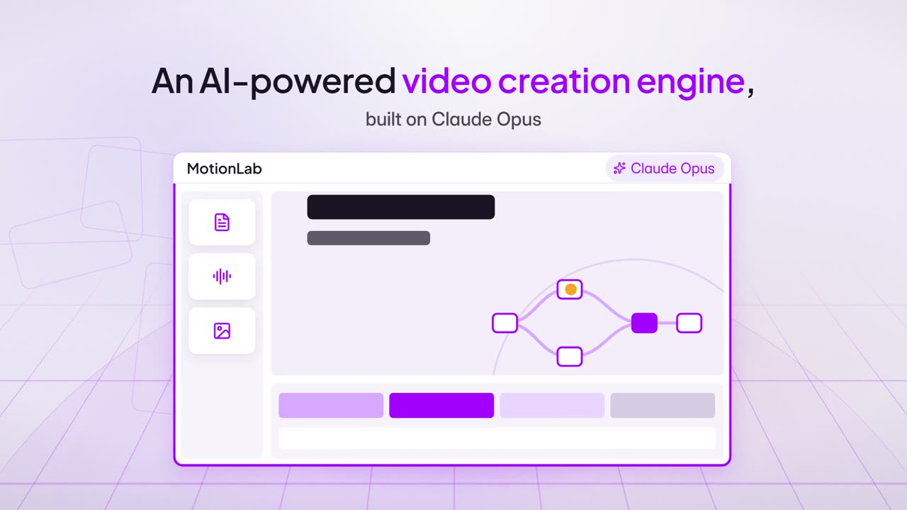<br><sub><b>MotionLab</b> · the product, shown as a living interface</sub></td>
<td width="33%">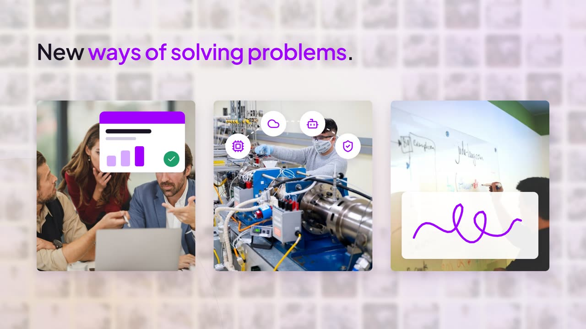<br><sub><b>MotionLab</b> · real people for a line about people</sub></td>
<td width="33%">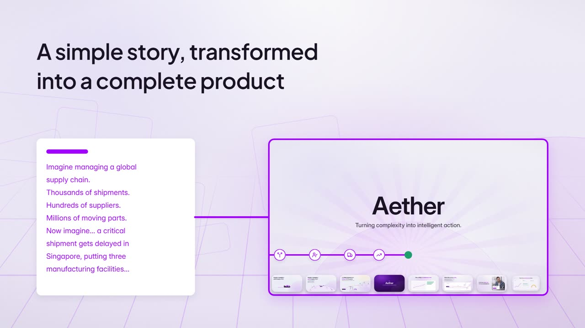<br><sub><b>MotionLab</b> · a simple story, transformed into a film</sub></td>
</tr>
<tr>
<td><br><sub><b>Aether</b> · the disruption: a shipment delayed in Singapore</sub></td>
<td>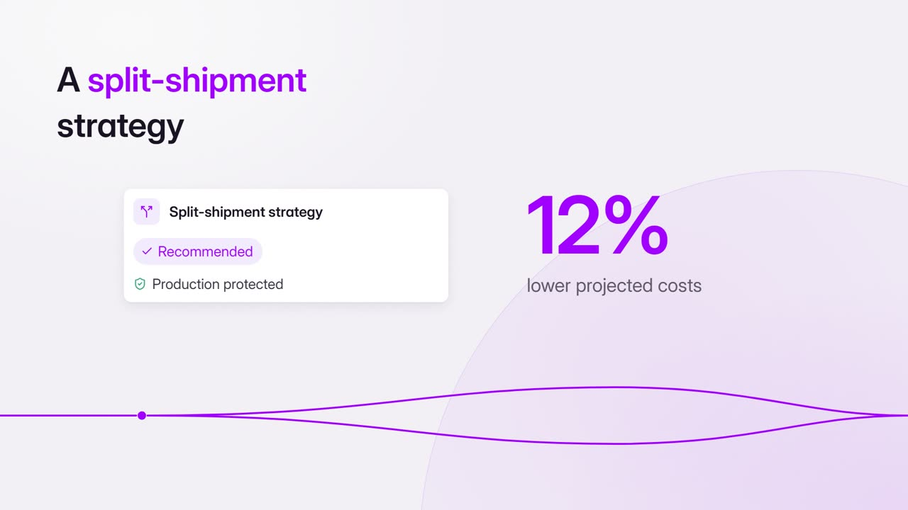<br><sub><b>Aether</b> · the decision, with its number counted up</sub></td>
<td><br><sub><b>Aether</b> · the human moment: a planner approves</sub></td>
</tr>
</table>

## Films

| Film | Length | What it shows |
|---|---|---|
| [`films/motionlab`](films/motionlab/FILM.md) · [how it was made](films/motionlab/SHOWCASE.md) | 3:06 | MotionLab, the engine's own promo. Its proof is a film within a film: the Aether product story plays inside MotionLab's frame, then pulls back out. |
| [`films/aether`](films/aether/FILM.md) · [how it was made](films/aether/SHOWCASE.md) | 1:21 | Aether, an AI supply-chain platform: a disruption followed through to its resolution. The first film made on this engine. |

Renders are not committed (they can be regenerated). Each film's `out/` folder holds its final MP4 once rendered.
Each showcase page walks through one film in pictures: storyboard, contact sheet, key frames, and the owner's notes
with what changed. Everything the kit can draw is in the [gallery](styles/GALLERY.md).

## How a film is made

Every film goes through the same stages ([DIRECTOR.md](DIRECTOR.md)):

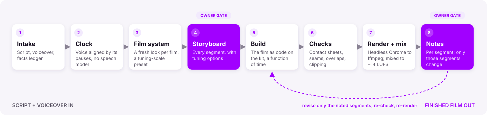

1. **Intake.** The script and voiceover are taken in, and every claim and number is recorded in a facts ledger.
2. **Clock.** The voiceover is aligned to the script by its pauses, so every phrase has a start and end time.
   No transcription is used ([`engine/audio/vo-clock.py`](engine/audio/vo-clock.py)).
3. **Film system.** The film's look (palette, ground, signature device, motion, pacing, type, music) is chosen fresh,
   and must differ from the last film.
4. **Storyboard.** Every segment is drawn as start and peak panels with tuning options. The owner tunes it before
   anything is built ([example](films/motionlab/storyboard/index.html)). Film-wide, a **tuning scale** of eight
   dials sets how dynamic, dense, real or loud the film is, compared to a Base. Each dial has live previews
   ([styles/scale/index.html](styles/scale/index.html), [rules](styles/SCALE.md)), and presets are chosen by theme.
5. **Build.** The film is written as code on the kit. Every frame is a pure function of time.
6. **Checks.** A contact sheet every 2 seconds, plus strips at every transition. Overlaps, clipping, empty frames
   and broken seams are fixed before showing.
7. **Render and mix.** Headless Chrome renders every frame, and ffmpeg encodes them. The voiceover, music and sound
   effects are mixed to −14 LUFS and measured on the final file.
8. **Notes.** Feedback comes per segment or timestamp, and only those segments change.

The rules that never change are in [ENGINE.md](ENGINE.md). Among them:
- text sits on a 12-column grid with a fixed type scale;
- one primary mover at a time;
- every transition is a named continuity move;
- scenes open sparse and build;
- the background moves with the story;
- every number on screen is traceable to the script.

## What the kit can draw

Optional treatments for single segments, and shader backgrounds, all on the same runtime. Each one is a few calls in
a film's code ([gallery with the code](styles/GALLERY.md)).

<table>
<tr>
<td width="25%">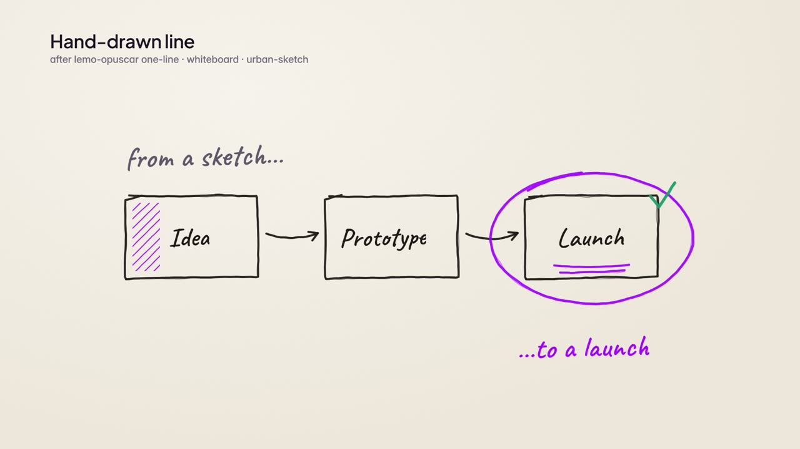<br><sub>Hand-drawn line</sub></td>
<td width="25%">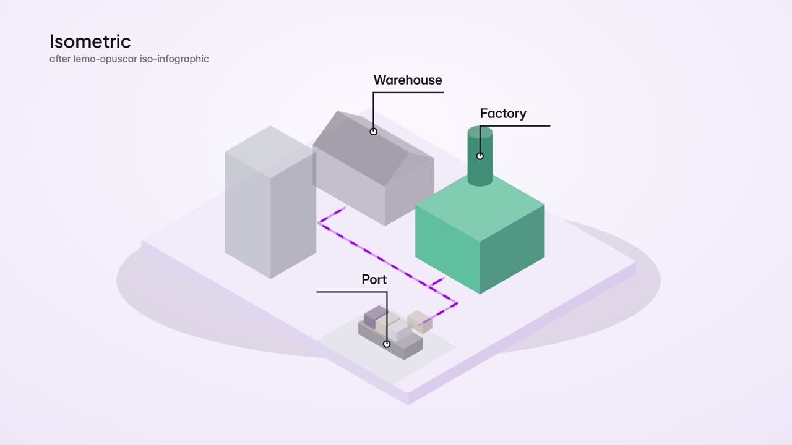<br><sub>Isometric</sub></td>
<td width="25%">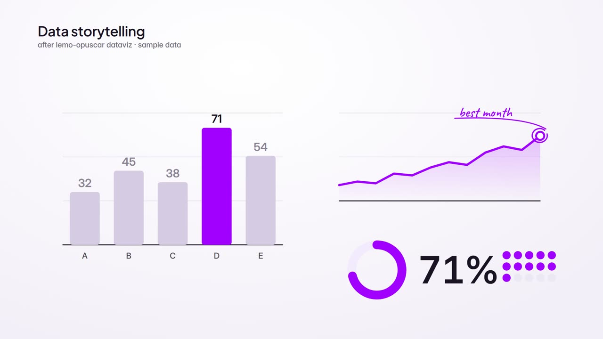<br><sub>Data storytelling</sub></td>
<td width="25%">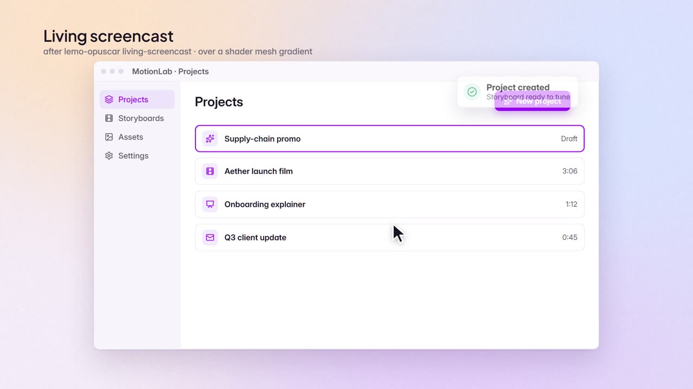<br><sub>Living screencast</sub></td>
</tr>
<tr>
<td>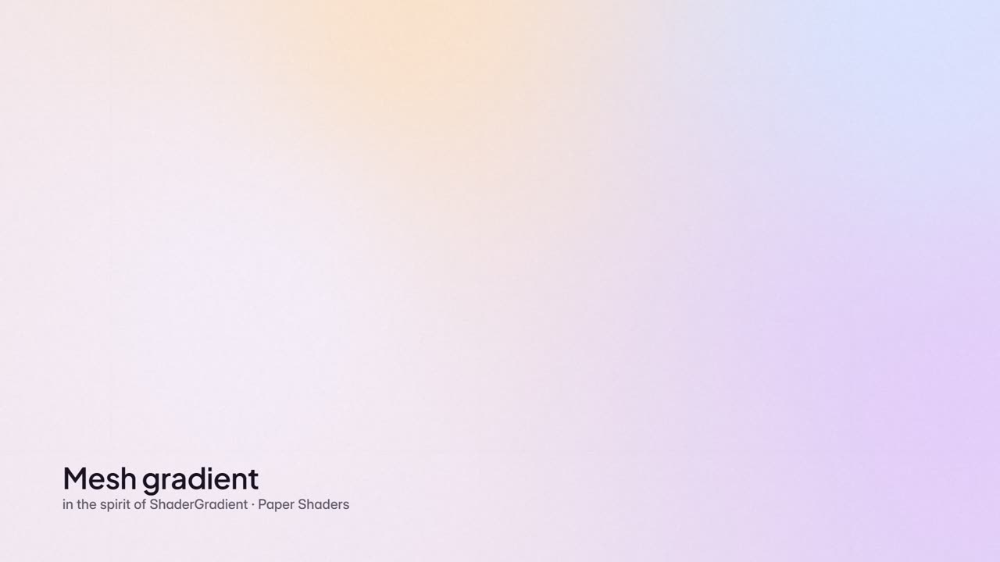<br><sub>Mesh gradient</sub></td>
<td><br><sub>Contour lines</sub></td>
<td>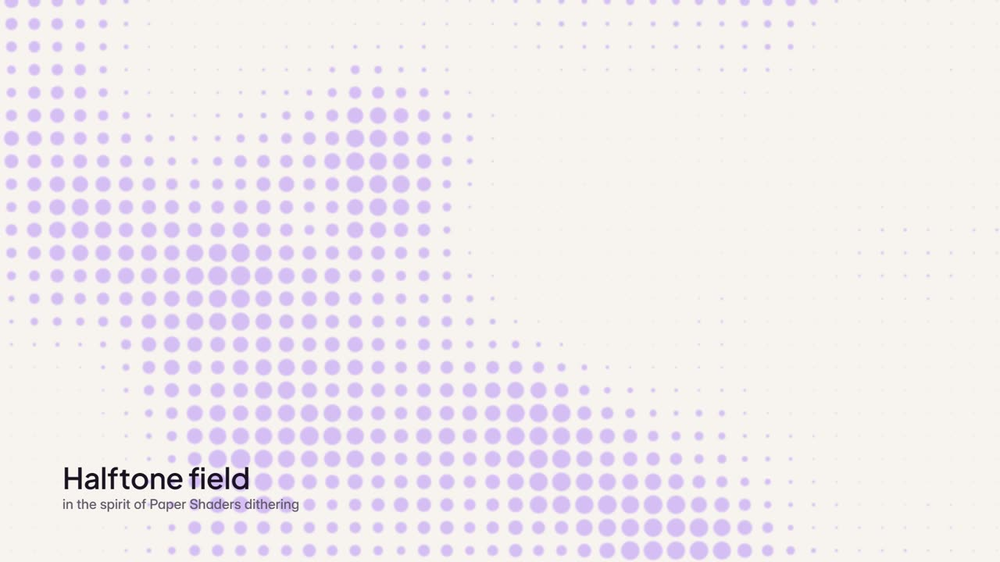<br><sub>Halftone field</sub></td>
<td>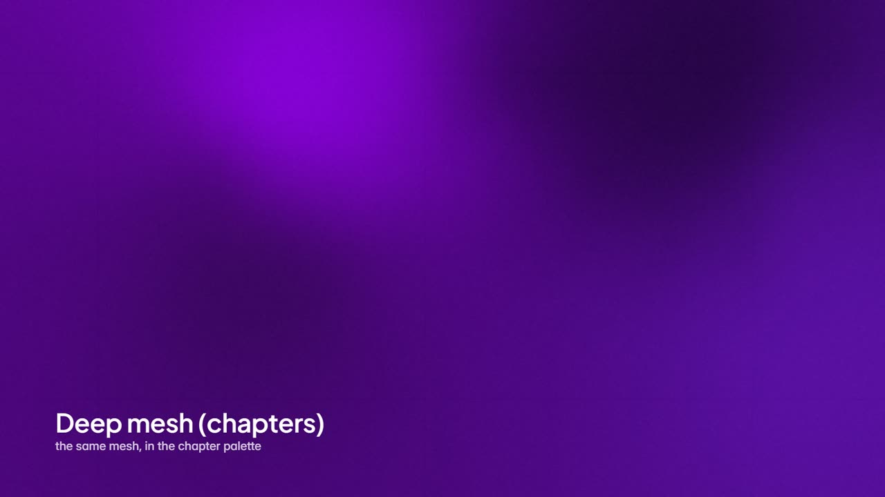<br><sub>Deep mesh (chapters)</sub></td>
</tr>
</table>

## Repository

```
README.md        this page
ENGINE.md        what the engine is: the craft rules (fixed) and the variety dimensions (chosen per film)
DIRECTOR.md      the production process, stage by stage
engine/
  runtime/       film.js: the timeline, easing, camera, continuity moves, sound events
  kit/           components (text, cards, scenes, hub, photos), icons, the living ground; optional segment treatments
                 (sketch, isometric, data, screencast) and shader grounds
  render/        stills, contact sheets, frames to MP4
  audio/         the voiceover clock and the mixer (VO + music + SFX, loudness-normalised)
styles/          journey (light-led, a line through the story), studio (warm, the frame motif), and treatments/ (rules
                 for the segment treatments and shader grounds); SCALE.md + scale/: the tuning scale and its previews
films/           one folder per film: FILM.md (brief, facts, credits, review log), SHOWCASE.md, storyboard, film code
  HISTORY.md     the look of each film, so the next one differs
docs/media/      stills, short clips and the pipeline diagram used by these pages
library/         free photos, music, sound effects, fonts and icons, with a licence ledger
third_party/     lemo-opuscar's 68 styles, pinned as a reference (MIT)
tools/           heavy-lock.mjs: one heavy job at a time on a low-memory machine · measure.mjs: reads a render's scale ·
                 regress.mjs: checks the finished films still render identically
```

## Running it

You need Node 24 or later, Google Chrome, ffmpeg and Python 3. Then run `npm install`.

```bash
# stills for review (a contact sheet every 2 s)
node engine/render/frames.mjs films/motionlab/film.html --range 0:186:2 --w 640

# the picture, then the mix (the voiceover, music and SFX from the film's sound events)
node engine/render/video.mjs films/motionlab/film.html
node engine/audio/mix.mjs films/motionlab        # -> films/motionlab/out/motionlab.mp4

# after any engine change: the finished films must still render identically (8 frames, PASS/FAIL)
node tools/regress.mjs
```

Long films can be rendered in parts with `--from` and `--to`, then joined.

## Assets and licensing

Only free assets are used: CC0 photos, Mixkit music and sound effects, OFL fonts and ISC icons. Each one is recorded
in [`library/LEDGER.md`](library/LEDGER.md). Diagrams, interfaces and illustrations are drawn in code. Stock
photography is used only for people and real places.
