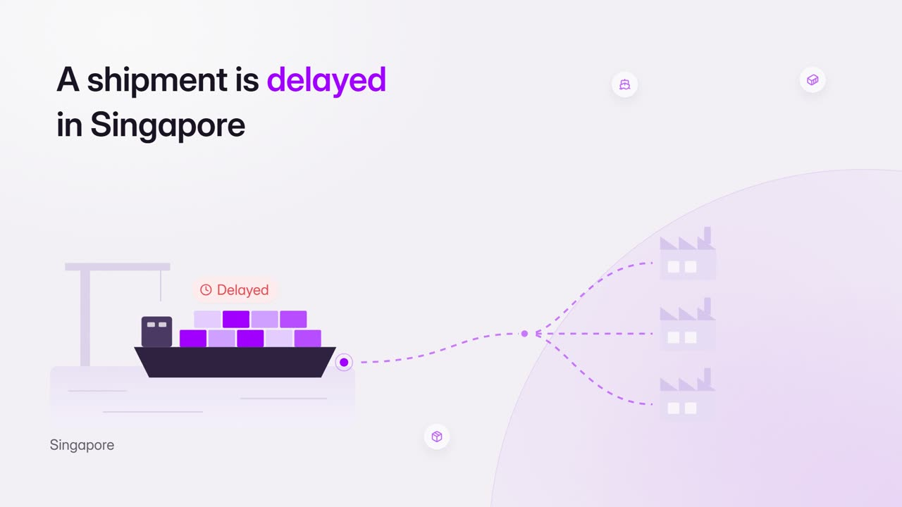
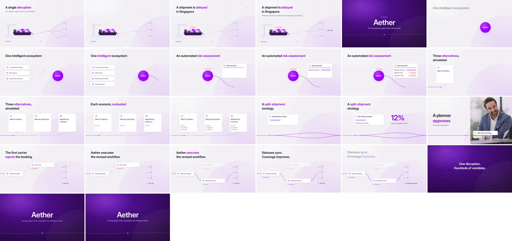
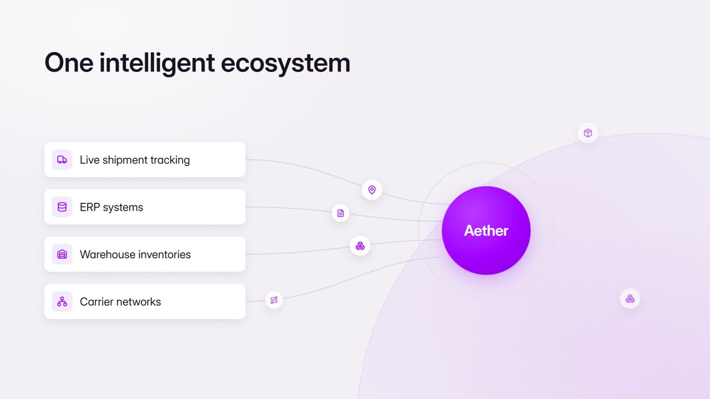
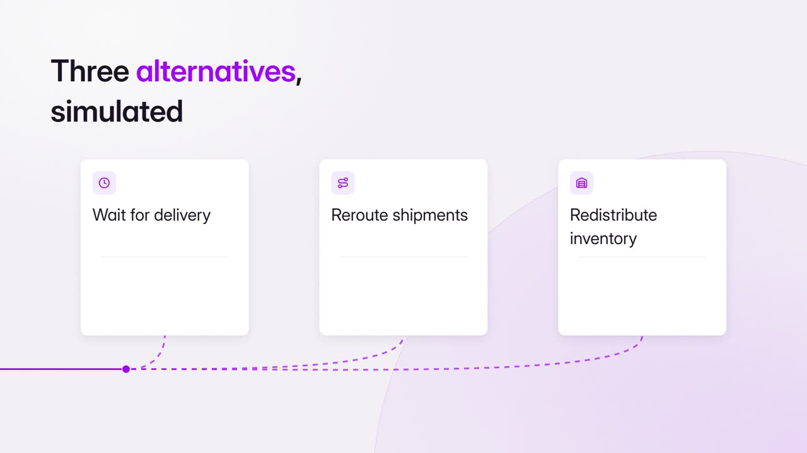
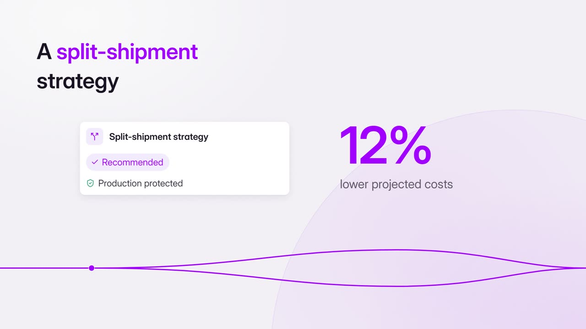
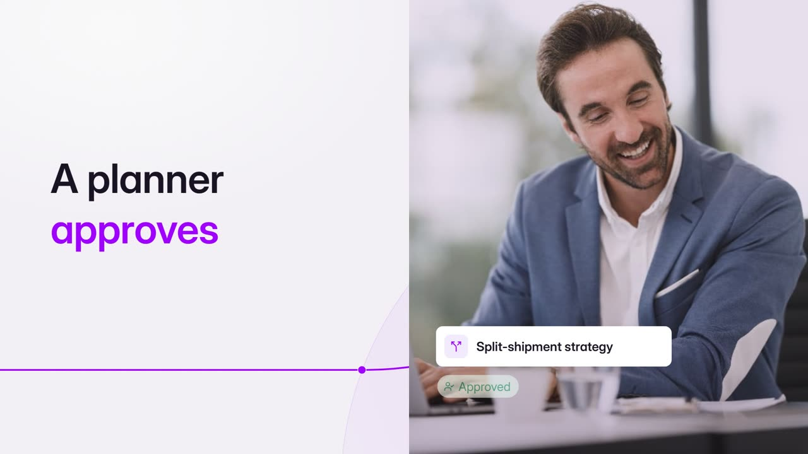
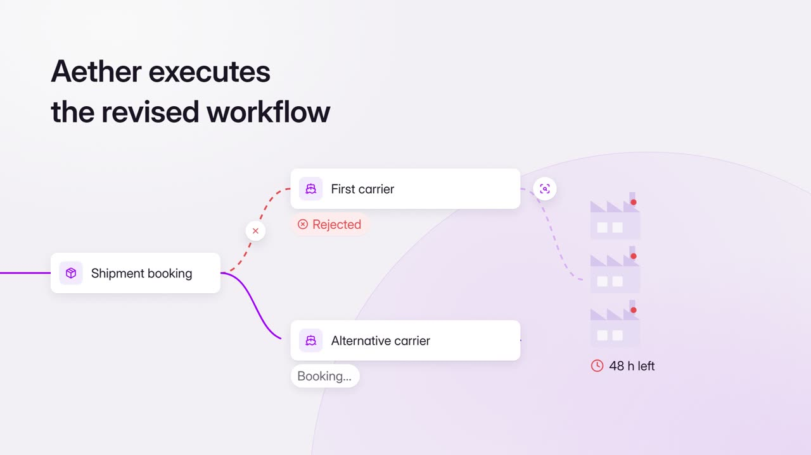
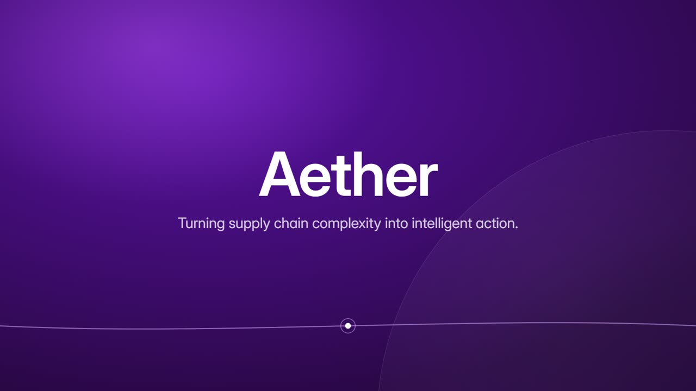

# Aether: how it was made

The first film made on the rebuilt engine: an 81-second B2B promo for Aether, an AI supply-chain platform. A single
disruption is followed through to one coordinated decision. It has 15 segments, at 1920×1080, 30 fps (2,430 frames).
The mix measures −14.0 LUFS, with a peak of −1.4 dBFS. No voiceover was recorded, so the film is timed as if
narrated: about 2.5 words a second, with a 0.6 s hold after each line.

The brief, facts and the full segment plan are in [FILM.md](FILM.md).

## 1 · The plan: one journey, five stages

Every segment was planned before it was built:
- its on-screen text (the script's own words);
- the visual as start, build and peak;
- the one primary mover;
- the named move into the next segment.

The film travels along one line through five stages (port, hub, decision, approval, recovery), and the camera follows
it.

| Stage | Segments | What the viewer sees | Move into the next |
|---|---|---|---|
| Port | s01–s02 | A ship's route flows to three factories; a risk pulse on "disruption"; the flow freezes on "standstill"; "48 h left" at each factory | Chapter: Aether arrives |
| Hub | s03–s06 | A deep-purple disc shrinks into the hub's core; four inputs build one per mention and their data gathers into the core; the risk assessment scans | Travel |
| Decision | s07–s09 | Three dashed routes to three option cards; criteria tick in; the cards gather into one recommendation; **12 %** counts up | Travel, then Become |
| Approval | s10 | A photo panel: a planner at work; the recommendation turns "Approved" | Travel |
| Recovery and close | s11–s15 | The first carrier rejects; Aether finds another and the route redraws; statuses sync, risks turn green; hundreds of variables gather into one point; the end card | Chapter, then the end |

## 2 · The film system

| | Choice | Why |
|---|---|---|
| Style | journey | A disruption-to-recovery story is a journey |
| Palette | Accenture Purple; state colours red, then green; cool lavender paper | The state colours carry the story's turn |
| Ground | a sparse depth field, arc lower right | The owner's choice |
| Signature | the journey line: port → hub → decision → execution → close | It connects every act |
| Illustration | soft-flat scenes, a hub diagram, one photo panel | A blend of drawn and real |
| Motion and pacing | measured; 0.6 s hold after lines | Calm and premium |
| Type | Inter | The default |
| Music | uplifting-inspiring (owner-supplied) | Warm and hopeful, to match the calm |

Aether is the **Base** of the [tuning scale](../../styles/SCALE.md): it sits at 0 on every dial. Its readings:
- 1.3 % of the frame moving on average;
- 5.6 % of the frame carrying edges;
- per minute: 21.5 beats, 66 on-screen words and 29 sound effects.

## 3 · The owner's verdict, and what it changed

"I love this. This was much better than anything we have built so far."

The owner had one concern, and it became a rule for every later film. Some elements stayed on screen too long
without change: the opening ship and port "already start from a high", fully composed on the first frame, and then
look "very slow and languishing" as the story moves on.

That is now a craft invariant in [ENGINE.md](../../ENGINE.md): scenes open sparse and build, the peak comes late,
and nothing lingers. MotionLab, the next film, was storyboarded and tuned against it
([its showcase](../motionlab/SHOWCASE.md)).

## 4 · The whole film, every 3 seconds

## 5 · Key frames

<table>
<tr>
<td width="50%"> s04 · "One intelligent ecosystem": four inputs, one per mention</td>
<td width="50%"> s07 · three alternatives, simulated</td>
</tr>
<tr>
<td> s09 · a split-shipment strategy, with 12 % lower projected costs</td>
<td> s10 · the human moment: a planner approves</td>
</tr>
<tr>
<td> s12 · Aether executes the revised workflow</td>
<td> s15 · "Turning supply chain complexity into intelligent action."</td>
</tr>
</table>
