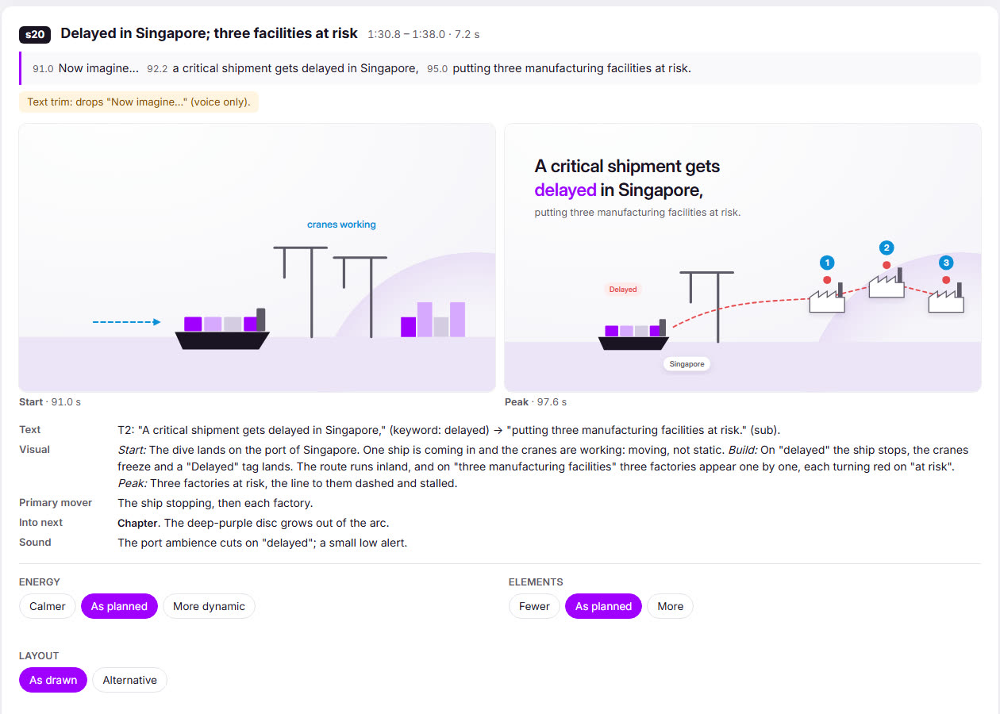
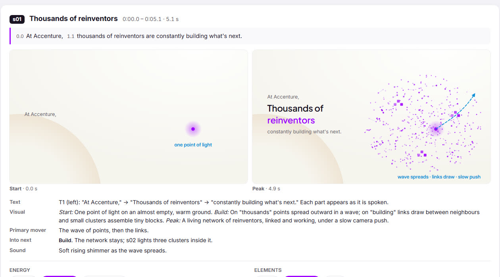
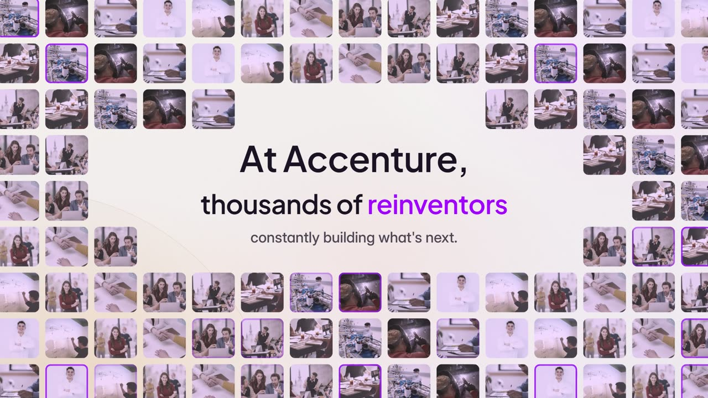
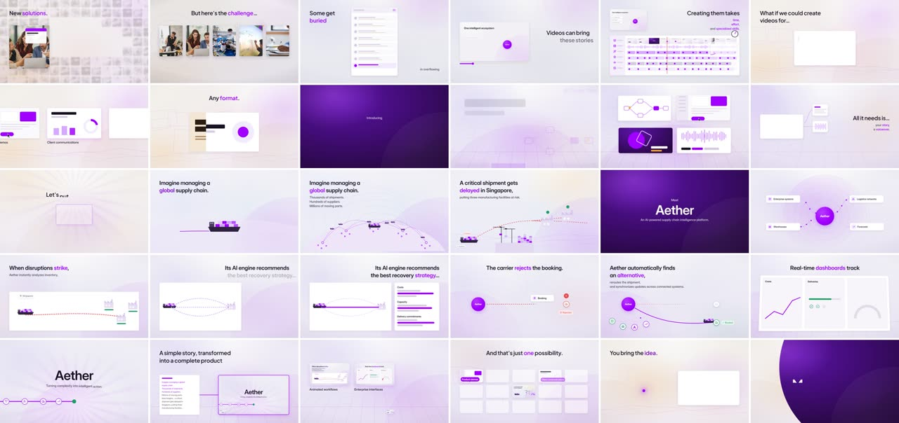
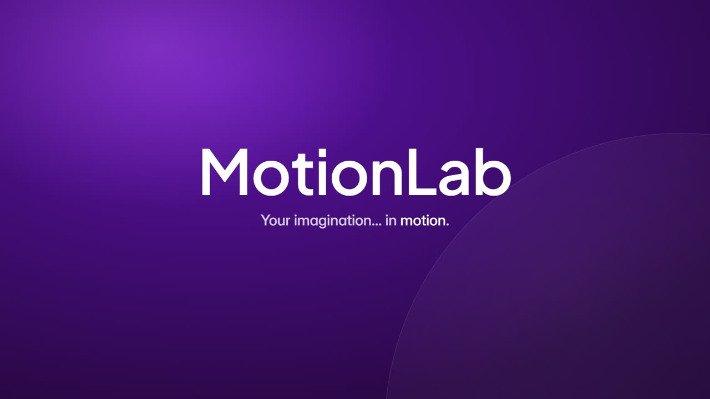

# MotionLab: how it was made

A 3:06 promo for MotionLab, the engine itself, made from the owner's script and voiceover. Its proof is a film within
a film: the Aether product story plays full screen as "what MotionLab made", then pulls back out. It has 36 segments
in 5 acts, at 1920×1080, 30 fps (5,595 frames). The mix measures −14.1 LUFS, with a peak of −1.7 dBFS.

The brief, facts and credits are in [FILM.md](FILM.md), and the look is recorded in [films/HISTORY.md](../HISTORY.md).

## 1 · The clock, from the voiceover

The voiceover (183.6 s) was aligned to the script by its pauses, with no speech model. ffmpeg's `silencedetect`
found 87 speech runs, which match the script's 87 phrases one to one. Every on-screen word enters on its spoken time
([timing.js](timing.js), from [`engine/audio/vo-clock.py`](../../engine/audio/vo-clock.py)).

## 2 · The storyboard, tuned by the owner before anything was built

Every segment was drawn as wireframe panels on the real grid and type scale, from **start** to **peak**. Each panel
carries its script lines with voiceover times, the plan (text, visual, primary mover, move into the next segment,
sound) and tuning chips. The owner returned their choices, and only then did the build start
([storyboard/index.html](storyboard/index.html)).

## 3 · The owner's notes, and what changed

The storyboard notes changed the film before a frame was rendered. The clearest case is the opening line:

<table><tr>
<td width="50%"> <b>Storyboard s01:</b> a point of light becomes a network of dots</td>
<td width="50%"> <b>Final s01</b>, after the note "show people doing something": real people arrive from every side and become a mosaic of thousands</td>
</tr></table>

| Segment | The owner's note | What changed |
|---|---|---|
| s01 | "At Accenture" too small and timid; left-aligned text is repetitive; show people doing something | Photos of people arrive from every side and become a mosaic; big centred text, letter by letter |
| s02 | The concepts are unclear (just nodes) | Three people, three clear things: an app is built, four capabilities light up, a tangle straightens into a path; a word-swap headline |
| s03 | Show attention as camera focus | A camera viewfinder focuses one innovation while the rest blur and fade |
| s04 | Not all text left aligned | A centred full-height inbox, the headline top-left and the subline bottom-right |
| s06 | Real video snippets | A real clip from the Aether film plays, and the editor shows a real filmstrip |
| s13 | More focus on the window | A large centred window with a glow and a push-in |
| s16 | The background is the same everywhere | A living background through the whole film (below) |
| s17 | Icons, not just text; subtext too slim | Lightbulb, speech-bubble and flask icons; subtext weight 500 across the engine |

**After the first render (v1)** the owner said: "This is how I always imagined it to be." They asked for one more
change: the background should move with the story, "not just the plain background with a circle in it". In v2 the
ground keys a new light, colour washes and a story texture for each section: rings for attention, a grid for "buried",
rays for "what if", waves and contours for the supply chain, and a studio floor and floating frames elsewhere. The owner's verdict on v2 was "stupendous", and it is now
the quality bar for new films.

## 4 · The film system

| | Choice |
|---|---|
| Style | studio (acts 1–3 and 5), plus journey for act 4 (the Aether showcase, in the look already approved) |
| Palette | Accenture Purple, an amber "attention" light, warm paper |
| Ground | a living ground: drifting washes, one story texture per section |
| Signature | the point of light, and the frame |
| Illustration | real people, UI and product specimens, real footage |
| Motion and pacing | brisk, with varied kinetic text; a 0.4 s hold, timed to the voiceover |
| Type | Plus Jakarta Sans for headlines, Inter for text |
| Music | bgm-tech-house (Mixkit), with uplifting-inspiring under act 4 |

On the [tuning scale](../../styles/SCALE.md) MotionLab measures about +1 to +1.5 above the Base on every dial. For
example, 2.2 % of the frame moves on average (the Base is 1.3 %), with 34 beats, 102 on-screen words and 50 sound
effects per minute.

## 5 · The whole film, every 6 seconds

## 6 · Key frames

<table>
<tr>
<td width="50%"> s13 · "An AI-powered video creation engine, built on Claude Opus."</td>
<td width="50%"> s21 · a chapter into the film within the film: "Meet Aether."</td>
</tr>
<tr>
<td> s25 · the human moment: "A planner approves the recommendation."</td>
<td> s36 · the close: "Your imagination… in motion."</td>
</tr>
</table>
