# Style library

96 visual styles in 20 families for premium B2B films. Each has a recipe, a director prompt in our own words, a tuning-scale setting and a live demo built on the engine's kit. The library was distilled from a study of several hundred code-built motion pieces, then rewritten for how we work: follow the script, time everything to the voiceover, and storyboard first. Nothing here is copied, and nothing changes the engine.

**How to use it:**
1. Pick a style for the film, or for one segment. Each recipe says when it fits.
2. Use its tuning-scale setting as the starting preset.
3. Paste its director prompt into the brief, filled in with the script.
4. Watch the live demo (`demos/demo.html#<style>` in a browser) to see the motion.

The demos are built with the engine's own kit and change nothing in it. Craft techniques that apply across styles are
in [CRAFT.md](CRAFT.md).

### Morphing-shape UI loop

| Still | Style |
|---|---|
| [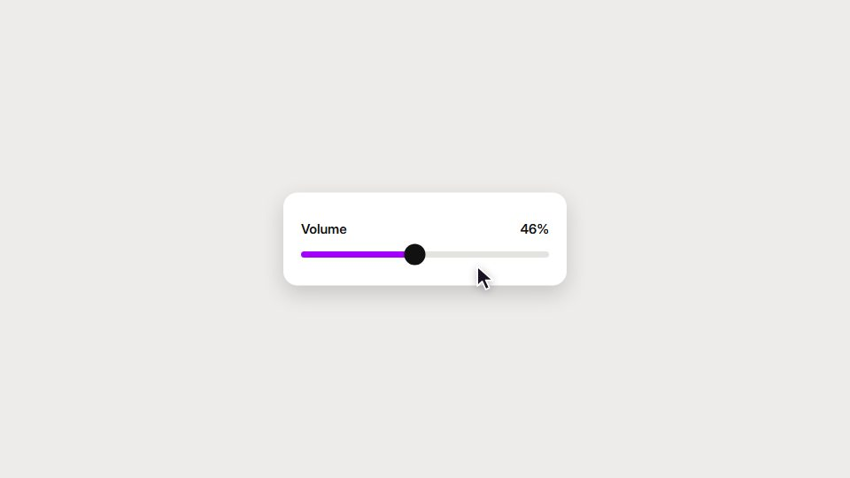](recipes/morph-ui-loop.md) | **[Morphing-shape UI loop](recipes/morph-ui-loop.md)** One rounded shape turns into button, loader, player, slider, toast and back, driven by a cursor on a beat grid Adapt: needs a small helper or a stylisation · feature-launch micro-films |
| [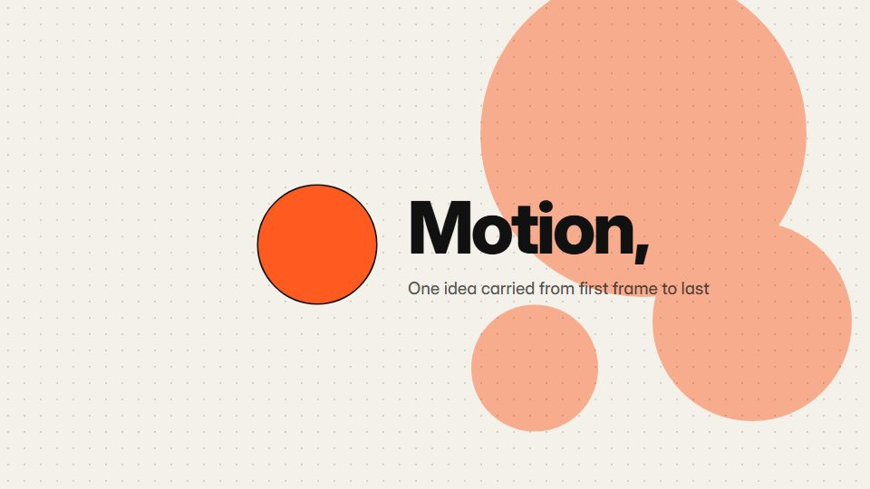](recipes/single-dot-throughline.md) | **[Single-dot studio reel](recipes/single-dot-throughline.md)** One coloured dot is the through-line: it starts in the UI, sits over a letter, traces a curve and closes the film Ready: our kit builds it today · brand signature film |

### Continuous-take launch film

| Still | Style |
|---|---|
|  | **[Continuous-take launch film](recipes/continuous-take.md)** No cuts: floods, irises, pills and glass panels grow each scene out of the last Adapt: needs a small helper or a stylisation · product launches |
| [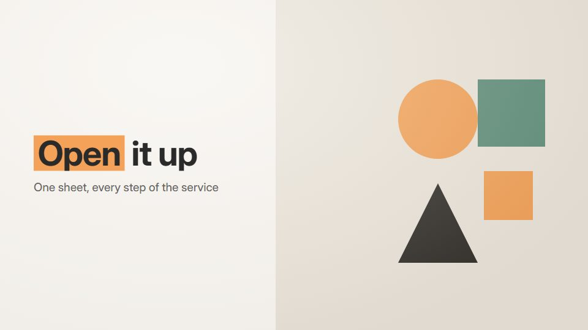](recipes/folded-paper-transitions.md) | **[Folded-paper transitions](recipes/folded-paper-transitions.md)** Scenes fold and unfold like paper: a panel creases, flips and opens into the next scene, like a map or a pop-up card Adapt: needs a small helper or a stylisation · unfolding explainer |

### Restrained premium product film

| Still | Style |
|---|---|
| [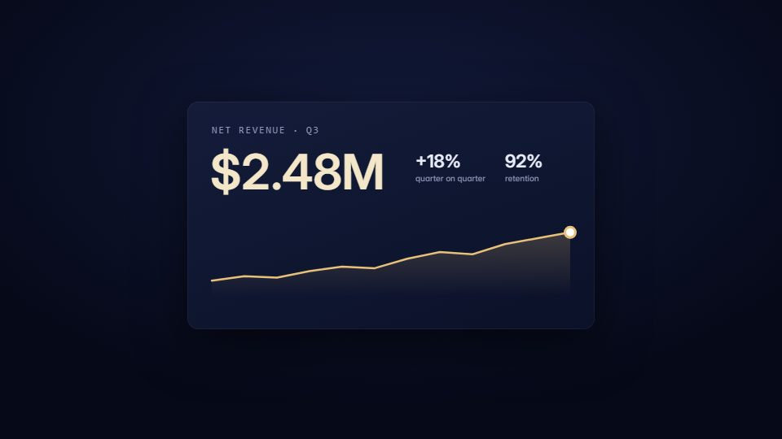](recipes/premium-product.md) | **[Restrained premium product film](recipes/premium-product.md)** Dark, precise, expensive-looking product reveal with the real UI as hero and almost no copy Ready: our kit builds it today · flagship launch |
| [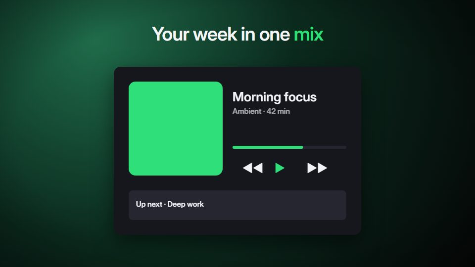](recipes/dark-stage-showcase.md) | **[Dark stage showcase](recipes/dark-stage-showcase.md)** The product plays inside one large rounded black stage, with a soft brand-tinted atmosphere glowing around it Ready: our kit builds it today · contained product promo |
| [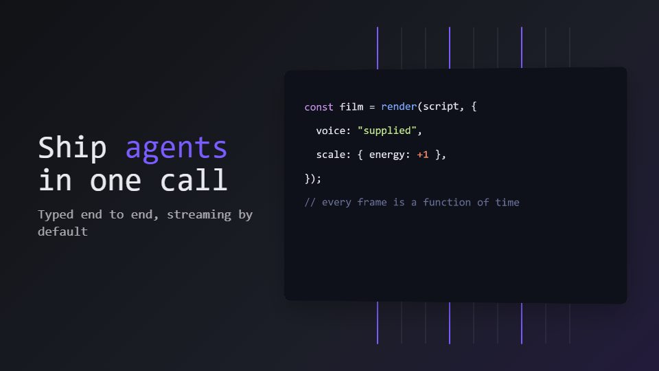](recipes/kinetic-code-launch.md) | **[Kinetic-code graphite launch](recipes/kinetic-code-launch.md)** Developer-tool launch where code itself streams, splits into tokens and re-forms as the next idea on graphite Adapt: needs a small helper or a stylisation · developer-tool launch |
| [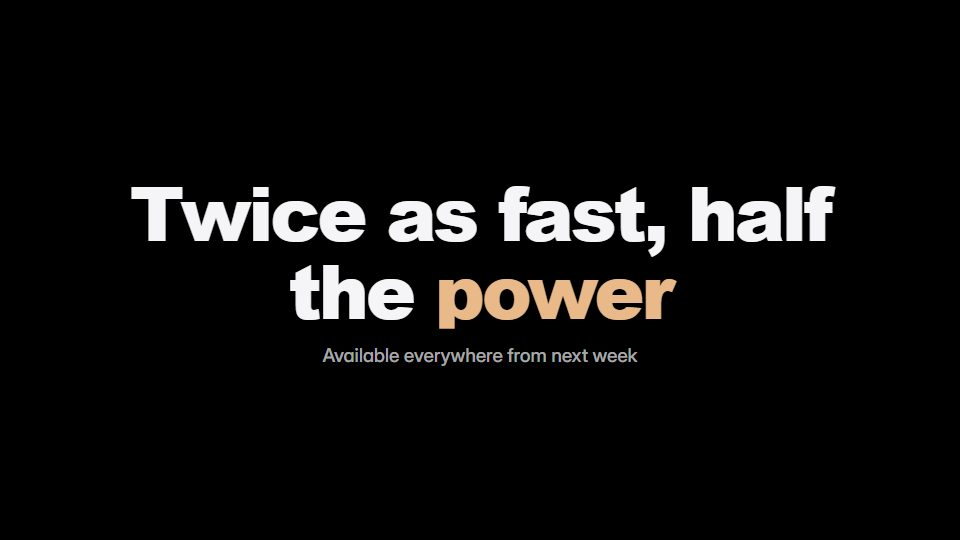](recipes/keynote-stage-launch.md) | **[Keynote-stage launch](recipes/keynote-stage-launch.md)** Stage-presentation launch: pure black, enormous headline words, spec numbers set huge, one hero object under a top light Ready: our kit builds it today · flagship announcement |
| [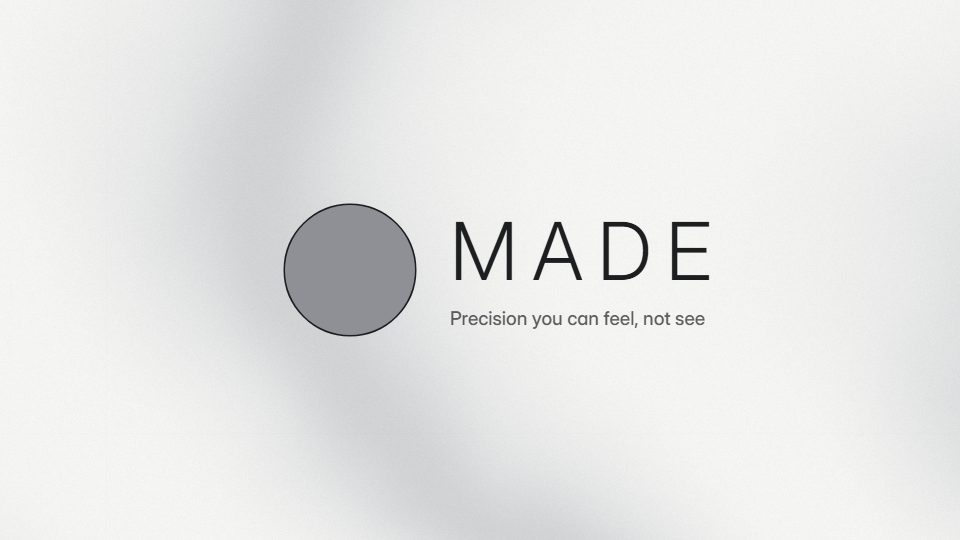](recipes/silver-studio-reveal.md) | **[Silver monochrome reveal](recipes/silver-studio-reveal.md)** A colourless light-studio reveal in silver, white and soft shadow, with no accent at all Ready: our kit builds it today · quiet premium reveal |
| [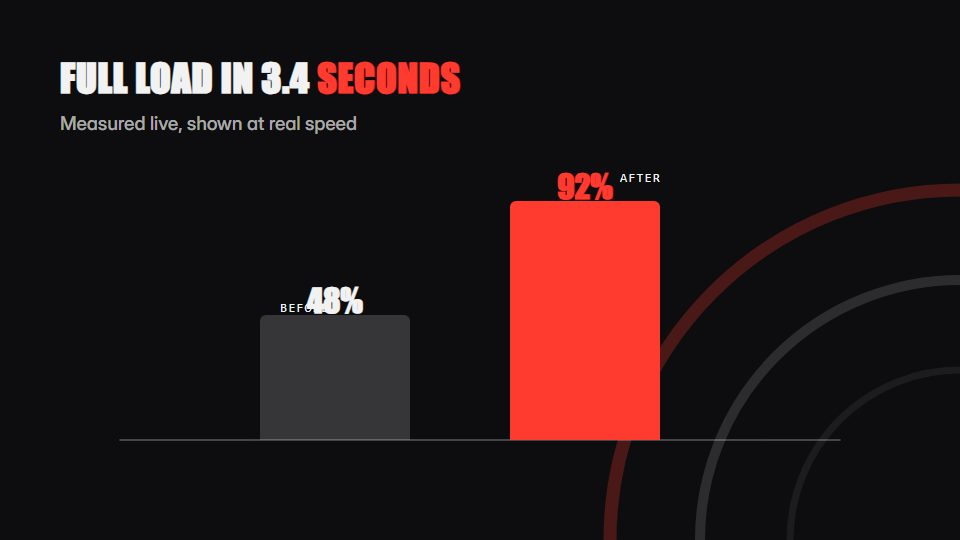](recipes/hardware-spec-telemetry.md) | **[Hardware spec telemetry](recipes/hardware-spec-telemetry.md)** Performance spec piece where real-time timers, firing-order lights and engineering callouts prove the numbers Adapt: needs a small helper or a stylisation · benchmark proof film |

### Real-UI product promo

| Still | Style |
|---|---|
| [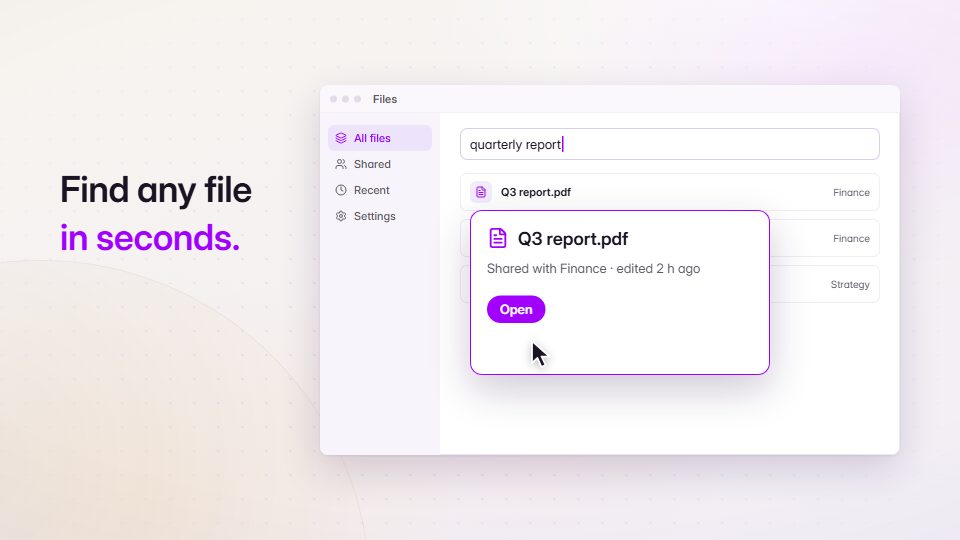](recipes/real-ui-promo.md) | **[Real-UI product promo](recipes/real-ui-promo.md)** The bulk: launch or promo videos built from a product's own site, repo, screenshots and brand tokens Ready: our kit builds it today · launch |
| [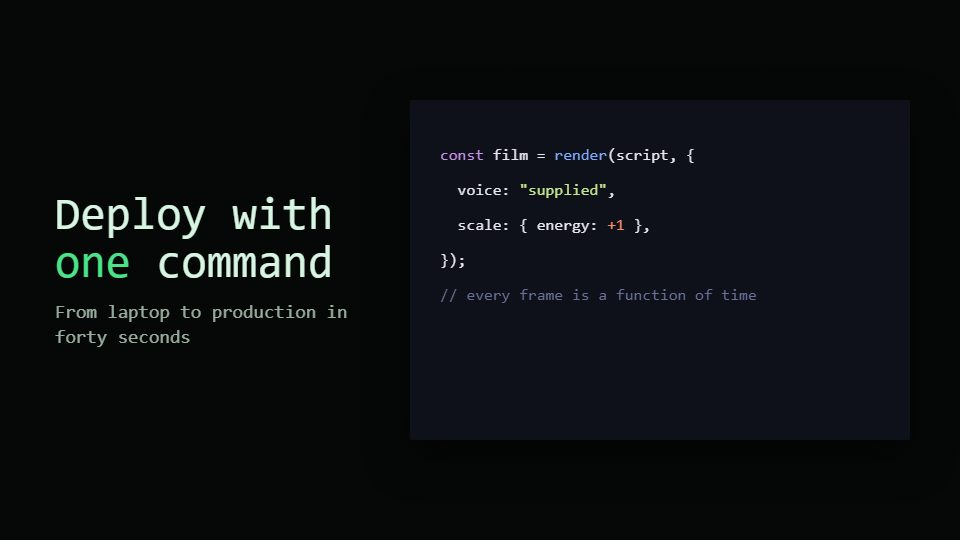](recipes/terminal-session-launch.md) | **[Terminal-session launch](recipes/terminal-session-launch.md)** The whole story plays out in a command-line session: typed commands, live logs and one result that lands Ready: our kit builds it today · CLI product launch |
|  | **[Glass dashboard promo](recipes/glass-dashboard-promo.md)** Frosted, see-through dashboard cards float over a soft colour field, layered like panes of glass Ready: our kit builds it today · dashboard product promo |
| [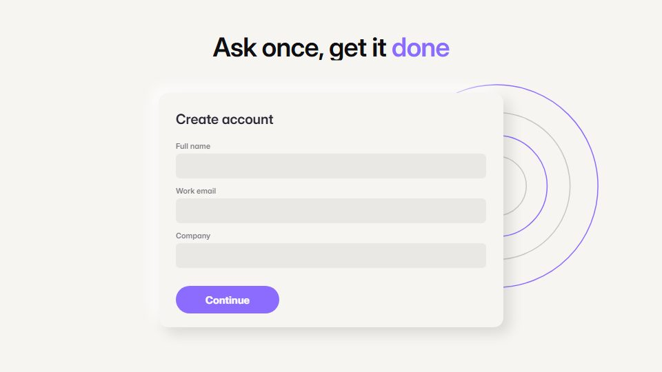](recipes/iridescent-prompt-launch.md) | **[Iridescent prompt launch](recipes/iridescent-prompt-launch.md)** An AI product told through one input box ringed by a slowly turning rainbow glow on a clean white page Ready: our kit builds it today · AI feature launch |
| [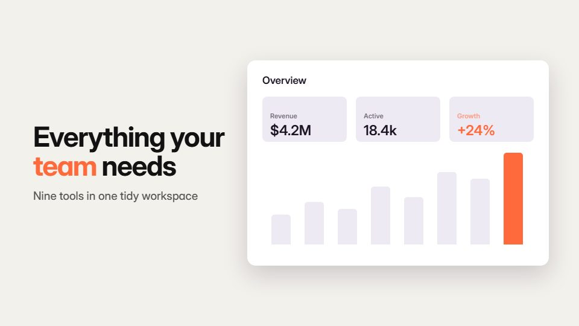](recipes/bento-feature-tour.md) | **[Bento feature tour](recipes/bento-feature-tour.md)** Features live in a bento grid of rounded tiles that reflow, swap and open one at a time Ready: our kit builds it today · feature roundup |
| [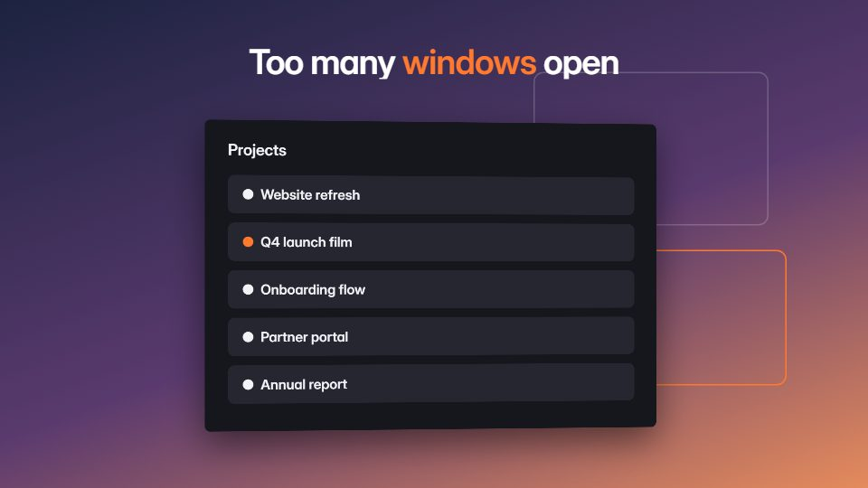](recipes/desktop-window-pileup.md) | **[Desktop window pile-up](recipes/desktop-window-pileup.md)** One slow, unbroken camera over a single desktop as app windows pile in from behind the lens and fly past it Adapt: needs a small helper or a stylisation · workflow tool teaser |
|  | **[Chat-thread story](recipes/chat-thread-story.md)** The product story is told as a conversation: bubbles, typing dots, attachments and a reply that does the job Ready: our kit builds it today · assistant product promo |
| [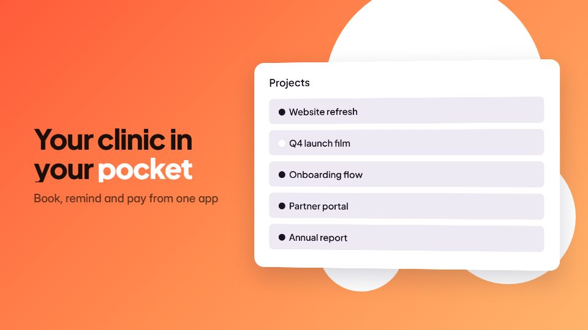](recipes/phone-frame-app-promo.md) | **[Floating phone app promo](recipes/phone-frame-app-promo.md)** Mobile app promo where device frames float on a colour field, turn slightly and swap real screens Ready: our kit builds it today · mobile app launch |
| [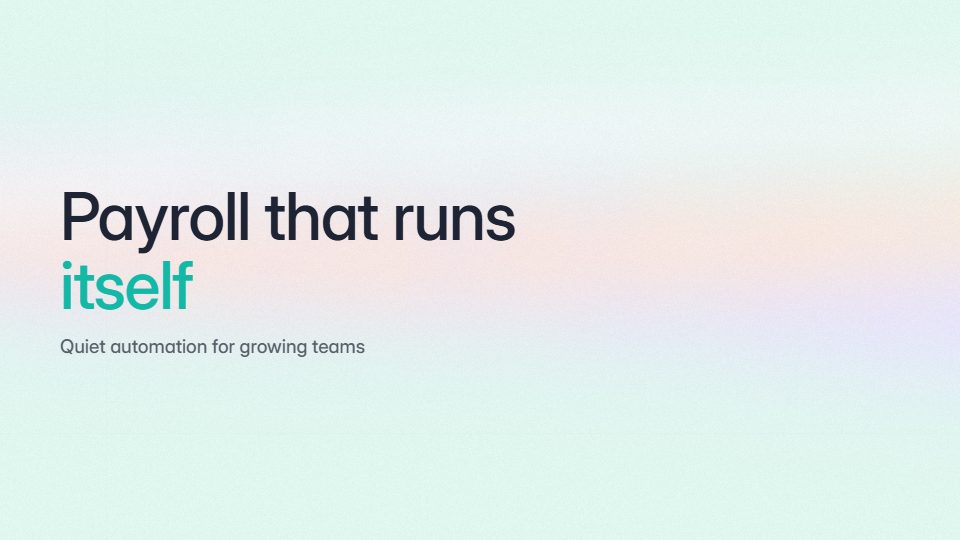](recipes/aurora-calm-saas.md) | **[Soft aurora SaaS promo](recipes/aurora-calm-saas.md)** Calm, light SaaS promo on a slow pastel aurora, with white cards and quiet type Ready: our kit builds it today · calm SaaS promo |

### Screen-guided walkthrough / how-to

| Still | Style |
|---|---|
| [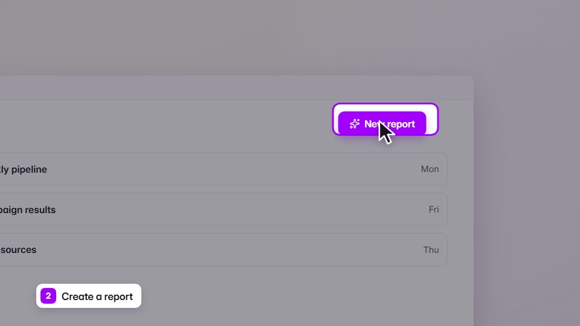](recipes/screen-walkthrough.md) | **[Screen-guided walkthrough / how-to](recipes/screen-walkthrough.md)** Cursor, clicks and tracking zooms through real screens; "5 features" or tutorial shorts Ready: our kit builds it today · onboarding |
| [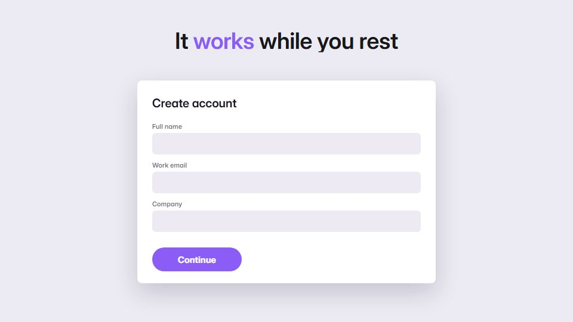](recipes/agent-cursor-demo.md) | **[Two-cursor agent demo](recipes/agent-cursor-demo.md)** A walkthrough where the user's pointer and a labelled agent pointer share the screen and hand work to each other Adapt: needs a small helper or a stylisation · agent workflow demo |
| [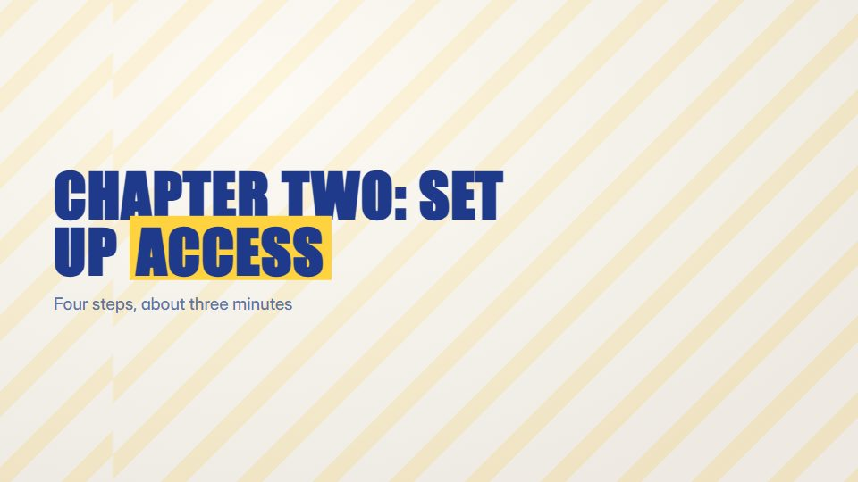](recipes/chaptered-course-module.md) | **[Chaptered course module](recipes/chaptered-course-module.md)** Long-form lesson in clear chapters, with a progress rail, chapter cards, worked steps and a recap Ready: our kit builds it today · training module |

### Motion-designer showreel / sizzle

| Still | Style |
|---|---|
| [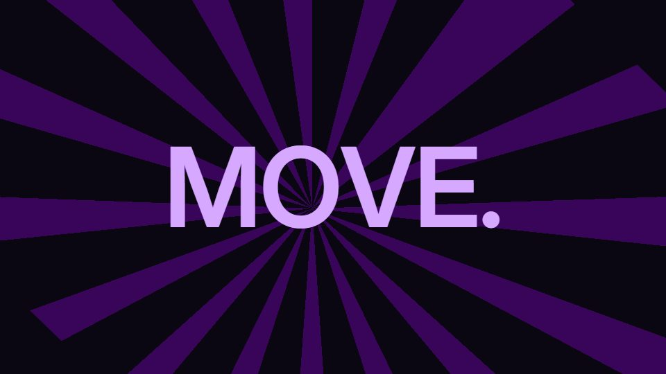](recipes/showreel.md) | **[Motion-designer showreel / sizzle](recipes/showreel.md)** "Show me what you can do": high-variety reel of techniques, usually 10–20 s Adapt: needs a small helper or a stylisation · agency or team sizzle |
| [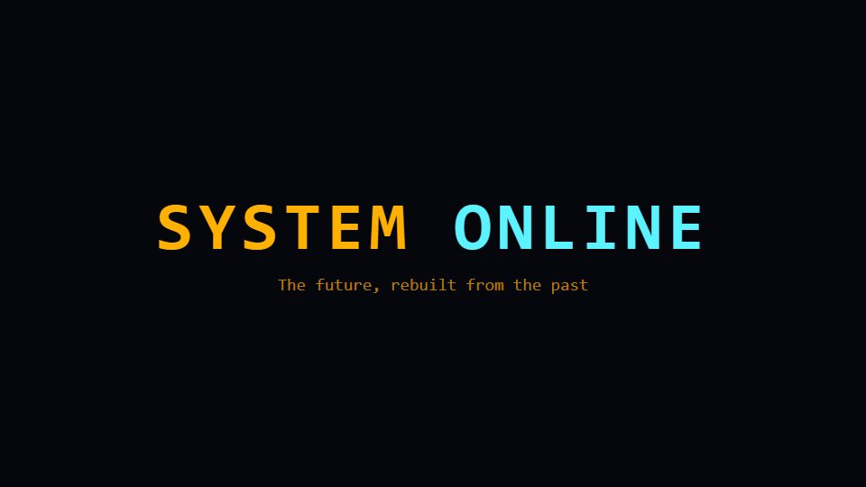](recipes/crt-retro-future.md) | **[CRT retro-future launch](recipes/crt-retro-future.md)** A retro-futurist launch seen through a curved phosphor screen: scanlines, bloom and warm grain Adapt: needs a small helper or a stylisation · retro-tech launch |

### Kinetic typography: speech, quote, manifesto

| Still | Style |
|---|---|
| [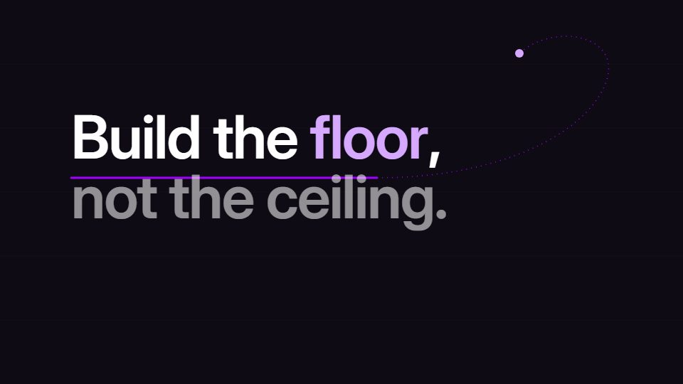](recipes/kinetic-type.md) | **[Kinetic typography: speech, quote, manifesto](recipes/kinetic-type.md)** The words are the picture; layout and geometry act out the rhetoric Ready: our kit builds it today · CEO quotes |
| [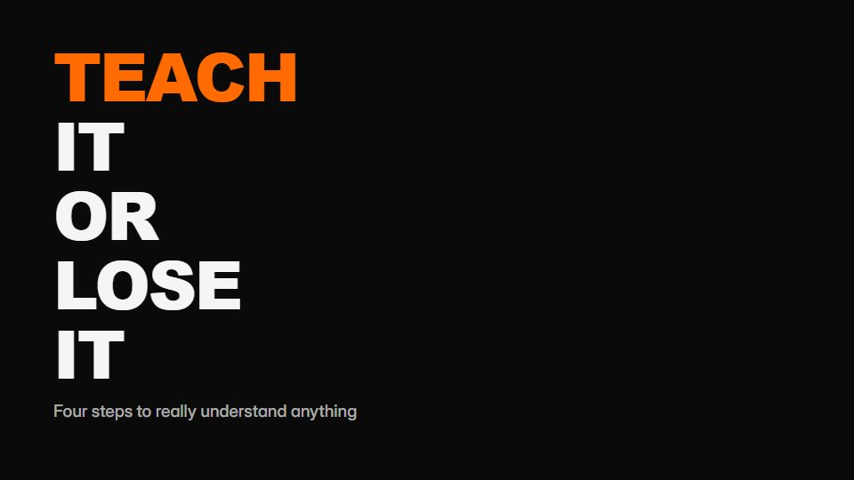](recipes/beat-slam-type.md) | **[Black-and-orange beat type](recipes/beat-slam-type.md)** Hard-cut typographic explainer: one word per beat, orange on black, and a final hammer line Ready: our kit builds it today · framework explainer |
| [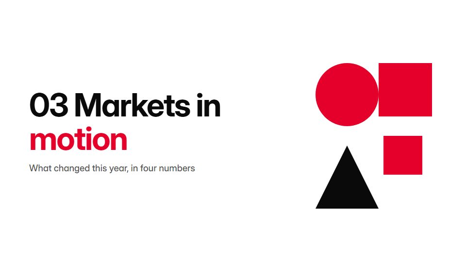](recipes/swiss-grid-editorial.md) | **[Swiss grid editorial](recipes/swiss-grid-editorial.md)** Strict modular grid, flush-left grotesque, red accents and huge numerals: information as layout Ready: our kit builds it today · report and strategy film |
| [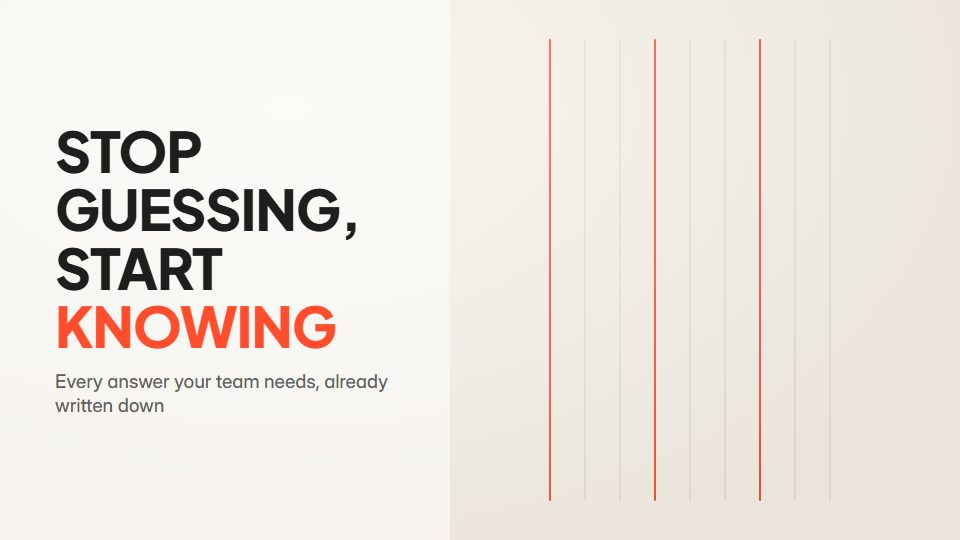](recipes/marker-flip-explainer.md) | **[Marker-note flip explainer](recipes/marker-flip-explainer.md)** Paper-light explainer with huge type, marker notes that draw themselves and hard light/dark inversions Adapt: needs a small helper or a stylisation · punchy explainer |

### Loud poster / op-art trailer

| Still | Style |
|---|---|
| [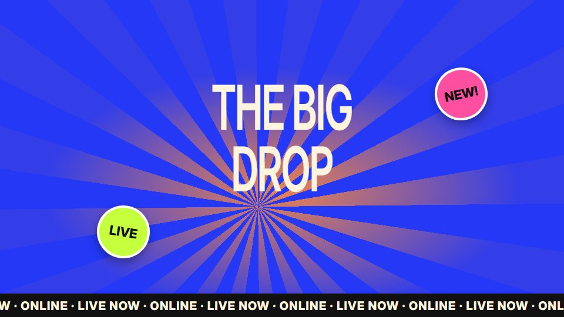](recipes/loud-poster.md) | **[Loud poster / op-art trailer](recipes/loud-poster.md)** Bold condensed type, sunbursts, stickers, stamps, tickers and print offsets Adapt: needs a small helper or a stylisation · consumer-facing or creator-economy launches |
| [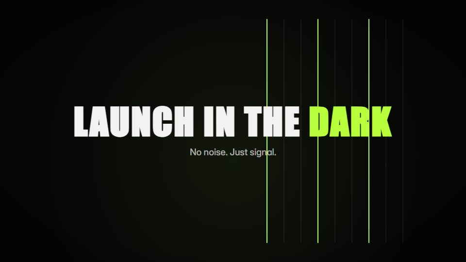](recipes/neon-signal-noir.md) | **[Neon-signal noir](recipes/neon-signal-noir.md)** Black night frames lit only by one neon edge colour, with terse condensed type like a trailer Adapt: needs a small helper or a stylisation · bold launch teaser |
| [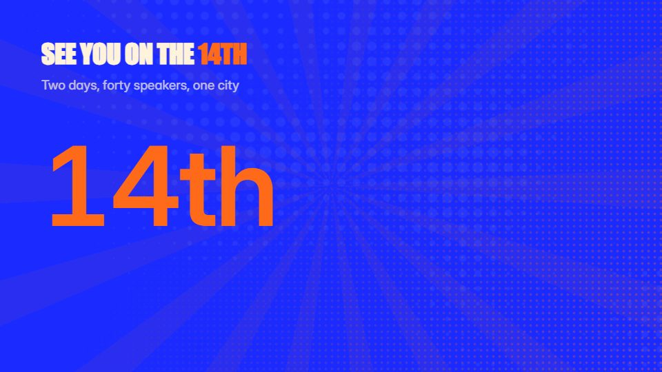](recipes/event-countdown-promo.md) | **[Event countdown promo](recipes/event-countdown-promo.md)** Event hype built round the date: big rolling numerals, venue line art, speaker flashes and a countdown Ready: our kit builds it today · event promo |

### Logo ident, bumper and reveal

| Still | Style |
|---|---|
| [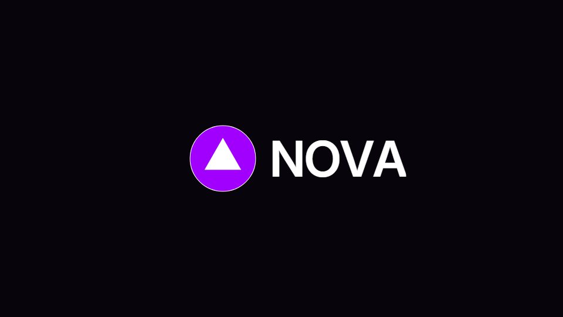](recipes/logo-ident.md) | **[Logo ident, bumper and reveal](recipes/logo-ident.md)** Short marks: wireframe-to-solid, letters folding into a dot, assembly reveals Ready: our kit builds it today · film open and close |
| [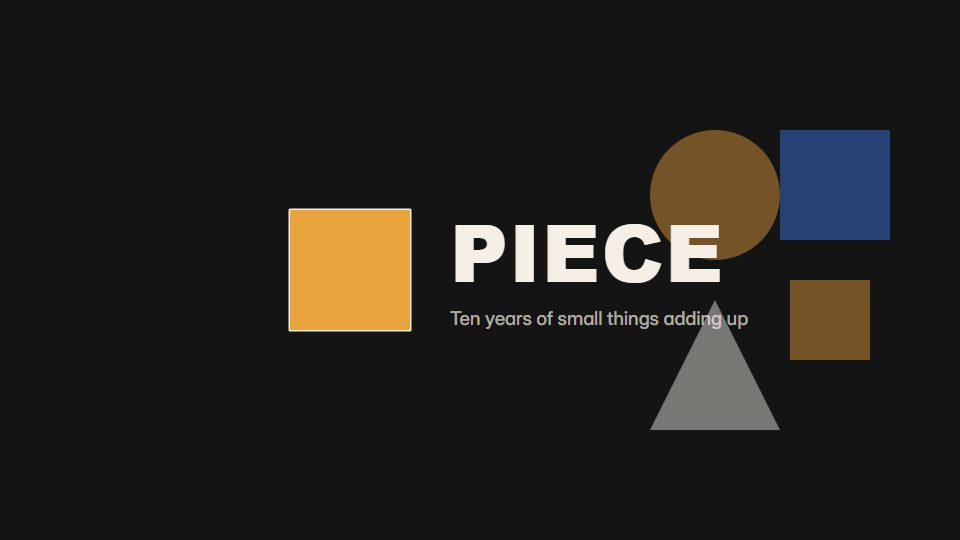](recipes/flip-tile-mosaic.md) | **[Flip-tile mosaic reveal](recipes/flip-tile-mosaic.md)** Thousands of small tiles drop and flip until, at the very end, they form the brand image or end card Adapt: needs a small helper or a stylisation · end-card reveal |
| [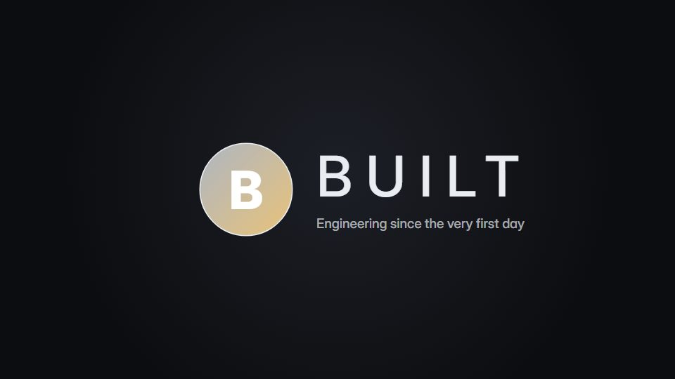](recipes/chrome-glint-ident.md) | **[Chrome-glint ident](recipes/chrome-glint-ident.md)** The mark assembles from faceted shards and is finished in polished metal, with one light glint across it Ready: our kit builds it today · premium ident |
| [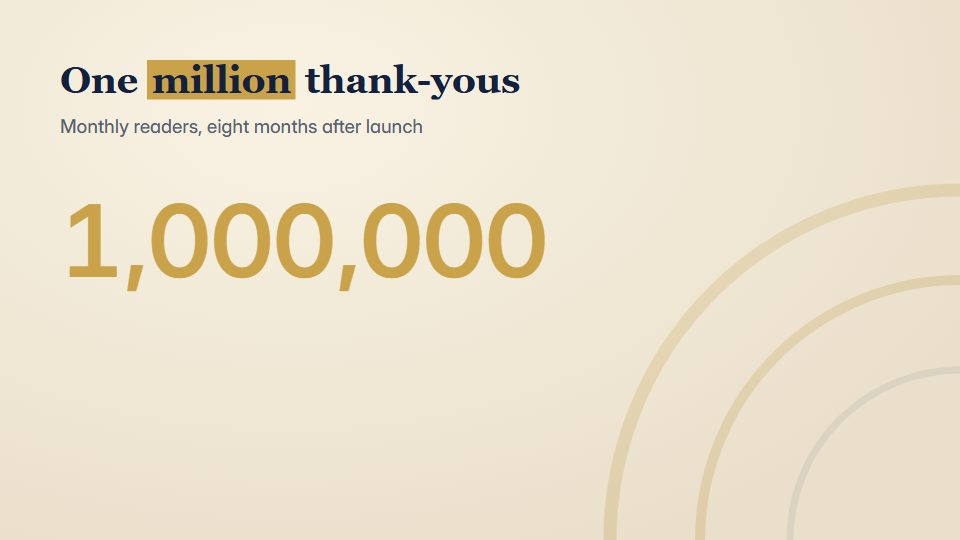](recipes/milestone-number-reveal.md) | **[Milestone number reveal](recipes/milestone-number-reveal.md)** A celebration film for one big number: a milestone, an anniversary or a user count, set like gold foil Ready: our kit builds it today · milestone celebration |

### Data story and numbers

| Still | Style |
|---|---|
| [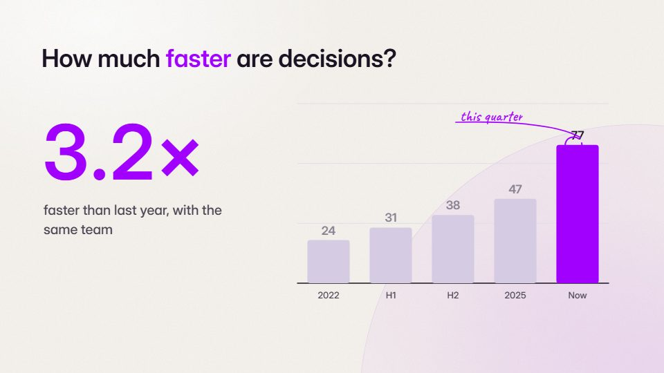](recipes/data-story.md) | **[Data story and numbers](recipes/data-story.md)** Counters, scale comparisons, unit marbles, charts that act Ready: our kit builds it today · results |
| [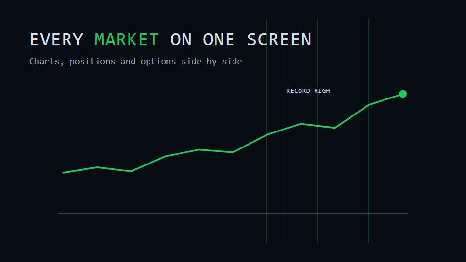](recipes/trading-desk-terminal.md) | **[Trading-desk terminal](recipes/trading-desk-terminal.md)** A dense, dark multi-window trading desk that grows from a single dot and zooms between charts, books and watchlists Adapt: needs a small helper or a stylisation · fintech platform promo |
| [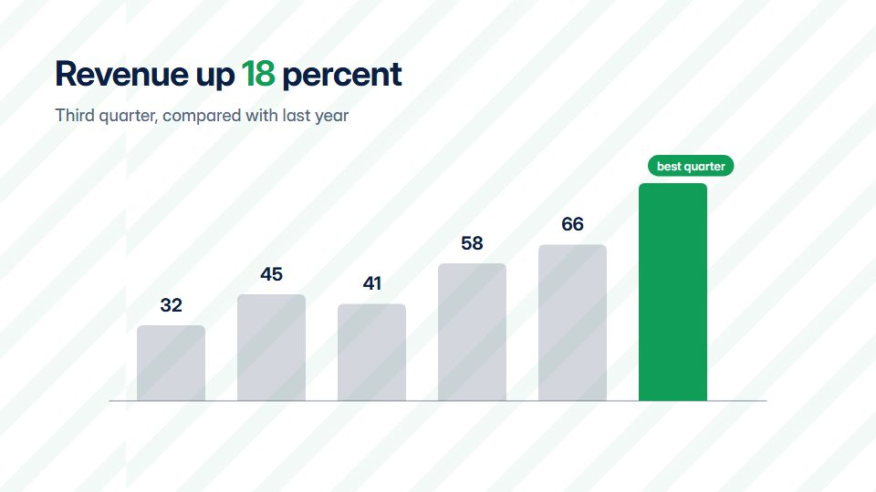](recipes/earnings-results-board.md) | **[Results-day board](recipes/earnings-results-board.md)** Quarterly results told like a market board: big KPIs, green and red deltas, a ticker band and clean bars Ready: our kit builds it today · results and KPIs |
| [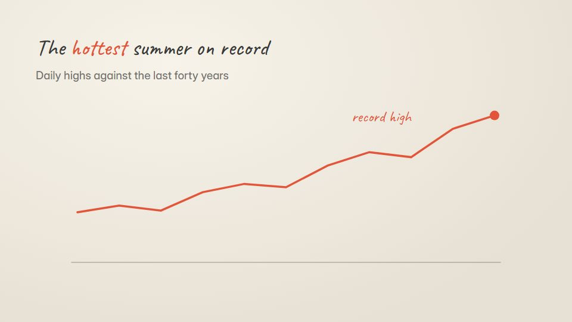](recipes/pencil-sketch-data.md) | **[Pencil-sketch data story](recipes/pencil-sketch-data.md)** Real data drawn as if by hand in graphite and coloured pencil, with a faint colour fringe for a modern edge Adapt: needs a small helper or a stylisation · research findings |
| [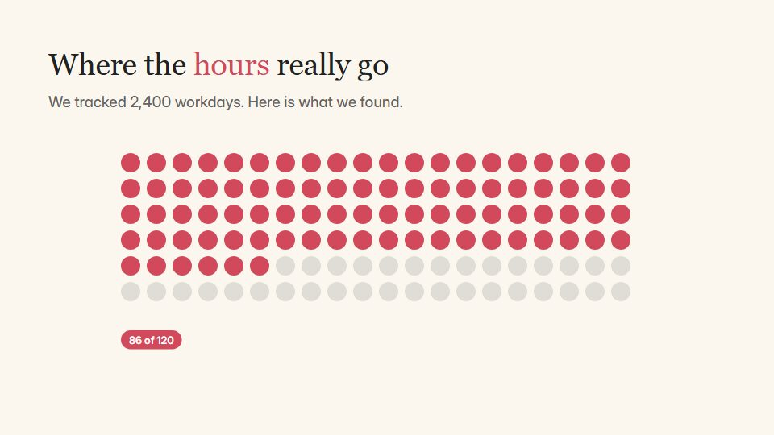](recipes/scrollytelling-essay.md) | **[Scrolling data essay](recipes/scrollytelling-essay.md)** A long-read data essay: a pinned chart holds while short annotated text cards scroll past and change it Ready: our kit builds it today · data-led report |
| [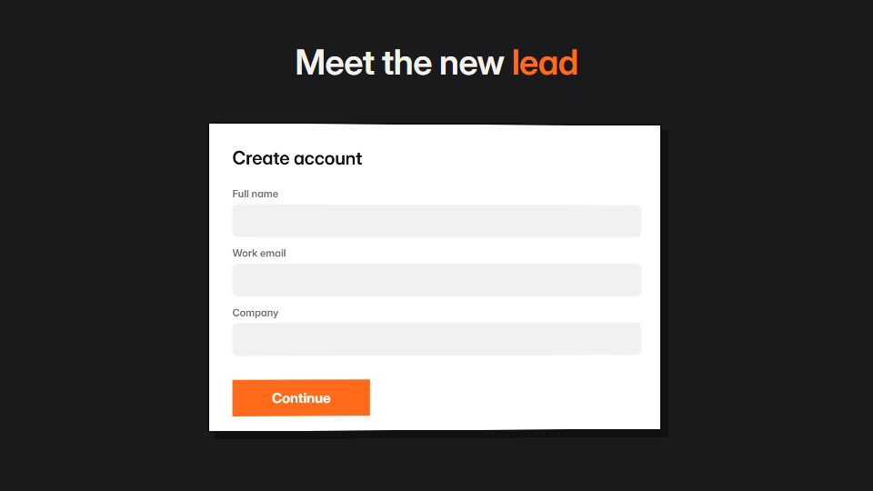](recipes/document-as-stage.md) | **[Document-as-stage](recipes/document-as-stage.md)** A single sheet (CV, spec, report or form) is the set: rows fill in, meters rise and a stamp lands Adapt: needs a small helper or a stylisation · profiles and one-pagers |

### Diagrammatic concept / mechanism explainer

| Still | Style |
|---|---|
| [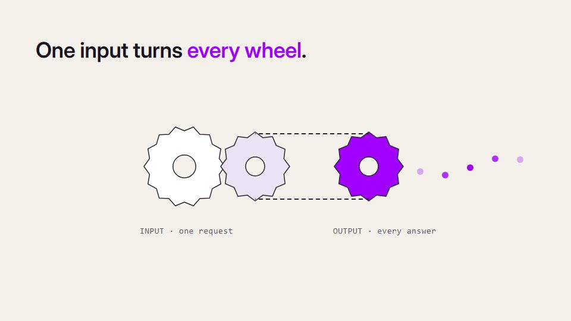](recipes/mechanism-explainer.md) | **[Diagrammatic concept / mechanism explainer](recipes/mechanism-explainer.md)** Systems, algorithms, science and proofs shown as working machines or diagrams Ready: our kit builds it today · "how it works" |
| [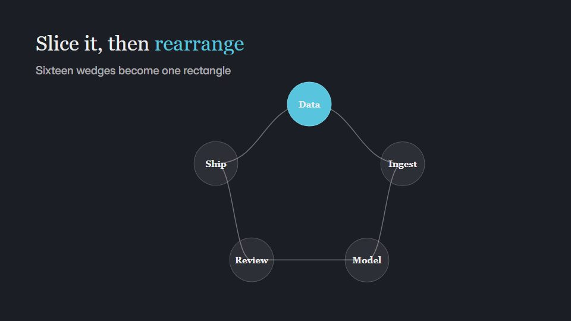](recipes/dark-slate-math.md) | **[Dark-slate math visual](recipes/dark-slate-math.md)** Calm mathematical visualisation on dark slate: shapes physically rearrange to make the point while formulas build term by term Ready: our kit builds it today · technical concept explainer |
| [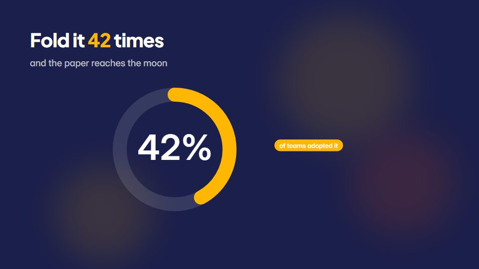](recipes/flat-vector-infographic.md) | **[Flat-vector science infographic](recipes/flat-vector-infographic.md)** A bright flat-vector world with no outlines, big numbers and rule-based zooms, for curious big-idea explainers Ready: our kit builds it today · big-idea explainer |
| [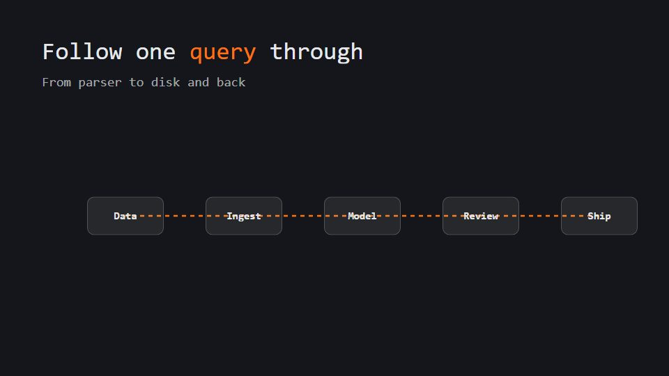](recipes/request-trace-codemap.md) | **[Life-of-a-request trace](recipes/request-trace-codemap.md)** A codebase or system shown as a map of modules, then one request travels through it step by step Ready: our kit builds it today · architecture explainer |
| [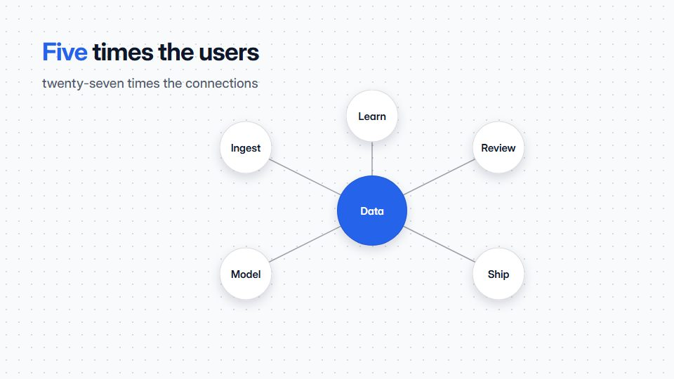](recipes/network-growth.md) | **[Network-effect growth diagram](recipes/network-growth.md)** Nodes multiply and connections explode, with a live counter showing links outgrowing users Ready: our kit builds it today · platform growth story |
| [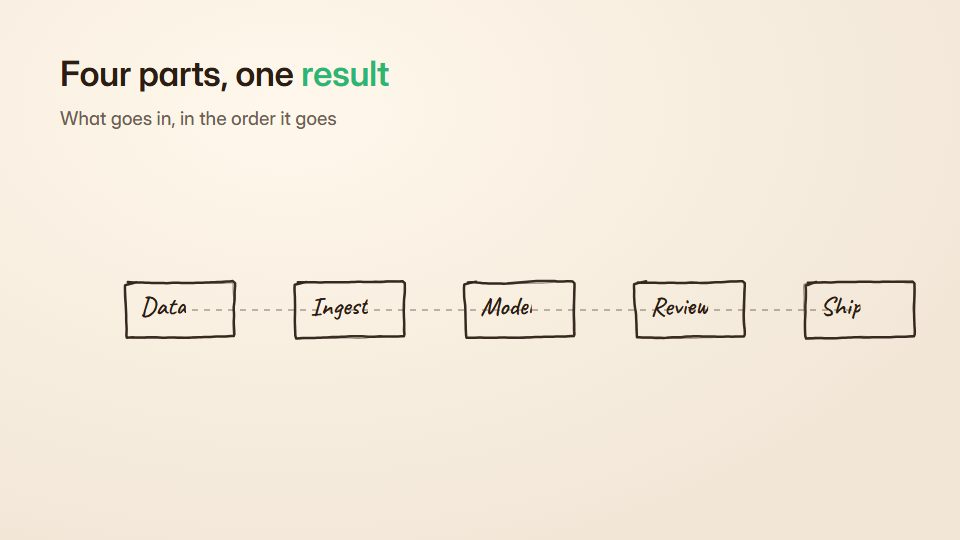](recipes/recipe-step-build.md) | **[Recipe-card step build](recipes/recipe-step-build.md)** A how-it's-made explainer that adds one ingredient at a time, with measures, live counters and a ticking checklist Ready: our kit builds it today · step-by-step recipe |
| [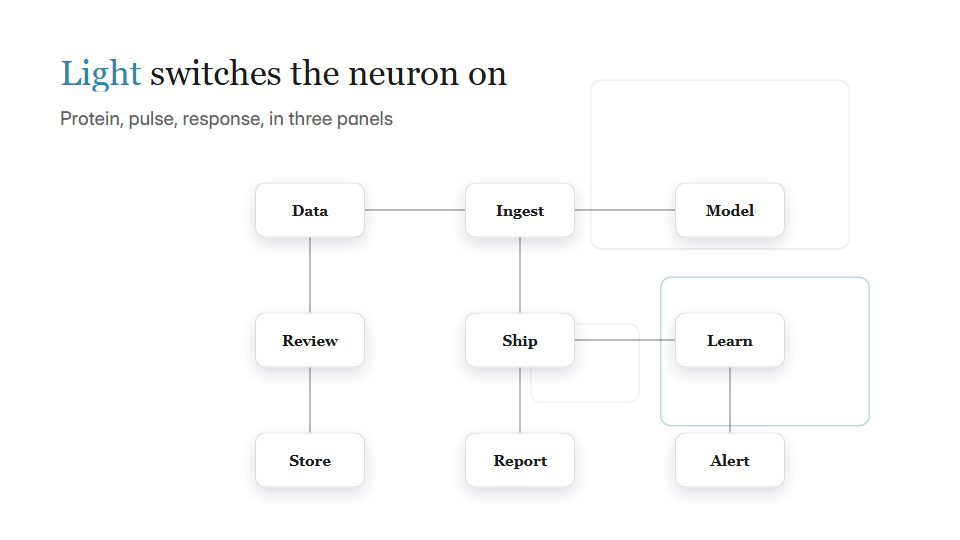](recipes/journal-figure-science.md) | **[Journal-figure science explainer](recipes/journal-figure-science.md)** Science explained like a well-made journal figure: lettered panels, precise diagrams and the source on screen Ready: our kit builds it today · science communication |
| [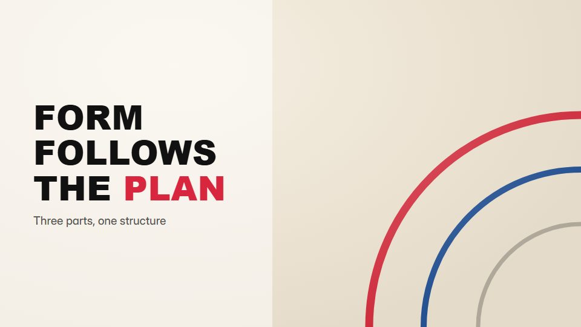](recipes/bauhaus-geometry.md) | **[Bauhaus geometric explainer](recipes/bauhaus-geometry.md)** Ideas built from primary circles, squares and triangles that slide, stack and recombine on a cream ground Adapt: needs a small helper or a stylisation · design-led framework |
| [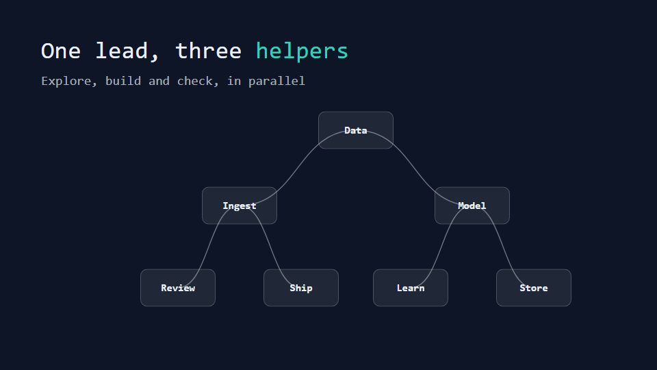](recipes/agent-org-tree.md) | **[Agent org-chart tree](recipes/agent-org-tree.md)** Roles or services shown as a tree that lights up as a task flows from the lead down to workers and back Ready: our kit builds it today · operating-model explainer |
| [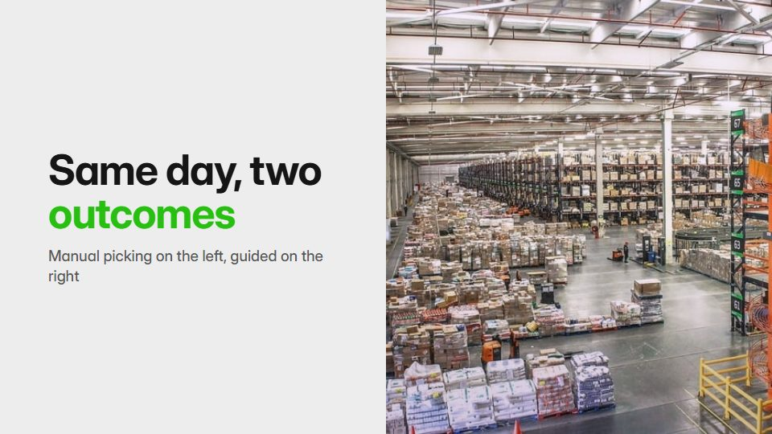](recipes/split-compare.md) | **[Synchronised split compare](recipes/split-compare.md)** Two or three versions play side by side in lockstep (old and new, healthy and broken) so the difference explains itself Ready: our kit builds it today · before-and-after proof |

### Storybook, hand-drawn and paper collage

| Still | Style |
|---|---|
| [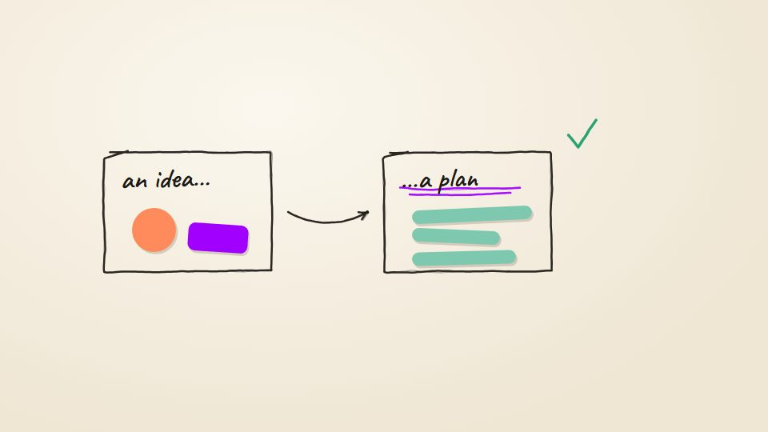](recipes/storybook.md) | **[Storybook, hand-drawn and paper collage](recipes/storybook.md)** Paper grain, crayon, doodles, cut paper, whiteboard; whimsical explainers Ready: our kit builds it today · friendly explainers |
| [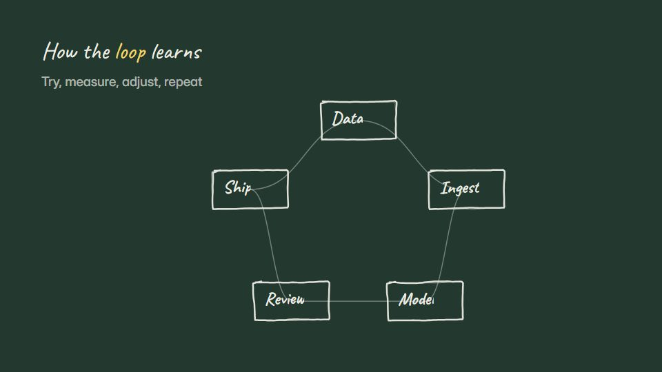](recipes/chalkboard-lesson.md) | **[Chalkboard lesson](recipes/chalkboard-lesson.md)** A classroom-board explainer: chalk lines, handwritten headings and diagrams wiped and redrawn as the lesson moves on Ready: our kit builds it today · training lesson |
|  | **[Monoline icon world](recipes/icon-world-monoline.md)** A tiny monoline figure lives inside interface icons on cream paper, and one red line plays the problem Adapt: needs a small helper or a stylisation · micro explainer loop |
|  | **[Comic-panel case story](recipes/panel-grid-story.md)** A customer story laid out as a page of comic panels that open one by one, with caption boxes and one accent colour Adapt: needs a small helper or a stylisation · customer case story |
|  | **[Ambient window loop](recipes/ambient-window-loop.md)** A slow, looping scene seen through a window, with a small story going on outside, for lobbies and waiting screens Adapt: needs a small helper or a stylisation · holding-screen loop |

### Line evolution / blueprint drafting

| Still | Style |
|---|---|
|  | **[Line evolution / blueprint drafting](recipes/blueprint-line.md)** One line keeps being re-inked: pencil on paper, then blueprint, then light Adapt: needs a small helper or a stylisation · engineering or product-design stories |
|  | **[Wireframe-to-skin reveal](recipes/wireframe-to-skin.md)** Each beat is first built as a grey wireframe (boxes, outlined text, guides), then the finished design skins over it without anything moving Ready: our kit builds it today · design process film |
|  | **[Sketch-to-render progression](recipes/sketch-to-render.md)** A subject grows in four stages: first pencil lines, then grey massing, then detail, then the finished full-colour result Adapt: needs a small helper or a stylisation · idea-to-finished story |

### Painterly and print-culture treatments

| Still | Style |
|---|---|
|  | **[Painterly and print-culture treatments](recipes/print-treatments.md)** Ink wash, risograph, halftone/manga, shadow puppets, oscilloscope, vase painting Adapt: needs a small helper or a stylisation · regional or cultural campaigns |
|  | **[Antique map route](recipes/antique-map-route.md)** A journey drawn on parchment: faint ink terrain, a vermilion route in one stroke, distance labels and a seal at the end Adapt: needs a small helper or a stylisation · journey and expansion |

### Timeline / history chronicle

| Still | Style |
|---|---|
|  | **[Timeline / history chronicle](recipes/timeline.md)** Eras and years marching by: history of a field, company or life Ready: our kit builds it today · company history |
|  | **[Ink-and-seal scroll chronicle](recipes/ink-seal-chronicle.md)** A long chronicle that alternates white-paper line drawings with gold-on-black plates, punctuated by red seals and one big brush keyword per shot Adapt: needs a small helper or a stylisation · heritage chronicle |
|  | **[Neon-year chronicle](recipes/neon-year-chronicle.md)** History told in punches: glowing year numerals swing in with a twist, and each year's event is sketched in white line art Ready: our kit builds it today · fast history recap |
|  | **[Period-style chronicle](recipes/period-style-chronicle.md)** Each era is drawn in the design language of its own time, so the look itself travels from vintage print to today Adapt: needs a small helper or a stylisation · evolution story |

### Scale dive

| Still | Style |
|---|---|
|  | **[Scale dive](recipes/scale-dive.md)** One unbroken zoom from room to device to chip to atom, or from street to cosmos Adapt: needs a small helper or a stylisation · infrastructure and hardware stories |
|  | **[Transit-line route map](recipes/transit-route-map.md)** A light, clean city map with coloured transit-style lines: zoom from districts into one route and ride along it Adapt: needs a small helper or a stylisation · coverage and routes |
|  | **[Clinical system cutaway](recipes/clinical-system-cutaway.md)** Zooms from a full-body view to a single molecule in clean clinical flat art, with a toggle between working and broken states Adapt: needs a small helper or a stylisation · health explainer |
|  | **[One-traveller journey clock](recipes/one-traveller-journey.md)** Follow a single particle, packet or parcel from start to finish while a running clock shows the real elapsed time Adapt: needs a small helper or a stylisation · journey explainer |

### Assembly and isometric systems

| Still | Style |
|---|---|
|  | **[Assembly and isometric systems](recipes/assembly-iso.md)** Things build themselves: construction steps, a data-centre tour, a sorting line Adapt: needs a small helper or a stylisation · platform architecture |
|  | **[Exploded-view callouts](recipes/exploded-view-callouts.md)** A product separates into layers along one axis, and dashed leader lines label each part Ready: our kit builds it today · what's-inside explainer |
|  | **[Instruction-manual steps](recipes/assembly-manual-steps.md)** Clean step-by-step pages like a good assembly manual: numbered steps, isometric parts, arrows and part counts Ready: our kit builds it today · setup guide |
|  | **[Floor-plan walkthrough](recipes/floor-plan-walkthrough.md)** A top-down plan whose rooms furnish themselves, then the camera glides room to room as light turns from day to evening Adapt: needs a small helper or a stylisation · space and facility tour |

### Documentary / archival brand film

| Still | Style |
|---|---|
|  | **[Documentary / archival brand film](recipes/documentary.md)** Film texture, archival clips, captions on narration, one saturated hero object Adapt: needs a small helper or a stylisation · brand manifesto |
|  | **[Broadcast news package](recipes/broadcast-news-package.md)** Newsroom-style graphics: lower-third straps, a live clock, a ticker, map insets and fact cards over real footage Adapt: needs a small helper or a stylisation · news-style update |
|  | **[Calm serif people film](recipes/calm-serif-people-film.md)** A grown-up, reassuring people film: deep green and gold, a fine serif, duotone portraits and plain promises Ready: our kit builds it today · recruitment and people |
|  | **[Epic title-card trailer](recipes/title-card-trailer.md)** Feature-film trailer grammar for a brand: letterboxed shots, wide-tracked title cards on black and a rising score Adapt: needs a small helper or a stylisation · launch teaser trailer |
|  | **[Video-essay paper desk](recipes/video-essay-desk.md)** Explainer in video-essay style: printed clippings, highlighter marks, typewriter-tape labels and hand-drawn arrows on a desk Adapt: needs a small helper or a stylisation · thought-leadership explainer |

### Talking-head and podcast graphic inserts

| Still | Style |
|---|---|
|  | **[Talking-head and podcast graphic inserts](recipes/podcast-inserts.md)** Full-screen explainer cards cut into a recorded conversation, with a speaker in a corner frame Adapt: needs a small helper or a stylisation · webinar and podcast repurposing |
|  | **[Speaker-ring carousel](recipes/speaker-ring-carousel.md)** Portraits of speakers or panellists sit on a slowly turning ring; the active one comes forward with name and role Adapt: needs a small helper or a stylisation · speaker intros |
|  | **[Audiogram quote clip](recipes/audiogram-quote-clip.md)** A clip from a talk or podcast shown as a quote card: portrait, live waveform and captions lighting word by word Ready: our kit builds it today · quote clips |

### Character story world

| Still | Style |
|---|---|
|  | **[Character story world](recipes/story-world.md)** A small cast of simple 2D characters in a world built in code, staged like an animated short and timed to the voiceover Adapt: needs a small helper or a stylisation · character-led brand story |
|  | **[Flat-vector character short](recipes/flat-vector-short.md)** Smooth flat-vector characters with soft gradients and glows instead of outlines, in a polished animated-short look Adapt: needs a small helper or a stylisation · polished animated short |
|  | **[Paper cut-out puppets](recipes/paper-puppet-stroll.md)** Jointed card puppets on layered paper sets, moving with a stiff, charming stroll Adapt: needs a small helper or a stylisation · warm anecdote story |
|  | **[Shadow-puppet theatre](recipes/shadow-theatre-fable.md)** A fable played as shadow puppets on a lamp-lit screen, in black and translucent colour Adapt: needs a small helper or a stylisation · values fable |
|  | **[Watercolour storybook world](recipes/watercolour-storybook.md)** A soft watercolour-and-crayon picture world where one warm light carries the feeling Adapt: needs a small helper or a stylisation · heartfelt brand story |
|  | **[Sumi-e ink epic](recipes/sumi-ink-epic.md)** A hero's journey painted live in black ink on rice paper, fast brushwork between long still holds Adapt: needs a small helper or a stylisation · hero-journey epic |
|  | **[One continuous line story](recipes/one-line-story.md)** A single line that never lifts draws the whole story, closing round each shape before it floods with pastel colour Adapt: needs a small helper or a stylisation · single-line brand story |
|  | **[Motion-comic story](recipes/motion-comic-story.md)** A graphic-novel story where each panel comes alive: layered depth, one moving element, and frame-breaking peaks Adapt: needs a small helper or a stylisation · dramatic story panels |
|  | **[Isometric living town](recipes/isometric-living-town.md)** A tidy isometric diorama of tiny people, desks and streets going about their day, with one storyline lit at a time Adapt: needs a small helper or a stylisation · living system overview |
|  | **[Silhouette fable](recipes/silhouette-fable.md)** Black silhouettes against huge gradient skies, with one bright symbol carrying the plot and sound telling half the story Adapt: needs a small helper or a stylisation · purpose fable |
|  | **[Stick-figure explainer story](recipes/stick-figure-story.md)** Quick marker stick figures act out a small story on a white board, with red kept for the one point to remember Adapt: needs a small helper or a stylisation · quick story explainer |
|  | **[Mascot-led brand story](recipes/mascot-brand-story.md)** A simple, expressive mascot lives inside the product world and guides the viewer through one real benefit Adapt: needs a small helper or a stylisation · mascot-led promo |
|  | **[Claymation-look loop](recipes/claymation-look-loop.md)** A tiny set of soft clay objects and characters animated on twos, like a stop-motion desk loop Adapt: needs a small helper or a stylisation · playful brand loop |
|  | **[Cosy pastel picture-book](recipes/cosy-pastel-picturebook.md)** Symmetrical, sugared-pastel scenes where the world changes outside a window while the inside stays cosy Adapt: needs a small helper or a stylisation · cosy seasonal film |
|  | **[Parallax picture story](recipes/parallax-picture-story.md)** Supplied illustrations or photos split into depth layers and moved in slow 2.5D, with one living detail per still Ready: our kit builds it today · story from stills |

## What this library leaves out
- **Games and playable prototypes:** interactive state machines, input handling and physics; we output films only.
- **True 3D worlds, landmarks and take-apart labs:** they need a 3D engine and PBR. Where the idea matters, restyle it as isometric or layered 2D (F16, F17).
- **Physics and simulation toys:** accumulated state breaks pure-function frames, and the spectacle rarely carries a B2B message. Use a seeded closed-form fake if needed.
- **Generative, demoscene and pixel showpieces:** no message, and the retro look is off-brand. Keep only "animate on twos" and our shader grounds.
- **Music and lyric videos:** whole-song timing and performance, while our films follow a supplied VO. The lyric-scale variety (subtitle-small to huge) is already in our type rules.
- **Character shorts, memes and social edits:** rigged characters, parody of real people, vertical-first. They fail "real people for people".
- **Web components and scroll pages:** interactive UI, not film. One idea worth taking: a spotlight mask that reveals an inner layer, staged on a timed path.
- **No usable brief:** showcase posts with no direction.

Rebuild these pages with `python -I style-library/build.py`. Render the stills with `node style-library/demos/stills.mjs`
(wrap it in the heavy lock).
