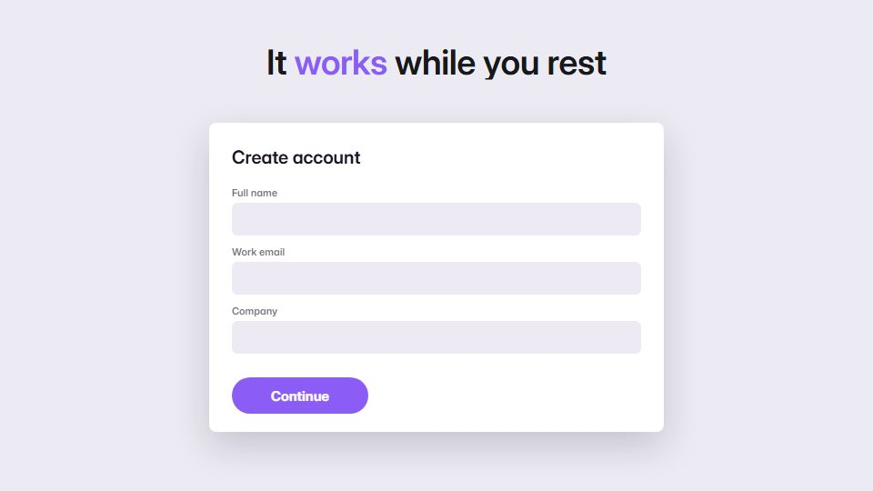

# Two-cursor agent demo

**A walkthrough where the user's pointer and a labelled agent pointer share the screen and hand work to each other** · Fit for our films: **Adapt: needs a small helper or a stylisation** · Live demo: [`demos/demo.html#agent-cursor-demo`](../demos/demo.html#agent-cursor-demo)

## The look
Clean light product UI (#FAFAFB, ink #18181B) with two cursors: the user's in black, the agent's in a brand colour (#8B5CF6) with a name tag; soft highlight boxes on whatever the agent touches.

## How it moves
The user cursor sets a goal and hands off; the agent cursor moves quicker and straighter, typing and clicking by itself; a small counter shows work done while the user is away. The camera tracks whichever cursor is acting.

## Shape of a piece
The user asks, the agent cursor appears, three actions it carries out, a counter of finished items, the user returns to a done result.

## Craft rules
Only one cursor moves at a time, and every agent action leaves a visible result. The tag stays readable.

## Ask for, before building
The real screens, the steps the agent takes, the counts or results, brand colour

## Where it fits
AI agent and automation demos, workflow tool walkthrough, overnight-automation promo

## Build it with our kit
screencast cursor, typed inputs, buttons, lists, toasts, camera push-ins, data counters

**Small helpers it would want (none built yet; the engine is unchanged):** A second cursor with a name tag and its own path

## Tuning scale
| Energy | Pace | Camera | Density | Background | Type | Realism | Sound |
|---|---|---|---|---|---|---|---|
| 0 | 0 | +1 | 0 | −1 | −1 | +2 | 0 |

## Our director prompt
Direct this film (or these segments) in the **Two-cursor agent demo** style. Follow the script word for word, time everything to the voiceover clock, and show me the storyboard before building.

- **Look:** Clean light product UI (#FAFAFB, ink #18181B) with two cursors: the user's in black, the agent's in a brand colour (#8B5CF6) with a name tag; soft highlight boxes on whatever the agent touches.
- **Motion:** The user cursor sets a goal and hands off; the agent cursor moves quicker and straighter, typing and clicking by itself; a small counter shows work done while the user is away. The camera tracks whichever cursor is acting.
- **Shape of the piece:** The user asks, the agent cursor appears, three actions it carries out, a counter of finished items, the user returns to a done result.
- **Rules:** Only one cursor moves at a time, and every agent action leaves a visible result. The tag stays readable.
- **Ask me first for:** the real screens, the steps the agent takes, the counts or results, brand colour
- **Tuning scale:** Energy 0, Pace 0, Camera +1, Density 0, Background −1, Type −1, Realism +2, Sound 0.
- **Build it with:** screencast cursor, typed inputs, buttons, lists, toasts, camera push-ins, data counters. Keep to the engine's craft rules: one primary mover, scenes that open sparse and build, text that is readable before anything ornamental moves.
