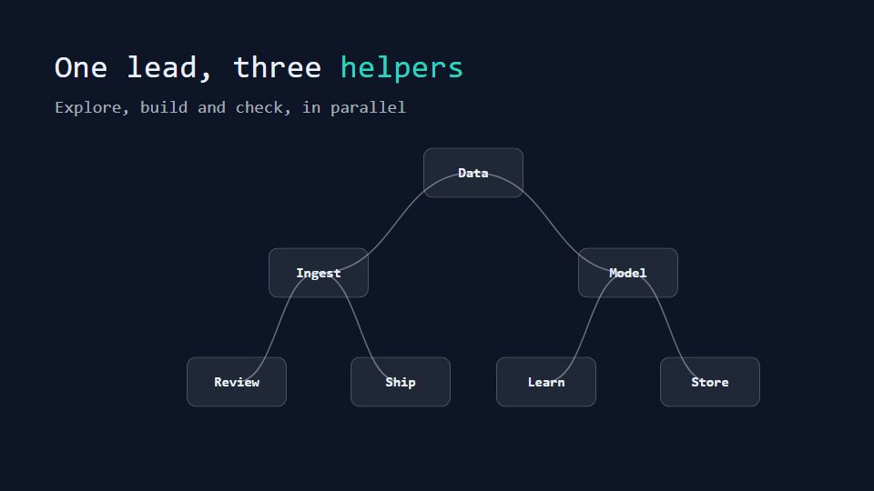

# Agent org-chart tree

**Roles or services shown as a tree that lights up as a task flows from the lead down to workers and back** · Fit for our films: **Ready: our kit builds it today** · Live demo: [`demos/demo.html#agent-org-tree`](../demos/demo.html#agent-org-tree)

## The look
Night navy (#0E1526) with cards (#16203A) carrying role names and small status dots; the lead in warm white, workers in teal (#2DD4BF), the task as an amber pulse (#FBBF24); mono labels.

## How it moves
The tree grows from its root, a task pulse runs down the branches, each card shows a short status line while it works, and results bubble back up to merge at the root.

## Shape of a piece
The root role, the tree unfolds, one task delegated and worked in parallel, results merge, the outcome.

## Craft rules
Branches never cross and there are at most three levels; status text is short and real.

## Ask for, before building
The roles or services, what each does in a few words, one example task

## Where it fits
Multi-agent AI explainer, team structure or operating model, service architecture

## Build it with our kit
diagram cards and strokes, data notes, kinetic text, camera travel

**Small helpers it would want (none built yet; the engine is unchanged):** A tree layout helper

## Tuning scale
| Energy | Pace | Camera | Density | Background | Type | Realism | Sound |
|---|---|---|---|---|---|---|---|
| 0 | 0 | 0 | +1 | −1 | −1 | −1 | 0 |

## Our director prompt
Direct this film (or these segments) in the **Agent org-chart tree** style. Follow the script word for word, time everything to the voiceover clock, and show me the storyboard before building.

- **Look:** Night navy (#0E1526) with cards (#16203A) carrying role names and small status dots; the lead in warm white, workers in teal (#2DD4BF), the task as an amber pulse (#FBBF24); mono labels.
- **Motion:** The tree grows from its root, a task pulse runs down the branches, each card shows a short status line while it works, and results bubble back up to merge at the root.
- **Shape of the piece:** The root role, the tree unfolds, one task delegated and worked in parallel, results merge, the outcome.
- **Rules:** Branches never cross and there are at most three levels; status text is short and real.
- **Ask me first for:** the roles or services, what each does in a few words, one example task
- **Tuning scale:** Energy 0, Pace 0, Camera 0, Density +1, Background −1, Type −1, Realism −1, Sound 0.
- **Build it with:** diagram cards and strokes, data notes, kinetic text, camera travel. Keep to the engine's craft rules: one primary mover, scenes that open sparse and build, text that is readable before anything ornamental moves.
