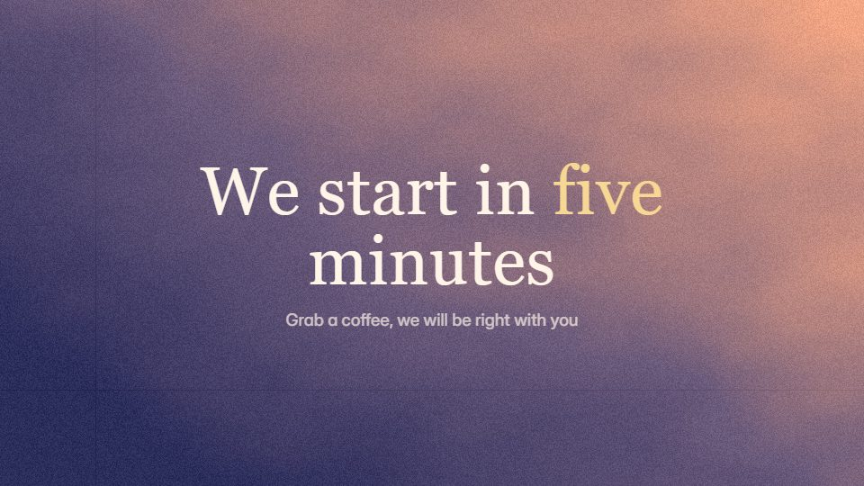

# Ambient window loop

**A slow, looping scene seen through a window, with a small story going on outside, for lobbies and waiting screens** · Fit for our films: **Adapt: needs a small helper or a stylisation** · Live demo: [`demos/demo.html#ambient-window-loop`](../demos/demo.html#ambient-window-loop)

## The look
A dusky sky gradient (#2B2D5B to #F3A683) with soft grain; a pastel window frame in the foreground; small distant things (lights, birds, a train) moving slowly; a gentle serif for any caption.

## How it moves
Everything moves continuously and very slowly; a tiny story cycles (light changes, a train passes, windows light up); the last frame matches the first so the loop has no seam.

## Shape of a piece
Settle on the window, one slow cycle of the story, return to the opening frame.

## Craft rules
No hard moves or flashes; text is a small caption at most, and the loop must be seamless.

## Ask for, before building
Loop length, brand palette, small story elements, optional caption

## Where it fits
Webinar lobby and holding screen, event background, office display, livestream backdrop

## Build it with our kit
shader grain ground, living ground washes, parallax camera, music (soft bed)

**Small helpers it would want (none built yet; the engine is unchanged):** A loop check (first frame equals last)

## Tuning scale
| Energy | Pace | Camera | Density | Background | Type | Realism | Sound |
|---|---|---|---|---|---|---|---|
| −2 | −2 | −1 | −1 | +1 | −2 | −1 | −1 |

## Our director prompt
Direct this film (or these segments) in the **Ambient window loop** style. Follow the script word for word, time everything to the voiceover clock, and show me the storyboard before building.

- **Look:** A dusky sky gradient (#2B2D5B to #F3A683) with soft grain; a pastel window frame in the foreground; small distant things (lights, birds, a train) moving slowly; a gentle serif for any caption.
- **Motion:** Everything moves continuously and very slowly; a tiny story cycles (light changes, a train passes, windows light up); the last frame matches the first so the loop has no seam.
- **Shape of the piece:** Settle on the window, one slow cycle of the story, return to the opening frame.
- **Rules:** No hard moves or flashes; text is a small caption at most, and the loop must be seamless.
- **Ask me first for:** loop length, brand palette, small story elements, optional caption
- **Tuning scale:** Energy −2, Pace −2, Camera −1, Density −1, Background +1, Type −2, Realism −1, Sound −1.
- **Build it with:** shader grain ground, living ground washes, parallax camera, music (soft bed). Keep to the engine's craft rules: one primary mover, scenes that open sparse and build, text that is readable before anything ornamental moves.
