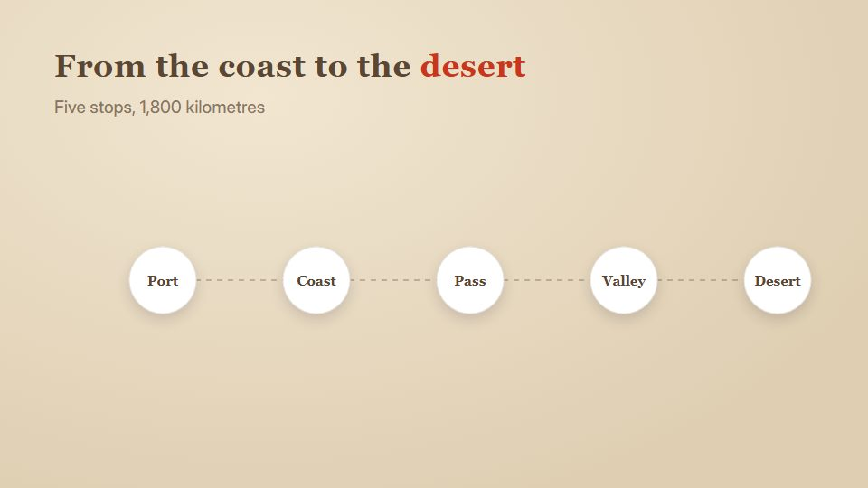

# Antique map route

**A journey drawn on parchment: faint ink terrain, a vermilion route in one stroke, distance labels and a seal at the end** · Fit for our films: **Adapt: needs a small helper or a stylisation** · Live demo: [`demos/demo.html#antique-map-route`](../demos/demo.html#antique-map-route)

## The look
Parchment (#EADBC0) with sepia ink (#5A4632), faint hatched hills and rivers, a vermilion route (#C8371D); an old-style serif for place names and a small mono for distances; a compass rose and a square red seal.

## How it moves
The camera glides along the route as it draws in one continuous stroke; place names fade in as it passes; distance counters tick; a seal stamps down to finish.

## Shape of a piece
The starting place, the route draws through 3-5 stops with a line each, the destination, the seal and summary.

## Craft rules
Maps are illustrative, not exact claims; one route colour; labels never sit on the line.

## Ask for, before building
The stops in order, distances or dates, the closing line

## Where it fits
Expansion or supply-chain story, customer journey, company origin story, partner network

## Build it with our kit
hand-drawn strokes, shader topo ground, data counters, camera travel, kinetic text

**Small helpers it would want (none built yet; the engine is unchanged):** A seal-stamp press; a path draw with camera follow

## Tuning scale
| Energy | Pace | Camera | Density | Background | Type | Realism | Sound |
|---|---|---|---|---|---|---|---|
| −1 | −1 | +1 | 0 | +1 | 0 | −1 | −1 |

## Our director prompt
Direct this film (or these segments) in the **Antique map route** style. Follow the script word for word, time everything to the voiceover clock, and show me the storyboard before building.

- **Look:** Parchment (#EADBC0) with sepia ink (#5A4632), faint hatched hills and rivers, a vermilion route (#C8371D); an old-style serif for place names and a small mono for distances; a compass rose and a square red seal.
- **Motion:** The camera glides along the route as it draws in one continuous stroke; place names fade in as it passes; distance counters tick; a seal stamps down to finish.
- **Shape of the piece:** The starting place, the route draws through 3-5 stops with a line each, the destination, the seal and summary.
- **Rules:** Maps are illustrative, not exact claims; one route colour; labels never sit on the line.
- **Ask me first for:** the stops in order, distances or dates, the closing line
- **Tuning scale:** Energy −1, Pace −1, Camera +1, Density 0, Background +1, Type 0, Realism −1, Sound −1.
- **Build it with:** hand-drawn strokes, shader topo ground, data counters, camera travel, kinetic text. Keep to the engine's craft rules: one primary mover, scenes that open sparse and build, text that is readable before anything ornamental moves.
