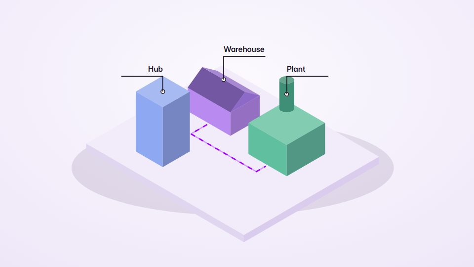

# Assembly and isometric systems

**Things build themselves: construction steps, a data-centre tour, a sorting line** · Fit for our films: **Adapt: needs a small helper or a stylisation** · Live demo: [`demos/demo.html#assembly-iso`](../demos/demo.html#assembly-iso)

## The look
An isometric or architectural-model look with a base plate, soft key light and rim, labels as clean overlays.

## How it moves
Parts build in dependency order (foundation, frame, skin, systems). Sketch lines turn into solid shapes. A guided tour runs through zones.

## Shape of a piece
Empty plot, build stages, a living state (flows running), labelled call-outs.

## Craft rules
Only show structure where it explains layers, parts or placement. No floating parts, no gaps. Labels are overlays, never baked into the art.

## Ask for, before building
The parts list and order, what each zone does.

## Where it fits
Platform architecture, supply chain, rollout plans.

## Build it with our kit
isometric treatment, hand-drawn strokes, data flows.

**Small helpers it would want (none built yet; the engine is unchanged):** A staged-build helper (stagger by dependency list); a stylised exploded view.

## Tuning scale
| Energy | Pace | Camera | Density | Background | Type | Realism | Sound |
|---|---|---|---|---|---|---|---|
| 0 | 0 | +1 | +1 | −1 | −1 | 0 | 0 |

## Our director prompt
Direct this film (or these segments) in the **Assembly and isometric systems** style. Follow the script word for word, time everything to the voiceover clock, and show me the storyboard before building.

- **Look:** an isometric or architectural-model look with a base plate, soft key light and rim, labels as clean overlays.
- **Motion:** parts build in dependency order (foundation, frame, skin, systems). Sketch lines turn into solid shapes. A guided tour runs through zones.
- **Shape of the piece:** empty plot, build stages, a living state (flows running), labelled call-outs.
- **Rules:** only show structure where it explains layers, parts or placement. No floating parts, no gaps. Labels are overlays, never baked into the art.
- **Ask me first for:** the parts list and order, what each zone does.
- **Tuning scale:** Energy 0, Pace 0, Camera +1, Density +1, Background −1, Type −1, Realism 0, Sound 0.
- **Build it with:** isometric treatment, hand-drawn strokes, data flows.. Keep to the engine's craft rules: one primary mover, scenes that open sparse and build, text that is readable before anything ornamental moves.
