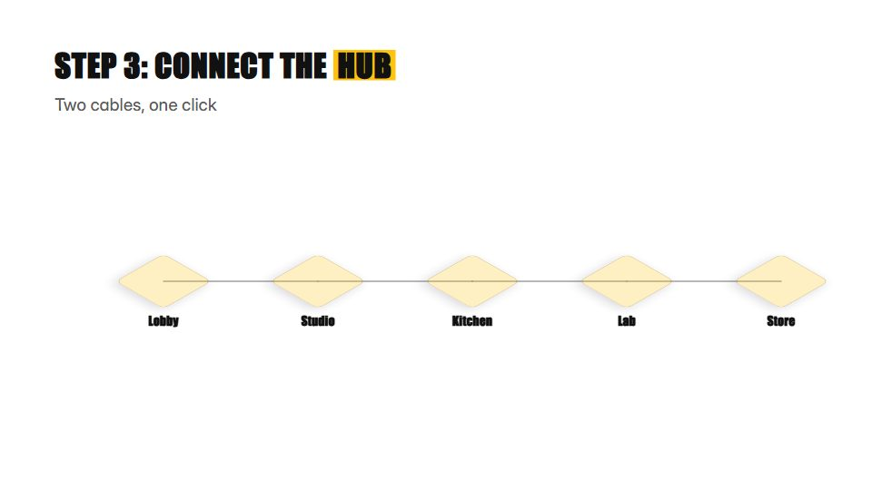

# Instruction-manual steps

**Clean step-by-step pages like a good assembly manual: numbered steps, isometric parts, arrows and part counts** · Fit for our films: **Ready: our kit builds it today** · Live demo: [`demos/demo.html#assembly-manual-steps`](../demos/demo.html#assembly-manual-steps)

## The look
White page (#FFFFFF) with black line art, light grey fills (#E6E6E6) and one action colour (#FFC20E) for arrows; big step numbers in a bold condensed sans; part counts in small boxes; pictures instead of words wherever possible.

## How it moves
Each step page slides in, the new part travels along its arrow and clicks into place with a tiny bounce, the step number advances; a sub-assembly builds in an inset and then joins the main model.

## Shape of a piece
Parts overview, 3-8 steps, a sub-assembly inset, the finished model, a done check.

## Craft rules
One action per step and nothing hidden; parts fit without overlap, and arrows always show the direction of travel.

## Ask for, before building
The steps in order, the part list, the finished image

## Where it fits
Setup or installation guide, onboarding steps, implementation plan, hardware unboxing

## Build it with our kit
isometric, continuity moves, data notes, kinetic text, music+SFX (clicks)

**Small helpers it would want (none built yet; the engine is unchanged):** None

## Tuning scale
| Energy | Pace | Camera | Density | Background | Type | Realism | Sound |
|---|---|---|---|---|---|---|---|
| −1 | 0 | −1 | 0 | −2 | −1 | −1 | 0 |

## Our director prompt
Direct this film (or these segments) in the **Instruction-manual steps** style. Follow the script word for word, time everything to the voiceover clock, and show me the storyboard before building.

- **Look:** White page (#FFFFFF) with black line art, light grey fills (#E6E6E6) and one action colour (#FFC20E) for arrows; big step numbers in a bold condensed sans; part counts in small boxes; pictures instead of words wherever possible.
- **Motion:** Each step page slides in, the new part travels along its arrow and clicks into place with a tiny bounce, the step number advances; a sub-assembly builds in an inset and then joins the main model.
- **Shape of the piece:** Parts overview, 3-8 steps, a sub-assembly inset, the finished model, a done check.
- **Rules:** One action per step and nothing hidden; parts fit without overlap, and arrows always show the direction of travel.
- **Ask me first for:** the steps in order, the part list, the finished image
- **Tuning scale:** Energy −1, Pace 0, Camera −1, Density 0, Background −2, Type −1, Realism −1, Sound 0.
- **Build it with:** isometric, continuity moves, data notes, kinetic text, music+SFX (clicks). Keep to the engine's craft rules: one primary mover, scenes that open sparse and build, text that is readable before anything ornamental moves.
