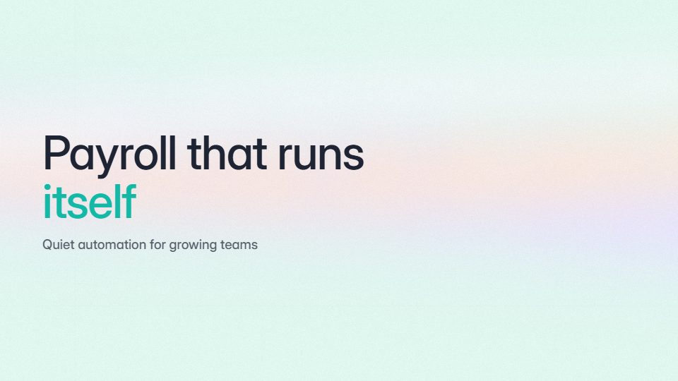

# Soft aurora SaaS promo

**Calm, light SaaS promo on a slow pastel aurora, with white cards and quiet type** · Fit for our films: **Ready: our kit builds it today** · Live demo: [`demos/demo.html#aurora-calm-saas`](../demos/demo.html#aurora-calm-saas)

## The look
Pale aurora in mint, lilac and peach (#DFF7EE, #E7E0FF, #FFE6D6, #F7F7FB) under white cards with long soft shadows; a medium grotesque in deep slate (#1E2433) and one teal accent (#14B8A6).

## How it moves
The aurora drifts the whole time, very slowly; cards rise a few pixels as they fade in and never fly; words appear at reading pace; one slow push per scene.

## Shape of a piece
A calm question, the product card appears, three benefits each on its own card, a gentle close on the logo.

## Craft rules
Nothing moves fast; the ground is the only constant motion. Shadows stay soft and consistent.

## Ask for, before building
Brand colours (or pastel defaults), 3 benefits, product screens, closing line

## Where it fits
HR, wellness or finance-ops SaaS, onboarding intros, website background loop

## Build it with our kit
shader aurora ground, screencast cards, kinetic text word-by-word, camera push, music

**Small helpers it would want (none built yet; the engine is unchanged):** None

## Tuning scale
| Energy | Pace | Camera | Density | Background | Type | Realism | Sound |
|---|---|---|---|---|---|---|---|
| −2 | −1 | 0 | −1 | +1 | −1 | 0 | −1 |

## Our director prompt
Direct this film (or these segments) in the **Soft aurora SaaS promo** style. Follow the script word for word, time everything to the voiceover clock, and show me the storyboard before building.

- **Look:** Pale aurora in mint, lilac and peach (#DFF7EE, #E7E0FF, #FFE6D6, #F7F7FB) under white cards with long soft shadows; a medium grotesque in deep slate (#1E2433) and one teal accent (#14B8A6).
- **Motion:** The aurora drifts the whole time, very slowly; cards rise a few pixels as they fade in and never fly; words appear at reading pace; one slow push per scene.
- **Shape of the piece:** A calm question, the product card appears, three benefits each on its own card, a gentle close on the logo.
- **Rules:** Nothing moves fast; the ground is the only constant motion. Shadows stay soft and consistent.
- **Ask me first for:** brand colours (or pastel defaults), 3 benefits, product screens, closing line
- **Tuning scale:** Energy −2, Pace −1, Camera 0, Density −1, Background +1, Type −1, Realism 0, Sound −1.
- **Build it with:** shader aurora ground, screencast cards, kinetic text word-by-word, camera push, music. Keep to the engine's craft rules: one primary mover, scenes that open sparse and build, text that is readable before anything ornamental moves.
