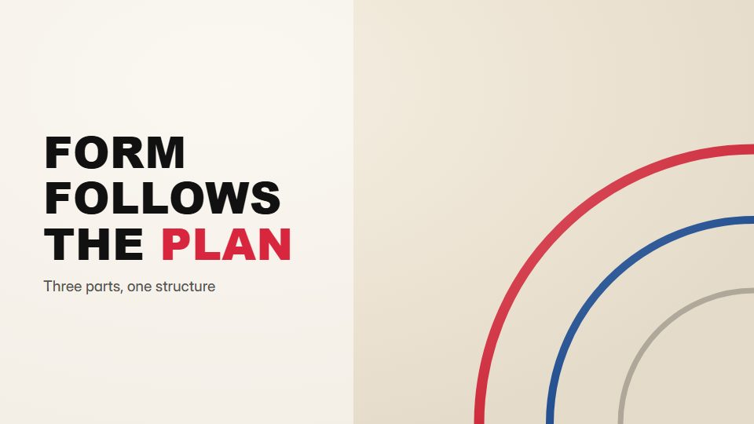

# Bauhaus geometric explainer

**Ideas built from primary circles, squares and triangles that slide, stack and recombine on a cream ground** · Fit for our films: **Adapt: needs a small helper or a stylisation** · Live demo: [`demos/demo.html#bauhaus-geometry`](../demos/demo.html#bauhaus-geometry)

## The look
Cream (#F1E9DA) with primary red (#D7263D), yellow (#F4B400), blue (#1B4F9C) and black; a geometric sans in heavy caps; flat shapes only, quarter-circles and half-discs, strict alignment.

## How it moves
Shapes enter by sliding or turning exactly 90 degrees, snap into compositions that stand for the idea, then break apart into the next; type is placed as one more block. A measured, mechanical rhythm.

## Shape of a piece
A single circle, the idea built from 3-5 shapes, a rearrangement that shows change, the final composition with the line.

## Craft rules
Three primaries plus black, all shapes on one grid; meaning comes from arrangement, not illustration.

## Ask for, before building
The idea in 3 parts, which part is the hero, the closing line

## Where it fits
Strategy or framework explainer, design-led brand film, culture or values piece

## Build it with our kit
continuity moves, living ground grid, kinetic text drop, camera (locked)

**Small helpers it would want (none built yet; the engine is unchanged):** A quarter-circle and half-disc shape set

## Tuning scale
| Energy | Pace | Camera | Density | Background | Type | Realism | Sound |
|---|---|---|---|---|---|---|---|
| 0 | 0 | −1 | 0 | 0 | +1 | −2 | 0 |

## Our director prompt
Direct this film (or these segments) in the **Bauhaus geometric explainer** style. Follow the script word for word, time everything to the voiceover clock, and show me the storyboard before building.

- **Look:** Cream (#F1E9DA) with primary red (#D7263D), yellow (#F4B400), blue (#1B4F9C) and black; a geometric sans in heavy caps; flat shapes only, quarter-circles and half-discs, strict alignment.
- **Motion:** Shapes enter by sliding or turning exactly 90 degrees, snap into compositions that stand for the idea, then break apart into the next; type is placed as one more block. A measured, mechanical rhythm.
- **Shape of the piece:** A single circle, the idea built from 3-5 shapes, a rearrangement that shows change, the final composition with the line.
- **Rules:** Three primaries plus black, all shapes on one grid; meaning comes from arrangement, not illustration.
- **Ask me first for:** the idea in 3 parts, which part is the hero, the closing line
- **Tuning scale:** Energy 0, Pace 0, Camera −1, Density 0, Background 0, Type +1, Realism −2, Sound 0.
- **Build it with:** continuity moves, living ground grid, kinetic text drop, camera (locked). Keep to the engine's craft rules: one primary mover, scenes that open sparse and build, text that is readable before anything ornamental moves.
