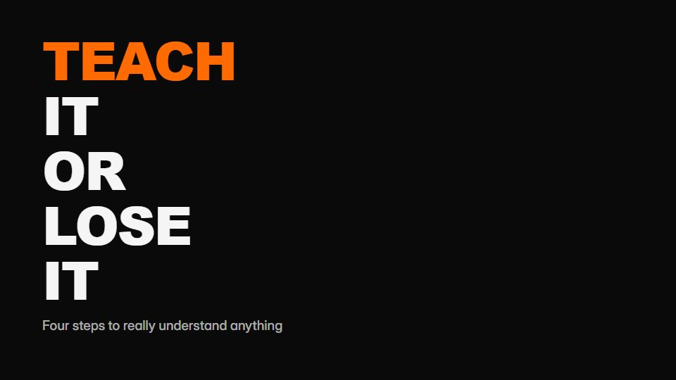

# Black-and-orange beat type

**Hard-cut typographic explainer: one word per beat, orange on black, and a final hammer line** · Fit for our films: **Ready: our kit builds it today** · Live demo: [`demos/demo.html#beat-slam-type`](../demos/demo.html#beat-slam-type)

## The look
Pure black (#0A0A0A) with hot orange words (#FF6B00) and white support words (#F5F5F5); an ultra-heavy condensed sans set very tight; no images or textures, at most one rule.

## How it moves
Each word slams in on a beat with a 2-3 frame settle and is replaced by the next; steps stack into a list, then clear. The last line lands after a beat of silence and holds longer.

## Shape of a piece
A hook word, four steps hit one per beat, a short build, the closing verdict line.

## Craft rules
Only the script's words, split at natural spoken groups; never more than one orange word per frame.

## Ask for, before building
The exact lines, the tempo or VO timings, which word in each line to colour

## Where it fits
Method or framework explainer, social cut of a talk, values or principles film

## Build it with our kit
kinetic text pop and drop, word swaps, timeline runtime on the beat, music+SFX

**Small helpers it would want (none built yet; the engine is unchanged):** None

## Tuning scale
| Energy | Pace | Camera | Density | Background | Type | Realism | Sound |
|---|---|---|---|---|---|---|---|
| +2 | +2 | −1 | −1 | −2 | +2 | −2 | +2 |

## Our director prompt
Direct this film (or these segments) in the **Black-and-orange beat type** style. Follow the script word for word, time everything to the voiceover clock, and show me the storyboard before building.

- **Look:** Pure black (#0A0A0A) with hot orange words (#FF6B00) and white support words (#F5F5F5); an ultra-heavy condensed sans set very tight; no images or textures, at most one rule.
- **Motion:** Each word slams in on a beat with a 2-3 frame settle and is replaced by the next; steps stack into a list, then clear. The last line lands after a beat of silence and holds longer.
- **Shape of the piece:** A hook word, four steps hit one per beat, a short build, the closing verdict line.
- **Rules:** Only the script's words, split at natural spoken groups; never more than one orange word per frame.
- **Ask me first for:** the exact lines, the tempo or VO timings, which word in each line to colour
- **Tuning scale:** Energy +2, Pace +2, Camera −1, Density −1, Background −2, Type +2, Realism −2, Sound +2.
- **Build it with:** kinetic text pop and drop, word swaps, timeline runtime on the beat, music+SFX. Keep to the engine's craft rules: one primary mover, scenes that open sparse and build, text that is readable before anything ornamental moves.
