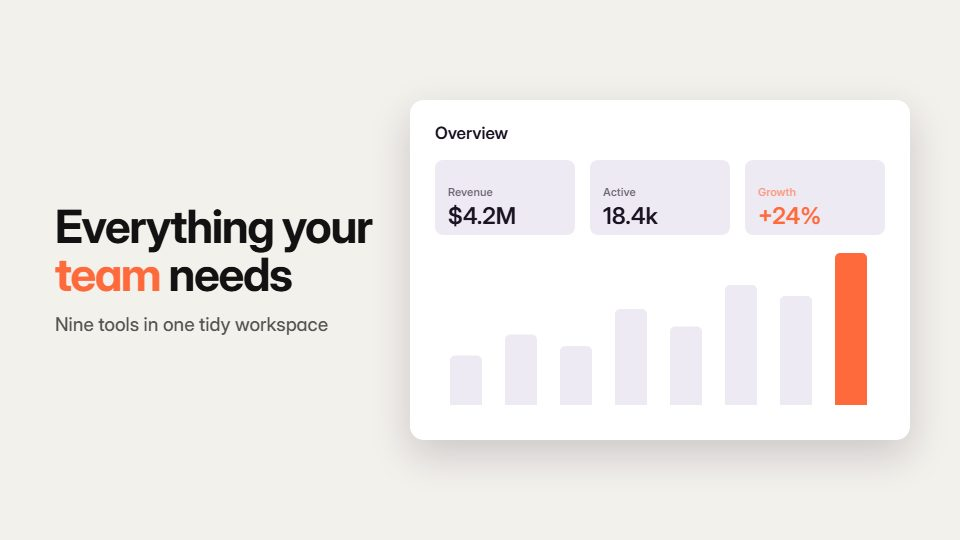

# Bento feature tour

**Features live in a bento grid of rounded tiles that reflow, swap and open one at a time** · Fit for our films: **Ready: our kit builds it today** · Live demo: [`demos/demo.html#bento-feature-tour`](../demos/demo.html#bento-feature-tour)

## The look
Off-white ground (#F3F1EC) with tiles in white, ink (#121212) and two brand tints (#FF6A3D, #3D6BFF); 24-28px corners; each tile holds one icon, number or UI crop; one bold grotesque at two sizes.

## How it moves
The grid unfolds from a single tile, reflows on the beat into new arrangements, and a click dives the camera into one tile, which becomes a full scene and then shrinks back into its slot.

## Shape of a piece
One tile, the grid unfolds, three tile dives (one feature each), the grid reflows into the logo tile.

## Craft rules
Gutters stay constant through every reflow; only one tile animates its content at a time.

## Ask for, before building
6-9 features with one visual each (icon, metric or screen crop), brand colours, logo

## Where it fits
Feature overview, release roundup, platform tour, sales deck opener

## Build it with our kit
continuity moves, camera push-ins, screencast crops, data counters, kinetic text pop, living ground

**Small helpers it would want (none built yet; the engine is unchanged):** A grid-reflow helper that tweens tile rectangles between layouts

## Tuning scale
| Energy | Pace | Camera | Density | Background | Type | Realism | Sound |
|---|---|---|---|---|---|---|---|
| 0 | +1 | +1 | +1 | −1 | 0 | 0 | 0 |

## Our director prompt
Direct this film (or these segments) in the **Bento feature tour** style. Follow the script word for word, time everything to the voiceover clock, and show me the storyboard before building.

- **Look:** Off-white ground (#F3F1EC) with tiles in white, ink (#121212) and two brand tints (#FF6A3D, #3D6BFF); 24-28px corners; each tile holds one icon, number or UI crop; one bold grotesque at two sizes.
- **Motion:** The grid unfolds from a single tile, reflows on the beat into new arrangements, and a click dives the camera into one tile, which becomes a full scene and then shrinks back into its slot.
- **Shape of the piece:** One tile, the grid unfolds, three tile dives (one feature each), the grid reflows into the logo tile.
- **Rules:** Gutters stay constant through every reflow; only one tile animates its content at a time.
- **Ask me first for:** 6-9 features with one visual each (icon, metric or screen crop), brand colours, logo
- **Tuning scale:** Energy 0, Pace +1, Camera +1, Density +1, Background −1, Type 0, Realism 0, Sound 0.
- **Build it with:** continuity moves, camera push-ins, screencast crops, data counters, kinetic text pop, living ground. Keep to the engine's craft rules: one primary mover, scenes that open sparse and build, text that is readable before anything ornamental moves.
