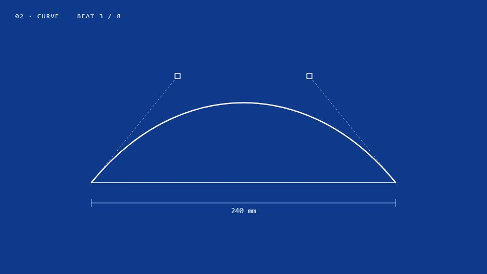

# Line evolution / blueprint drafting

**One line keeps being re-inked: pencil on paper, then blueprint, then light** · Fit for our films: **Adapt: needs a small helper or a stylisation** · Live demo: [`demos/demo.html#blueprint-line`](../demos/demo.html#blueprint-line)

## The look
Three inks for the same geometry: pencil on cream graph paper, white line on blueprint blue, and a lit line on black with a bright core and scan-line fills. A 60 px grid with every fifth line stronger. Each stage's accent becomes the next stage's base colour.

## How it moves
The camera is locked like a drafting table; objects turn instead. One line never leaves the screen. It becomes rails, curves with handles, shapes, tiles, gears and panels. Scene changes use a hard-edged shape flood or a single scan line.

## Shape of a piece
A line, then type, curve, shape, tile, solid, mechanism, panel, data and lockup, one idea per bar.

## Craft rules
Keep a margin clear (nothing at rest near the edges). No glows; light comes from line density. A corner label carries chapter and beat count.

## Ask for, before building
The "promotion" story (what the line becomes), three inks.

## Where it fits
Engineering or product-design stories, from concept to product.

## Build it with our kit
hand-drawn strokes, dot/grid ground, isometric.

**Small helpers it would want (none built yet; the engine is unchanged):** Ink swap (one geometry, three renderers), hatching fill, dimension lines with live numbers.

## Tuning scale
| Energy | Pace | Camera | Density | Background | Type | Realism | Sound |
|---|---|---|---|---|---|---|---|
| +1 | +1 | −2 | 0 | 0 | +1 | −2 | 0 |

## Our director prompt
Direct this film (or these segments) in the **Line evolution / blueprint drafting** style. Follow the script word for word, time everything to the voiceover clock, and show me the storyboard before building.

- **Look:** three inks for the same geometry: pencil on cream graph paper, white line on blueprint blue, and a lit line on black with a bright core and scan-line fills. A 60 px grid with every fifth line stronger. Each stage's accent becomes the next stage's base colour.
- **Motion:** the camera is locked like a drafting table; objects turn instead. One line never leaves the screen. It becomes rails, curves with handles, shapes, tiles, gears and panels. Scene changes use a hard-edged shape flood or a single scan line.
- **Shape of the piece:** a line, then type, curve, shape, tile, solid, mechanism, panel, data and lockup, one idea per bar.
- **Rules:** keep a margin clear (nothing at rest near the edges). No glows; light comes from line density. A corner label carries chapter and beat count.
- **Ask me first for:** the "promotion" story (what the line becomes), three inks.
- **Tuning scale:** Energy +1, Pace +1, Camera −2, Density 0, Background 0, Type +1, Realism −2, Sound 0.
- **Build it with:** hand-drawn strokes, dot/grid ground, isometric.. Keep to the engine's craft rules: one primary mover, scenes that open sparse and build, text that is readable before anything ornamental moves.
