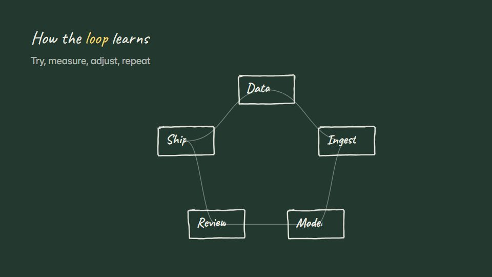

# Chalkboard lesson

**A classroom-board explainer: chalk lines, handwritten headings and diagrams wiped and redrawn as the lesson moves on** · Fit for our films: **Ready: our kit builds it today** · Live demo: [`demos/demo.html#chalkboard-lesson`](../demos/demo.html#chalkboard-lesson)

## The look
Board green (#23382F) with chalk white (#EDEDE4), chalk yellow (#F3D66B) and pink (#F29CA3); dusty grain and faint smudges; handwriting for headings, a simple print hand for labels.

## How it moves
Strokes draw on at chalk speed with a little dust; an eraser swipe clears room for the next idea; arrows and rings are added as the narration stresses a point; the camera drifts across a wide board.

## Shape of a piece
The lesson title, the core diagram drawn, three annotations, an erase-and-redraw for the twist, the summary boxed.

## Craft rules
The board is never full: erase before it gets busy. One colour is kept for emphasis.

## Ask for, before building
The lesson points, the key diagram, the summary line

## Where it fits
Training and enablement, how-it-works lesson, partner or academic education

## Build it with our kit
hand-drawn strokes and handwriting, living ground (grain), shader grain, camera travel

**Small helpers it would want (none built yet; the engine is unchanged):** An eraser-wipe mask

## Tuning scale
| Energy | Pace | Camera | Density | Background | Type | Realism | Sound |
|---|---|---|---|---|---|---|---|
| −1 | −1 | 0 | 0 | 0 | 0 | −1 | −1 |

## Our director prompt
Direct this film (or these segments) in the **Chalkboard lesson** style. Follow the script word for word, time everything to the voiceover clock, and show me the storyboard before building.

- **Look:** Board green (#23382F) with chalk white (#EDEDE4), chalk yellow (#F3D66B) and pink (#F29CA3); dusty grain and faint smudges; handwriting for headings, a simple print hand for labels.
- **Motion:** Strokes draw on at chalk speed with a little dust; an eraser swipe clears room for the next idea; arrows and rings are added as the narration stresses a point; the camera drifts across a wide board.
- **Shape of the piece:** The lesson title, the core diagram drawn, three annotations, an erase-and-redraw for the twist, the summary boxed.
- **Rules:** The board is never full: erase before it gets busy. One colour is kept for emphasis.
- **Ask me first for:** the lesson points, the key diagram, the summary line
- **Tuning scale:** Energy −1, Pace −1, Camera 0, Density 0, Background 0, Type 0, Realism −1, Sound −1.
- **Build it with:** hand-drawn strokes and handwriting, living ground (grain), shader grain, camera travel. Keep to the engine's craft rules: one primary mover, scenes that open sparse and build, text that is readable before anything ornamental moves.
