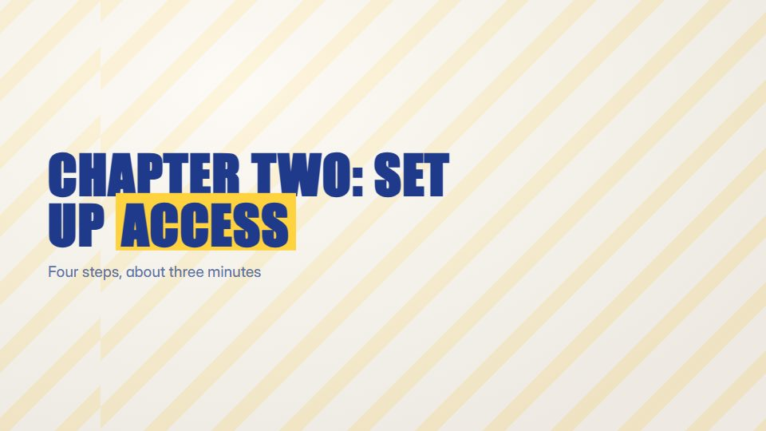

# Chaptered course module

**Long-form lesson in clear chapters, with a progress rail, chapter cards, worked steps and a recap** · Fit for our films: **Ready: our kit builds it today** · Live demo: [`demos/demo.html#chaptered-course-module`](../demos/demo.html#chaptered-course-module)

## The look
Paper-white (#FBFAF7) with deep blue ink (#1F3A8A) and a yellow marker (#FFD23F); big chapter numerals in a condensed grotesque; a thin progress rail along the bottom with a tick per chapter.

## How it moves
Each chapter opens with its numeral sliding in and the rail advancing; steps reveal one at a time with checkmarks drawing on; recap rows tick off in order. Calm pace with long readable holds.

## Shape of a piece
Title, 5-7 chapters (opening card, steps, one tip), a recap list, a next-step card.

## Craft rules
One chapter carries one idea; captions are short and verbatim, and the rail always shows where the viewer is.

## Ask for, before building
The chapter list, steps per chapter, screenshots, recap points

## Where it fits
Onboarding course, knowledge transfer, internal training, product academy

## Build it with our kit
screencast parts, kinetic text, hand-drawn ticks, data notes, living ground

**Small helpers it would want (none built yet; the engine is unchanged):** A chapter progress-rail component

## Tuning scale
| Energy | Pace | Camera | Density | Background | Type | Realism | Sound |
|---|---|---|---|---|---|---|---|
| −1 | −1 | 0 | 0 | −1 | 0 | +1 | −1 |

## Our director prompt
Direct this film (or these segments) in the **Chaptered course module** style. Follow the script word for word, time everything to the voiceover clock, and show me the storyboard before building.

- **Look:** Paper-white (#FBFAF7) with deep blue ink (#1F3A8A) and a yellow marker (#FFD23F); big chapter numerals in a condensed grotesque; a thin progress rail along the bottom with a tick per chapter.
- **Motion:** Each chapter opens with its numeral sliding in and the rail advancing; steps reveal one at a time with checkmarks drawing on; recap rows tick off in order. Calm pace with long readable holds.
- **Shape of the piece:** Title, 5-7 chapters (opening card, steps, one tip), a recap list, a next-step card.
- **Rules:** One chapter carries one idea; captions are short and verbatim, and the rail always shows where the viewer is.
- **Ask me first for:** the chapter list, steps per chapter, screenshots, recap points
- **Tuning scale:** Energy −1, Pace −1, Camera 0, Density 0, Background −1, Type 0, Realism +1, Sound −1.
- **Build it with:** screencast parts, kinetic text, hand-drawn ticks, data notes, living ground. Keep to the engine's craft rules: one primary mover, scenes that open sparse and build, text that is readable before anything ornamental moves.
