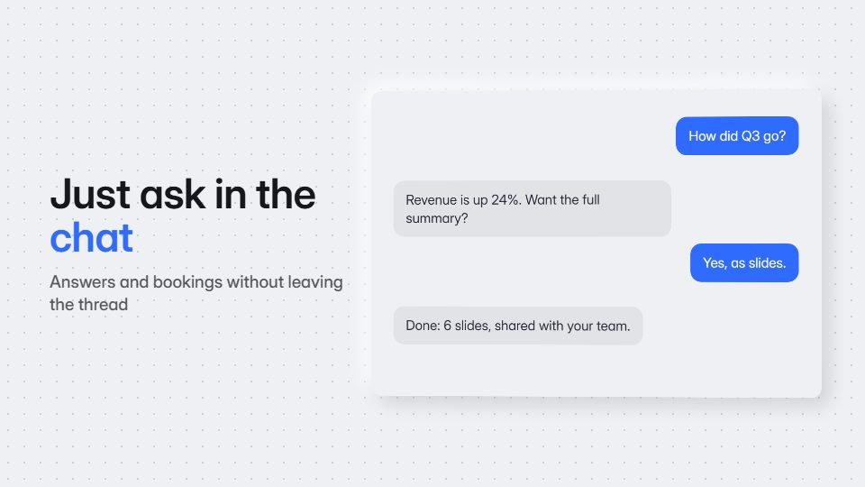

# Chat-thread story

**The product story is told as a conversation: bubbles, typing dots, attachments and a reply that does the job** · Fit for our films: **Ready: our kit builds it today** · Live demo: [`demos/demo.html#chat-thread-story`](../demos/demo.html#chat-thread-story)

## The look
Soft neutral ground (#EEF0F3) with a centred thread; user bubbles in ink (#15171C), product bubbles in white with an accent edge (#2F6BFF); rich cards (charts, bookings, files) inside replies; a friendly rounded grotesque.

## How it moves
Bubbles spring up from the composer, typing dots breathe before each reply, an attachment grows out of its bubble into a full card and folds back; the camera drifts to follow the newest message.

## Shape of a piece
The question types, the product replies, a rich card expands, a follow-up action completes, a confirmation toast and the name.

## Craft rules
Short, glanceable messages and never more than four bubbles on screen; the product speaks in the accent, the user stays neutral.

## Ask for, before building
A real user question and the answer, 2-3 rich result cards, brand accent and avatar

## Where it fits
Assistant or support-bot promo, messaging feature launch, customer-service explainer

## Build it with our kit
screencast lists, typed inputs, toasts and modals, camera push-ins, kinetic text, music+SFX (pops)

**Small helpers it would want (none built yet; the engine is unchanged):** A chat-bubble component with a typing indicator

## Tuning scale
| Energy | Pace | Camera | Density | Background | Type | Realism | Sound |
|---|---|---|---|---|---|---|---|
| 0 | 0 | 0 | 0 | −1 | −1 | +1 | 0 |

## Our director prompt
Direct this film (or these segments) in the **Chat-thread story** style. Follow the script word for word, time everything to the voiceover clock, and show me the storyboard before building.

- **Look:** Soft neutral ground (#EEF0F3) with a centred thread; user bubbles in ink (#15171C), product bubbles in white with an accent edge (#2F6BFF); rich cards (charts, bookings, files) inside replies; a friendly rounded grotesque.
- **Motion:** Bubbles spring up from the composer, typing dots breathe before each reply, an attachment grows out of its bubble into a full card and folds back; the camera drifts to follow the newest message.
- **Shape of the piece:** The question types, the product replies, a rich card expands, a follow-up action completes, a confirmation toast and the name.
- **Rules:** Short, glanceable messages and never more than four bubbles on screen; the product speaks in the accent, the user stays neutral.
- **Ask me first for:** a real user question and the answer, 2-3 rich result cards, brand accent and avatar
- **Tuning scale:** Energy 0, Pace 0, Camera 0, Density 0, Background −1, Type −1, Realism +1, Sound 0.
- **Build it with:** screencast lists, typed inputs, toasts and modals, camera push-ins, kinetic text, music+SFX (pops). Keep to the engine's craft rules: one primary mover, scenes that open sparse and build, text that is readable before anything ornamental moves.
