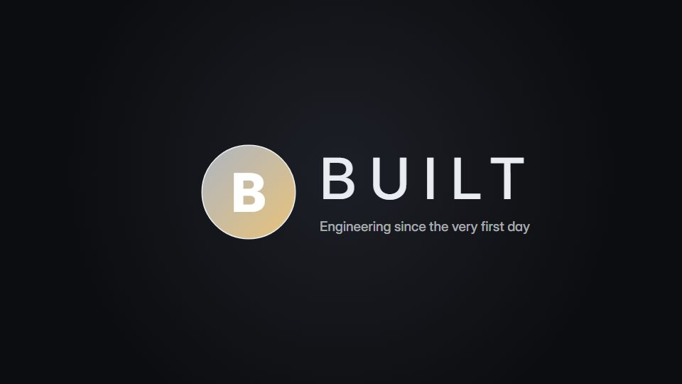

# Chrome-glint ident

**The mark assembles from faceted shards and is finished in polished metal, with one light glint across it** · Fit for our films: **Ready: our kit builds it today** · Live demo: [`demos/demo.html#chrome-glint-ident`](../demos/demo.html#chrome-glint-ident)

## The look
Deep charcoal (#0C0D10) with a cool steel gradient mark (#E9EDF2 to #6B7380) and an optional warm gold variant (#E8C27A); a wide, lightly tracked grotesque for the name.

## How it moves
An outline of the mark draws first, faceted shards fly in and lock one by one, the surface turns to metal, a single glint sweeps across, then the name types out letter by letter.

## Shape of a piece
Outline, shard assembly, metal finish, glint, name and tagline.

## Craft rules
Use the real logo geometry; the glint happens once, and the hold is long enough to read.

## Ask for, before building
Vector logo, preferred metal (steel, gold, glass), tagline, length

## Where it fits
Film open and close, premium brand ident, event bumper

## Build it with our kit
hand-drawn stroke draw-on, kinetic text letter-by-letter, living ground sweeps, shader grain

**Small helpers it would want (none built yet; the engine is unchanged):** A metallic gradient fill with a moving specular band; shard split of an SVG shape

## Tuning scale
| Energy | Pace | Camera | Density | Background | Type | Realism | Sound |
|---|---|---|---|---|---|---|---|
| 0 | 0 | 0 | −2 | −1 | 0 | 0 | 0 |

## Our director prompt
Direct this film (or these segments) in the **Chrome-glint ident** style. Follow the script word for word, time everything to the voiceover clock, and show me the storyboard before building.

- **Look:** Deep charcoal (#0C0D10) with a cool steel gradient mark (#E9EDF2 to #6B7380) and an optional warm gold variant (#E8C27A); a wide, lightly tracked grotesque for the name.
- **Motion:** An outline of the mark draws first, faceted shards fly in and lock one by one, the surface turns to metal, a single glint sweeps across, then the name types out letter by letter.
- **Shape of the piece:** Outline, shard assembly, metal finish, glint, name and tagline.
- **Rules:** Use the real logo geometry; the glint happens once, and the hold is long enough to read.
- **Ask me first for:** vector logo, preferred metal (steel, gold, glass), tagline, length
- **Tuning scale:** Energy 0, Pace 0, Camera 0, Density −2, Background −1, Type 0, Realism 0, Sound 0.
- **Build it with:** hand-drawn stroke draw-on, kinetic text letter-by-letter, living ground sweeps, shader grain. Keep to the engine's craft rules: one primary mover, scenes that open sparse and build, text that is readable before anything ornamental moves.
