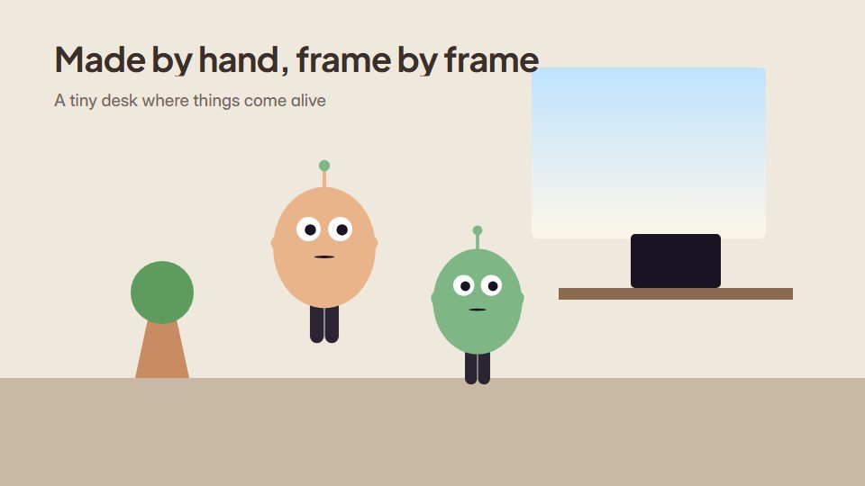

# Claymation-look loop

**A tiny set of soft clay objects and characters animated on twos, like a stop-motion desk loop** · Fit for our films: **Adapt: needs a small helper or a stylisation** · Live demo: [`demos/demo.html#claymation-look-loop`](../demos/demo.html#claymation-look-loop)

## The look
Soft clay colours (#F3E0C4, #E9B48A, #7FB685, #4F6D8F) with rounded, slightly lumpy shapes, faint thumbprint texture, a soft studio shadow and a shallow-focus background.

## How it moves
Everything moves on twos (about 12 poses a second) for the stop-motion step; objects squash a little as they land; a small loop runs (a paper plane circling, steam rising) with a slight frame-to-frame texture boil.

## Shape of a piece
The little set, the hero object comes alive, a playful moment, the loop closes on the name.

## Craft rules
Keep the step on twos for everything, camera included; nothing perfectly smooth or perfectly geometric.

## Ask for, before building
The set objects, the playful action, loop length, palette

## Where it fits
Friendly product loop, social or website hero, holiday card, onboarding moment

## Build it with our kit
living ground washes, shader grain, camera (locked), kinetic text, music+SFX

**Small helpers it would want (none built yet; the engine is unchanged):** A hold-on-twos time quantiser; a clay texture with slight boil

## Tuning scale
| Energy | Pace | Camera | Density | Background | Type | Realism | Sound |
|---|---|---|---|---|---|---|---|
| 0 | −1 | −1 | −1 | 0 | −1 | 0 | 0 |

## Our director prompt
Direct this film (or these segments) in the **Claymation-look loop** style. Follow the script word for word, time everything to the voiceover clock, and show me the storyboard before building.

- **Look:** Soft clay colours (#F3E0C4, #E9B48A, #7FB685, #4F6D8F) with rounded, slightly lumpy shapes, faint thumbprint texture, a soft studio shadow and a shallow-focus background.
- **Motion:** Everything moves on twos (about 12 poses a second) for the stop-motion step; objects squash a little as they land; a small loop runs (a paper plane circling, steam rising) with a slight frame-to-frame texture boil.
- **Shape of the piece:** The little set, the hero object comes alive, a playful moment, the loop closes on the name.
- **Rules:** Keep the step on twos for everything, camera included; nothing perfectly smooth or perfectly geometric.
- **Ask me first for:** the set objects, the playful action, loop length, palette
- **Tuning scale:** Energy 0, Pace −1, Camera −1, Density −1, Background 0, Type −1, Realism 0, Sound 0.
- **Build it with:** living ground washes, shader grain, camera (locked), kinetic text, music+SFX. Keep to the engine's craft rules: one primary mover, scenes that open sparse and build, text that is readable before anything ornamental moves.
