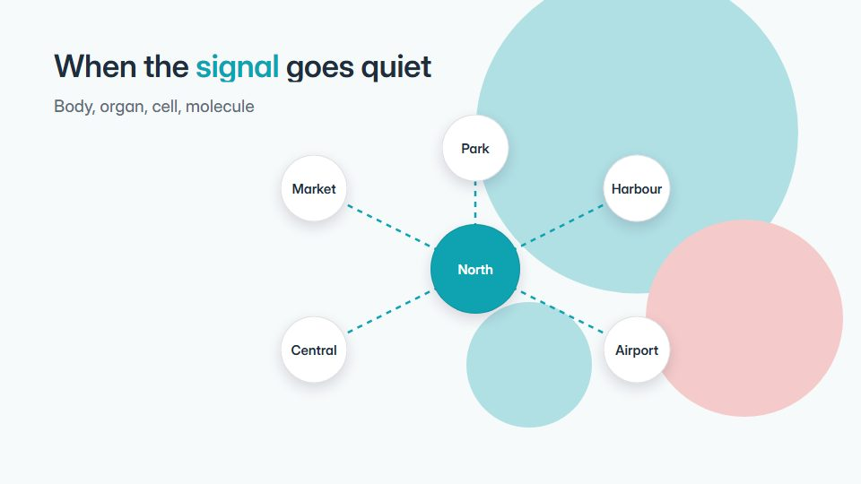

# Clinical system cutaway

**Zooms from a full-body view to a single molecule in clean clinical flat art, with a toggle between working and broken states** · Fit for our films: **Adapt: needs a small helper or a stylisation** · Live demo: [`demos/demo.html#clinical-system-cutaway`](../demos/demo.html#clinical-system-cutaway)

## The look
Clinical white (#F7FAFB) with soft teal (#0FA3B1), coral for failure (#F25F5C) and deep slate text (#1F2D3D); flat organ silhouettes, soft rounded shapes, pulse dots for signals; a humanist sans.

## How it moves
Zoom smoothly from body to organ to cell to molecule, each level fading its context; a signal pulse travels between parts; a slider moves from intact to broken and the pulses fade out.

## Shape of a piece
The body view and the common myth, the healthy loop, zoom to the cause, the broken state, what the treatment or product changes.

## Craft rules
Medically accurate wording and no fear imagery; each zoom level has one label and one fact.

## Ask for, before building
Reviewed medical facts, the levels to zoom through, the product's role, disclaimer

## Where it fits
Medtech or digital-health explainer, patient education, clinical training

## Build it with our kit
camera zoom (scale dive), diagram strokes, data counters, kinetic text, living ground

**Small helpers it would want (none built yet; the engine is unchanged):** A slider control that drives a state value

## Tuning scale
| Energy | Pace | Camera | Density | Background | Type | Realism | Sound |
|---|---|---|---|---|---|---|---|
| −1 | −1 | +2 | 0 | −1 | −1 | −1 | −1 |

## Our director prompt
Direct this film (or these segments) in the **Clinical system cutaway** style. Follow the script word for word, time everything to the voiceover clock, and show me the storyboard before building.

- **Look:** Clinical white (#F7FAFB) with soft teal (#0FA3B1), coral for failure (#F25F5C) and deep slate text (#1F2D3D); flat organ silhouettes, soft rounded shapes, pulse dots for signals; a humanist sans.
- **Motion:** Zoom smoothly from body to organ to cell to molecule, each level fading its context; a signal pulse travels between parts; a slider moves from intact to broken and the pulses fade out.
- **Shape of the piece:** The body view and the common myth, the healthy loop, zoom to the cause, the broken state, what the treatment or product changes.
- **Rules:** Medically accurate wording and no fear imagery; each zoom level has one label and one fact.
- **Ask me first for:** reviewed medical facts, the levels to zoom through, the product's role, disclaimer
- **Tuning scale:** Energy −1, Pace −1, Camera +2, Density 0, Background −1, Type −1, Realism −1, Sound −1.
- **Build it with:** camera zoom (scale dive), diagram strokes, data counters, kinetic text, living ground. Keep to the engine's craft rules: one primary mover, scenes that open sparse and build, text that is readable before anything ornamental moves.
