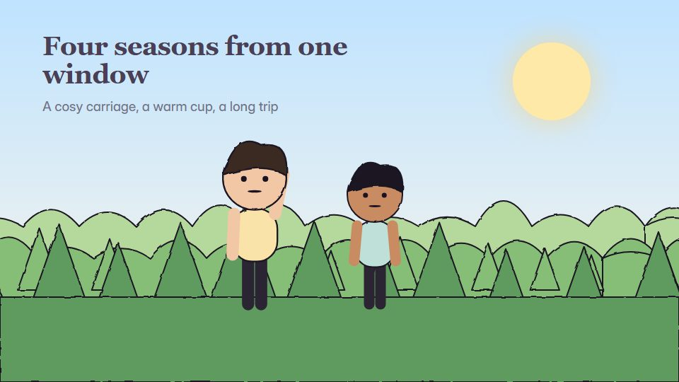

# Cosy pastel picture-book

**Symmetrical, sugared-pastel scenes where the world changes outside a window while the inside stays cosy** · Fit for our films: **Adapt: needs a small helper or a stylisation** · Live demo: [`demos/demo.html#cosy-pastel-picturebook`](../demos/demo.html#cosy-pastel-picturebook)

## The look
Centred, symmetrical compositions in pastels (#F7C6C7, #BFE0D9, #F9E3A9, #C9B6E4) with tidy rounded characters, little props and frame-within-frame windows; soft shadows; a charming serif title in plum (#4A3F55).

## How it moves
Straight, centred camera moves (a level push, a level pan); seasons or times of day change outside a window while the inside stays warm; characters loop small actions (sip, wave, nod).

## Shape of a piece
The cosy room, the world outside changes over four beats, a visitor or message arrives, the warm close.

## Craft rules
Symmetry and centring are the signature; moves run in straight lines, never diagonals, and the tone stays calm and kind.

## Ask for, before building
The script, the setting (room, carriage, shop), the four changes, palette

## Where it fits
Seasonal or holiday brand film, customer thank-you, hospitality or travel promo, wellbeing message

## Build it with our kit
camera push and pan, living ground washes, hand-drawn strokes, kinetic text, music

**Small helpers it would want (none built yet; the engine is unchanged):** A frame-within-frame window mask

## Tuning scale
| Energy | Pace | Camera | Density | Background | Type | Realism | Sound |
|---|---|---|---|---|---|---|---|
| −1 | −1 | 0 | 0 | +1 | −1 | −1 | −1 |

## Our director prompt
Direct this film (or these segments) in the **Cosy pastel picture-book** style. Follow the script word for word, time everything to the voiceover clock, and show me the storyboard before building.

- **Look:** Centred, symmetrical compositions in pastels (#F7C6C7, #BFE0D9, #F9E3A9, #C9B6E4) with tidy rounded characters, little props and frame-within-frame windows; soft shadows; a charming serif title in plum (#4A3F55).
- **Motion:** Straight, centred camera moves (a level push, a level pan); seasons or times of day change outside a window while the inside stays warm; characters loop small actions (sip, wave, nod).
- **Shape of the piece:** The cosy room, the world outside changes over four beats, a visitor or message arrives, the warm close.
- **Rules:** Symmetry and centring are the signature; moves run in straight lines, never diagonals, and the tone stays calm and kind.
- **Ask me first for:** the script, the setting (room, carriage, shop), the four changes, palette
- **Tuning scale:** Energy −1, Pace −1, Camera 0, Density 0, Background +1, Type −1, Realism −1, Sound −1.
- **Build it with:** camera push and pan, living ground washes, hand-drawn strokes, kinetic text, music. Keep to the engine's craft rules: one primary mover, scenes that open sparse and build, text that is readable before anything ornamental moves.
