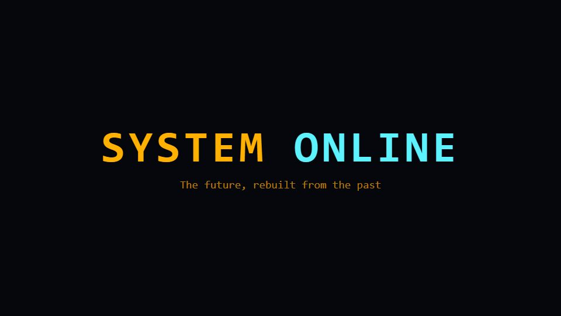

# CRT retro-future launch

**A retro-futurist launch seen through a curved phosphor screen: scanlines, bloom and warm grain** · Fit for our films: **Adapt: needs a small helper or a stylisation** · Live demo: [`demos/demo.html#crt-retro-future`](../demos/demo.html#crt-retro-future)

## The look
Deep blue-black (#05070D) with amber (#FFB000) and phosphor cyan (#5CF2FF); a monospace or squared display face; scanlines, slight barrel curve, glow on bright edges, warm film grain.

## How it moves
Pictures power on from a thin horizontal line, text types behind a block cursor, scenes roll vertically like a slipping signal and then lock. Steady tempo; a one-frame flicker only on hits.

## Shape of a piece
Power-on, a terminal greeting, three short claims as screens, a signal-roll transition, the logo burned in.

## Craft rules
Keep curve and scanlines light enough that copy stays crisp; one flicker per section, never constant.

## Ask for, before building
Logo, 3 lines of copy, accent (amber or cyan), product screens to show on the monitor

## Where it fits
Developer or gaming-adjacent launch, anniversary nostalgia piece, event opener

## Build it with our kit
shader grain, kinetic text letter-by-letter, screencast windows, living ground sweeps, music+SFX

**Small helpers it would want (none built yet; the engine is unchanged):** A CRT post pass (scanlines, curvature, bloom)

## Tuning scale
| Energy | Pace | Camera | Density | Background | Type | Realism | Sound |
|---|---|---|---|---|---|---|---|
| +1 | 0 | −1 | 0 | +1 | +1 | −1 | +1 |

## Our director prompt
Direct this film (or these segments) in the **CRT retro-future launch** style. Follow the script word for word, time everything to the voiceover clock, and show me the storyboard before building.

- **Look:** Deep blue-black (#05070D) with amber (#FFB000) and phosphor cyan (#5CF2FF); a monospace or squared display face; scanlines, slight barrel curve, glow on bright edges, warm film grain.
- **Motion:** Pictures power on from a thin horizontal line, text types behind a block cursor, scenes roll vertically like a slipping signal and then lock. Steady tempo; a one-frame flicker only on hits.
- **Shape of the piece:** Power-on, a terminal greeting, three short claims as screens, a signal-roll transition, the logo burned in.
- **Rules:** Keep curve and scanlines light enough that copy stays crisp; one flicker per section, never constant.
- **Ask me first for:** logo, 3 lines of copy, accent (amber or cyan), product screens to show on the monitor
- **Tuning scale:** Energy +1, Pace 0, Camera −1, Density 0, Background +1, Type +1, Realism −1, Sound +1.
- **Build it with:** shader grain, kinetic text letter-by-letter, screencast windows, living ground sweeps, music+SFX. Keep to the engine's craft rules: one primary mover, scenes that open sparse and build, text that is readable before anything ornamental moves.
