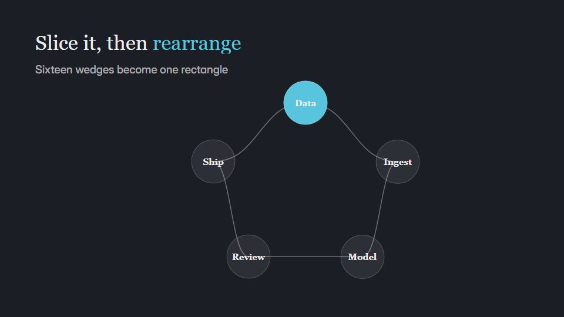

# Dark-slate math visual

**Calm mathematical visualisation on dark slate: shapes physically rearrange to make the point while formulas build term by term** · Fit for our films: **Ready: our kit builds it today** · Live demo: [`demos/demo.html#dark-slate-math`](../demos/demo.html#dark-slate-math)

## The look
Slate (#1C1E26) with soft blue (#58C4DD), yellow (#FFD166) and green (#83C167) strokes; a classic serif for formulas, a light grotesque for labels; clean lines without glow, shape fills at about 60%.

## How it moves
Shapes split, slide and recombine on smooth paths; equations write themselves term by term, each term sharing the colour of its shape; the camera reframes slowly, one transformation at a time.

## Shape of a piece
A question, the object, slicing or transforming it step by step, the formula assembles, the result holds.

## Craft rules
Colour ties symbol to shape; no term appears before its shape has moved. Hold the result.

## Ask for, before building
The concept or algorithm, the exact formula or result, the step sequence

## Where it fits
Pricing or ROI logic, algorithm explainer, technical product concept, training

## Build it with our kit
hand-drawn strokes draw-on, kinetic text letter-by-letter, continuity moves, data notes

**Small helpers it would want (none built yet; the engine is unchanged):** A small formula typesetter (fractions, superscripts)

## Tuning scale
| Energy | Pace | Camera | Density | Background | Type | Realism | Sound |
|---|---|---|---|---|---|---|---|
| −1 | −1 | 0 | −1 | −2 | 0 | −2 | −1 |

## Our director prompt
Direct this film (or these segments) in the **Dark-slate math visual** style. Follow the script word for word, time everything to the voiceover clock, and show me the storyboard before building.

- **Look:** Slate (#1C1E26) with soft blue (#58C4DD), yellow (#FFD166) and green (#83C167) strokes; a classic serif for formulas, a light grotesque for labels; clean lines without glow, shape fills at about 60%.
- **Motion:** Shapes split, slide and recombine on smooth paths; equations write themselves term by term, each term sharing the colour of its shape; the camera reframes slowly, one transformation at a time.
- **Shape of the piece:** A question, the object, slicing or transforming it step by step, the formula assembles, the result holds.
- **Rules:** Colour ties symbol to shape; no term appears before its shape has moved. Hold the result.
- **Ask me first for:** the concept or algorithm, the exact formula or result, the step sequence
- **Tuning scale:** Energy −1, Pace −1, Camera 0, Density −1, Background −2, Type 0, Realism −2, Sound −1.
- **Build it with:** hand-drawn strokes draw-on, kinetic text letter-by-letter, continuity moves, data notes. Keep to the engine's craft rules: one primary mover, scenes that open sparse and build, text that is readable before anything ornamental moves.
