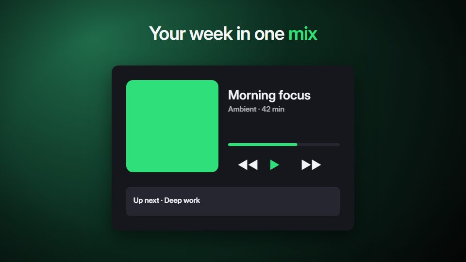

# Dark stage showcase

**The product plays inside one large rounded black stage, with a soft brand-tinted atmosphere glowing around it** · Fit for our films: **Ready: our kit builds it today** · Live demo: [`demos/demo.html#dark-stage-showcase`](../demos/demo.html#dark-stage-showcase)

## The look
A near-black rounded stage (#0E0F11) fills about 80% of the frame; outside it a misty glow (#1F6B4A fading to #050807). White grotesque headlines, muted grey (#8A8F98) secondary text, one bright accent (#2FE07A) kept for controls.

## How it moves
The stage lands first and then stays put; content inside rises and swaps with short glides while the outer glow drifts. The camera is locked; all scale change happens inside the stage.

## Shape of a piece
Icon grows in the stage, the hero artwork or screen settles, three feature swaps inside the same frame, a quiet end card with the mark.

## Craft rules
Compact, centred compositions with plenty of black; type stays modest, like an ad, not a slide title. Nothing outside the stage but the glow.

## Ask for, before building
Brand accent, hero artwork or screen, three feature moments, end line

## Where it fits
App feature launch, media or content product promo, website hero loop, event screen

## Build it with our kit
screencast windows and lists, living ground washes, kinetic text rise, camera (locked), music+SFX

**Small helpers it would want (none built yet; the engine is unchanged):** A stage-frame helper (rounded clip with an outer atmospheric wash)

## Tuning scale
| Energy | Pace | Camera | Density | Background | Type | Realism | Sound |
|---|---|---|---|---|---|---|---|
| −1 | 0 | −1 | −1 | 0 | −1 | 0 | 0 |

## Our director prompt
Direct this film (or these segments) in the **Dark stage showcase** style. Follow the script word for word, time everything to the voiceover clock, and show me the storyboard before building.

- **Look:** A near-black rounded stage (#0E0F11) fills about 80% of the frame; outside it a misty glow (#1F6B4A fading to #050807). White grotesque headlines, muted grey (#8A8F98) secondary text, one bright accent (#2FE07A) kept for controls.
- **Motion:** The stage lands first and then stays put; content inside rises and swaps with short glides while the outer glow drifts. The camera is locked; all scale change happens inside the stage.
- **Shape of the piece:** Icon grows in the stage, the hero artwork or screen settles, three feature swaps inside the same frame, a quiet end card with the mark.
- **Rules:** Compact, centred compositions with plenty of black; type stays modest, like an ad, not a slide title. Nothing outside the stage but the glow.
- **Ask me first for:** brand accent, hero artwork or screen, three feature moments, end line
- **Tuning scale:** Energy −1, Pace 0, Camera −1, Density −1, Background 0, Type −1, Realism 0, Sound 0.
- **Build it with:** screencast windows and lists, living ground washes, kinetic text rise, camera (locked), music+SFX. Keep to the engine's craft rules: one primary mover, scenes that open sparse and build, text that is readable before anything ornamental moves.
