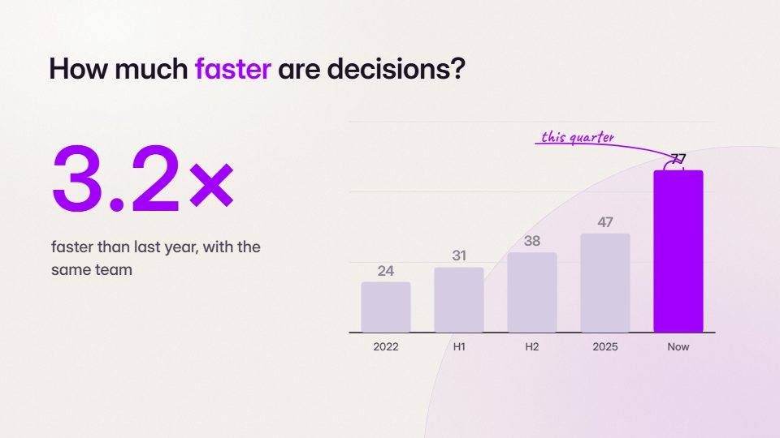

# Data story and numbers

**Counters, scale comparisons, unit marbles, charts that act** · Fit for our films: **Ready: our kit builds it today** · Live demo: [`demos/demo.html#data-story`](../demos/demo.html#data-story)

## The look
Tabular numerals, fixed unit labels, one highlight colour, plenty of air, hatched/solid/outline states for past, present and future.

## How it moves
Numbers roll only while moving and then settle sharply. Counters run on the film's global clock, so they keep running through cutaways. A line chart draws from the same function that moves a dot. The current bar fills solid while earlier bars are hatched. One-unit changes are staged as the decisive event.

## Shape of a piece
The question, the scale reference, the reveal number, the comparison, the meaning line.

## Craft rules
A frozen counter means a broken render. Real data, honest uncertainty. Lay results out so they compare at a glance.

## Ask for, before building
A data file with source, the one number that matters, the comparison.

## Where it fits
Results, ROI, executive summaries, annual reviews.

## Build it with our kit
data storytelling (bars, lines, donut, counters, unit charts, pinned notes).

**Small helpers it would want (none built yet; the engine is unchanged):** A global-clock counter mode; a chart-follows-dot coupling; past/now/future bar states.

## Tuning scale
| Energy | Pace | Camera | Density | Background | Type | Realism | Sound |
|---|---|---|---|---|---|---|---|
| 0 | 0 | 0 | 0 | −1 | 0 | 0 | −1 |

## Our director prompt
Direct this film (or these segments) in the **Data story and numbers** style. Follow the script word for word, time everything to the voiceover clock, and show me the storyboard before building.

- **Look:** tabular numerals, fixed unit labels, one highlight colour, plenty of air, hatched/solid/outline states for past, present and future.
- **Motion:** numbers roll only while moving and then settle sharply. Counters run on the film's global clock, so they keep running through cutaways. A line chart draws from the same function that moves a dot. The current bar fills solid while earlier bars are hatched. One-unit changes are staged as the decisive event.
- **Shape of the piece:** the question, the scale reference, the reveal number, the comparison, the meaning line.
- **Rules:** a frozen counter means a broken render. Real data, honest uncertainty. Lay results out so they compare at a glance.
- **Ask me first for:** a data file with source, the one number that matters, the comparison.
- **Tuning scale:** Energy 0, Pace 0, Camera 0, Density 0, Background −1, Type 0, Realism 0, Sound −1.
- **Build it with:** data storytelling (bars, lines, donut, counters, unit charts, pinned notes).. Keep to the engine's craft rules: one primary mover, scenes that open sparse and build, text that is readable before anything ornamental moves.
