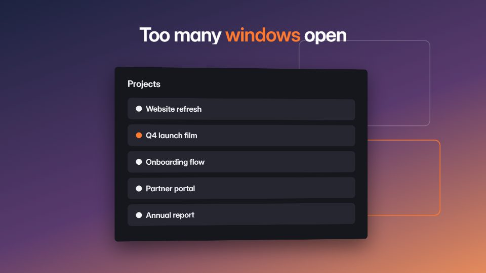

# Desktop window pile-up

**One slow, unbroken camera over a single desktop as app windows pile in from behind the lens and fly past it** · Fit for our films: **Adapt: needs a small helper or a stylisation** · Live demo: [`demos/demo.html#desktop-window-pileup`](../demos/demo.html#desktop-window-pileup)

## The look
Full-bleed wallpaper gradient (#1C2340 to #E58B5C), real window chrome with soft shadows, light film grain; between window moments, one big centred line with a coloured wipe (#FF7A2F) across it.

## How it moves
Each push, pull or pan lasts 1.5-3 s on gentle in-out curves at roughly half normal speed; windows arrive from behind the camera and stack; motion blur only on fast fly-throughs.

## Shape of a piece
A centred line enters word by word, pull back to the desktop, windows pile up (the problem), push through them, the product window alone, a tight crop and the name.

## Craft rules
No cuts: every change is a camera move. The hero window is always the sharpest, largest thing in frame.

## Ask for, before building
Screenshots of the product and the tools it replaces, wallpaper or brand gradient, the opening line

## Where it fits
Productivity or workflow tool launch, too-many-tabs problem framing, teaser

## Build it with our kit
screencast windows, camera with parallax, kinetic text word-by-word and mask wipe, shader grain, real screenshots

**Small helpers it would want (none built yet; the engine is unchanged):** A fly-past depth stack for windows (z-ordered scale with blur)

## Tuning scale
| Energy | Pace | Camera | Density | Background | Type | Realism | Sound |
|---|---|---|---|---|---|---|---|
| −1 | −1 | +2 | +1 | 0 | 0 | +1 | −1 |

## Our director prompt
Direct this film (or these segments) in the **Desktop window pile-up** style. Follow the script word for word, time everything to the voiceover clock, and show me the storyboard before building.

- **Look:** Full-bleed wallpaper gradient (#1C2340 to #E58B5C), real window chrome with soft shadows, light film grain; between window moments, one big centred line with a coloured wipe (#FF7A2F) across it.
- **Motion:** Each push, pull or pan lasts 1.5-3 s on gentle in-out curves at roughly half normal speed; windows arrive from behind the camera and stack; motion blur only on fast fly-throughs.
- **Shape of the piece:** A centred line enters word by word, pull back to the desktop, windows pile up (the problem), push through them, the product window alone, a tight crop and the name.
- **Rules:** No cuts: every change is a camera move. The hero window is always the sharpest, largest thing in frame.
- **Ask me first for:** screenshots of the product and the tools it replaces, wallpaper or brand gradient, the opening line
- **Tuning scale:** Energy −1, Pace −1, Camera +2, Density +1, Background 0, Type 0, Realism +1, Sound −1.
- **Build it with:** screencast windows, camera with parallax, kinetic text word-by-word and mask wipe, shader grain, real screenshots. Keep to the engine's craft rules: one primary mover, scenes that open sparse and build, text that is readable before anything ornamental moves.
