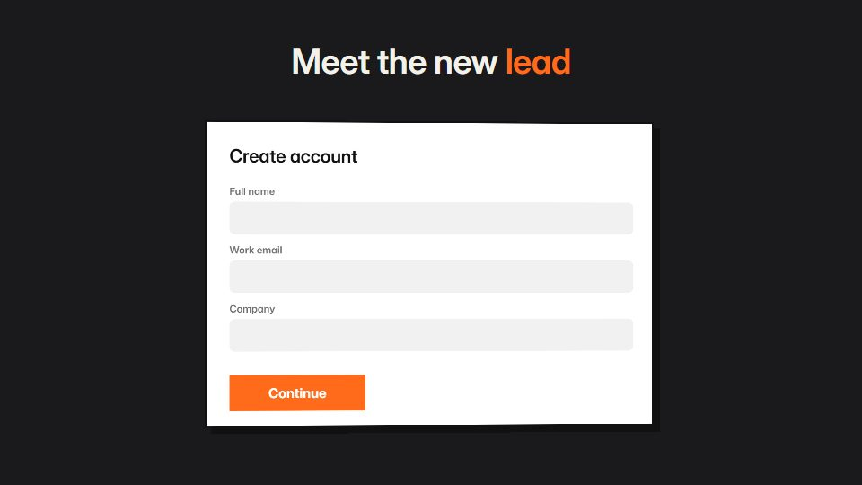

# Document-as-stage

**A single sheet (CV, spec, report or form) is the set: rows fill in, meters rise and a stamp lands** · Fit for our films: **Adapt: needs a small helper or a stylisation** · Live demo: [`demos/demo.html#document-as-stage`](../demos/demo.html#document-as-stage)

## The look
A white sheet on a dark desk (#1A1A1C) under a soft shadow; black type in a sturdy grotesque with mono labels; one accent (#FF6B1A) for bullets and stamps; ruled lines and form fields.

## How it moves
The sheet drops onto the desk with a thud, fields fill row by row, meters rise on different curves, the camera dives into one detail until it fills the frame, and the finished sheet returns at the end.

## Shape of a piece
Blank sheet lands, fields fill, a dive into one detail, score or skill meters, the completed sheet with a stamp.

## Craft rules
The sheet is the anchor: every scene starts and ends on it, and text is readable at full-page framing.

## Ask for, before building
The document content (fields and values), the detail to dive into, accent colour

## Where it fits
Team bios and hiring, case-study one-pager, spec sheet, proposal summary

## Build it with our kit
screencast lists and typed inputs, data counters and bars, camera push-ins, kinetic text, music+SFX

**Small helpers it would want (none built yet; the engine is unchanged):** A stamp-press helper (scale-down, slight turn, ink spread)

## Tuning scale
| Energy | Pace | Camera | Density | Background | Type | Realism | Sound |
|---|---|---|---|---|---|---|---|
| 0 | +1 | +1 | +1 | −1 | 0 | 0 | +1 |

## Our director prompt
Direct this film (or these segments) in the **Document-as-stage** style. Follow the script word for word, time everything to the voiceover clock, and show me the storyboard before building.

- **Look:** A white sheet on a dark desk (#1A1A1C) under a soft shadow; black type in a sturdy grotesque with mono labels; one accent (#FF6B1A) for bullets and stamps; ruled lines and form fields.
- **Motion:** The sheet drops onto the desk with a thud, fields fill row by row, meters rise on different curves, the camera dives into one detail until it fills the frame, and the finished sheet returns at the end.
- **Shape of the piece:** Blank sheet lands, fields fill, a dive into one detail, score or skill meters, the completed sheet with a stamp.
- **Rules:** The sheet is the anchor: every scene starts and ends on it, and text is readable at full-page framing.
- **Ask me first for:** the document content (fields and values), the detail to dive into, accent colour
- **Tuning scale:** Energy 0, Pace +1, Camera +1, Density +1, Background −1, Type 0, Realism 0, Sound +1.
- **Build it with:** screencast lists and typed inputs, data counters and bars, camera push-ins, kinetic text, music+SFX. Keep to the engine's craft rules: one primary mover, scenes that open sparse and build, text that is readable before anything ornamental moves.
