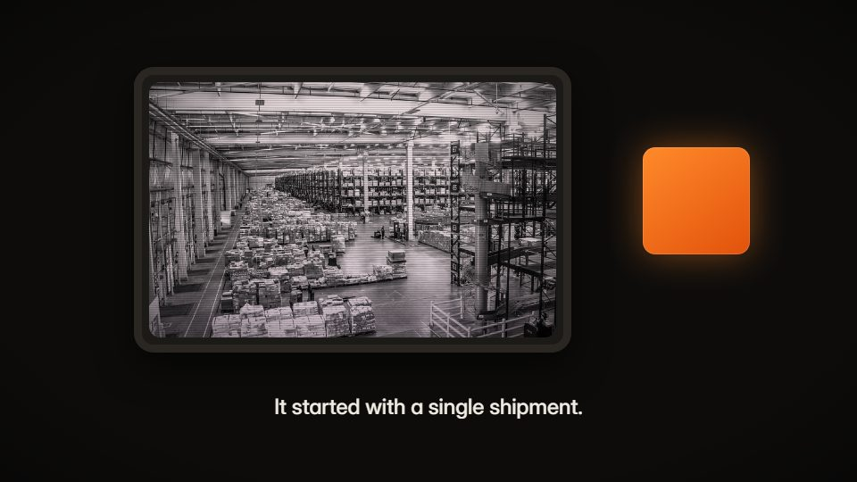

# Documentary / archival brand film

**Film texture, archival clips, captions on narration, one saturated hero object** · Fit for our films: **Adapt: needs a small helper or a stylisation** · Live demo: [`demos/demo.html#documentary`](../demos/demo.html#documentary)

## The look
White, silver, cream and archival black, with one saturated hero object as the only colour. Real archival clips on a period TV, real old web pages, fresh grain every frame, halation on highlights, soft vignette, lifted blacks.

## How it moves
Push into a real document. A cursor lands on one real item. Captions light word by word on the narration's timing. Hard cuts land on spoken words. The hero object is lit rim-first, colourless, and comes alive on the drop.

## Shape of a piece
Cold open on archive, the past, the bridge (the coined idea), the hero reveal, the proof curve, the brand at the very end.

## Craft rules
One feeling, one idea, no feature tour. Captions of seven words or fewer, one layer at a time. Visuals keep moving when the narrator pauses.

## Ask for, before building
Public-domain archive clips, the coined word, the five-year vision line, the VO.

## Where it fits
Brand manifesto, category creation, investor narrative.

## Build it with our kit
real photos and footage, kinetic captions, grain shader, VO clock, music ducking.

**Small helpers it would want (none built yet; the engine is unchanged):** A film-finish pass (per-frame grain, halation, edge-clamped colour fringe, gate weave); a period-screen frame; word-lit captions on VO word times.

## Tuning scale
| Energy | Pace | Camera | Density | Background | Type | Realism | Sound |
|---|---|---|---|---|---|---|---|
| −1 | 0 | 0 | −1 | 0 | −1 | +2 | 0 |

## Our director prompt
Direct this film (or these segments) in the **Documentary / archival brand film** style. Follow the script word for word, time everything to the voiceover clock, and show me the storyboard before building.

- **Look:** white, silver, cream and archival black, with one saturated hero object as the only colour. Real archival clips on a period TV, real old web pages, fresh grain every frame, halation on highlights, soft vignette, lifted blacks.
- **Motion:** push into a real document. A cursor lands on one real item. Captions light word by word on the narration's timing. Hard cuts land on spoken words. The hero object is lit rim-first, colourless, and comes alive on the drop.
- **Shape of the piece:** cold open on archive, the past, the bridge (the coined idea), the hero reveal, the proof curve, the brand at the very end.
- **Rules:** one feeling, one idea, no feature tour. Captions of seven words or fewer, one layer at a time. Visuals keep moving when the narrator pauses.
- **Ask me first for:** public-domain archive clips, the coined word, the five-year vision line, the VO.
- **Tuning scale:** Energy −1, Pace 0, Camera 0, Density −1, Background 0, Type −1, Realism +2, Sound 0.
- **Build it with:** real photos and footage, kinetic captions, grain shader, VO clock, music ducking.. Keep to the engine's craft rules: one primary mover, scenes that open sparse and build, text that is readable before anything ornamental moves.
