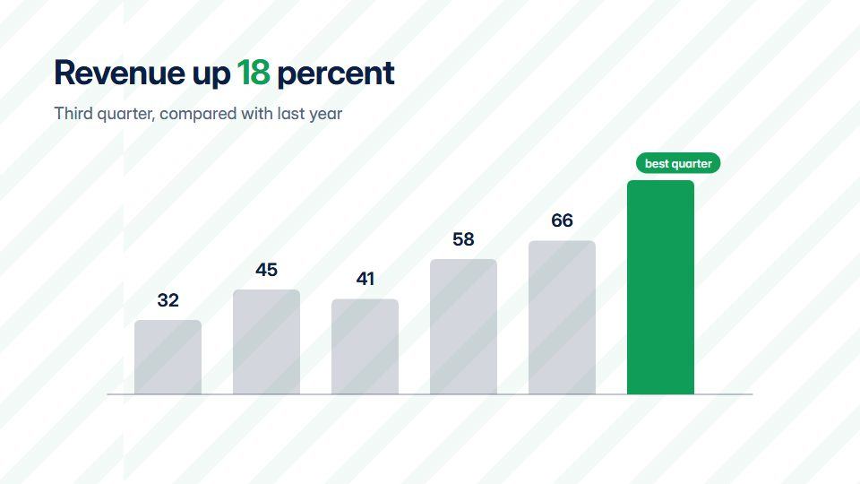

# Results-day board

**Quarterly results told like a market board: big KPIs, green and red deltas, a ticker band and clean bars** · Fit for our films: **Ready: our kit builds it today** · Live demo: [`demos/demo.html#earnings-results-board`](../demos/demo.html#earnings-results-board)

## The look
Bright white (#FFFFFF) with navy (#0B1F44), market green (#0F9D58) and muted red (#D93025); a sturdy grotesque with tabular figures; a thin ticker band at the foot; bars carrying value pills.

## How it moves
KPIs count up in turn while delta arrows slide in; bars grow from the baseline left to right; the ticker band scrolls steadily throughout; transitions wipe along the band.

## Shape of a piece
Period title, the headline KPI, three supporting metrics with deltas, a trend chart, an outlook line and sign-off.

## Craft rules
Every figure is sourced and labelled with its period; deltas are coloured by meaning, never for decoration.

## Ask for, before building
Verified figures and periods, the headline metric, comparison basis, outlook sentence

## Where it fits
Quarterly results, investor update, board summary, sales kickoff numbers

## Build it with our kit
data bars, counters and notes, kinetic text, living ground sweeps, music

**Small helpers it would want (none built yet; the engine is unchanged):** A scrolling ticker band

## Tuning scale
| Energy | Pace | Camera | Density | Background | Type | Realism | Sound |
|---|---|---|---|---|---|---|---|
| 0 | 0 | −1 | +1 | −1 | 0 | 0 | 0 |

## Our director prompt
Direct this film (or these segments) in the **Results-day board** style. Follow the script word for word, time everything to the voiceover clock, and show me the storyboard before building.

- **Look:** Bright white (#FFFFFF) with navy (#0B1F44), market green (#0F9D58) and muted red (#D93025); a sturdy grotesque with tabular figures; a thin ticker band at the foot; bars carrying value pills.
- **Motion:** KPIs count up in turn while delta arrows slide in; bars grow from the baseline left to right; the ticker band scrolls steadily throughout; transitions wipe along the band.
- **Shape of the piece:** Period title, the headline KPI, three supporting metrics with deltas, a trend chart, an outlook line and sign-off.
- **Rules:** Every figure is sourced and labelled with its period; deltas are coloured by meaning, never for decoration.
- **Ask me first for:** verified figures and periods, the headline metric, comparison basis, outlook sentence
- **Tuning scale:** Energy 0, Pace 0, Camera −1, Density +1, Background −1, Type 0, Realism 0, Sound 0.
- **Build it with:** data bars, counters and notes, kinetic text, living ground sweeps, music. Keep to the engine's craft rules: one primary mover, scenes that open sparse and build, text that is readable before anything ornamental moves.
