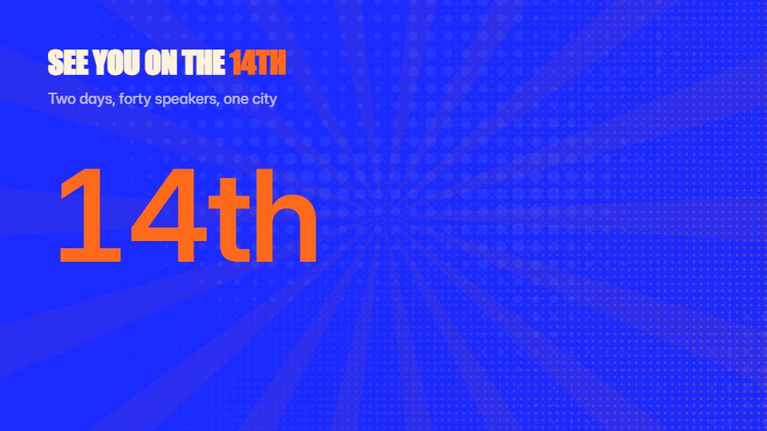

# Event countdown promo

**Event hype built round the date: big rolling numerals, venue line art, speaker flashes and a countdown** · Fit for our films: **Ready: our kit builds it today** · Live demo: [`demos/demo.html#event-countdown-promo`](../demos/demo.html#event-countdown-promo)

## The look
A bold cobalt field (#1B2BFF) with cream (#FFF3DC) and tangerine (#FF6A1A); extra-condensed numerals at full height; halftone behind; line-art venue or skyline; ticket-stub shapes.

## How it moves
Numerals roll like an odometer onto the date; the halftone ground turns slowly; speaker photos land as stamped tickets; the countdown ticks on the beat at the end.

## Shape of a piece
The date rolls in, what and where, three highlights or speakers, the countdown, the register link.

## Craft rules
The date is always the biggest thing on screen; patterns move continuously, never in steps.

## Ask for, before building
Event name, date, venue, 3 speakers or highlights with photos, URL

## Where it fits
Conference or webinar promo, launch-event invite, community meetup teaser

## Build it with our kit
data counters, kinetic text drop, shader halftone ground, real photos, living ground rays, music+SFX

**Small helpers it would want (none built yet; the engine is unchanged):** An odometer-roll counter

## Tuning scale
| Energy | Pace | Camera | Density | Background | Type | Realism | Sound |
|---|---|---|---|---|---|---|---|
| +2 | +1 | 0 | +1 | +2 | +2 | 0 | +2 |

## Our director prompt
Direct this film (or these segments) in the **Event countdown promo** style. Follow the script word for word, time everything to the voiceover clock, and show me the storyboard before building.

- **Look:** A bold cobalt field (#1B2BFF) with cream (#FFF3DC) and tangerine (#FF6A1A); extra-condensed numerals at full height; halftone behind; line-art venue or skyline; ticket-stub shapes.
- **Motion:** Numerals roll like an odometer onto the date; the halftone ground turns slowly; speaker photos land as stamped tickets; the countdown ticks on the beat at the end.
- **Shape of the piece:** The date rolls in, what and where, three highlights or speakers, the countdown, the register link.
- **Rules:** The date is always the biggest thing on screen; patterns move continuously, never in steps.
- **Ask me first for:** event name, date, venue, 3 speakers or highlights with photos, URL
- **Tuning scale:** Energy +2, Pace +1, Camera 0, Density +1, Background +2, Type +2, Realism 0, Sound +2.
- **Build it with:** data counters, kinetic text drop, shader halftone ground, real photos, living ground rays, music+SFX. Keep to the engine's craft rules: one primary mover, scenes that open sparse and build, text that is readable before anything ornamental moves.
