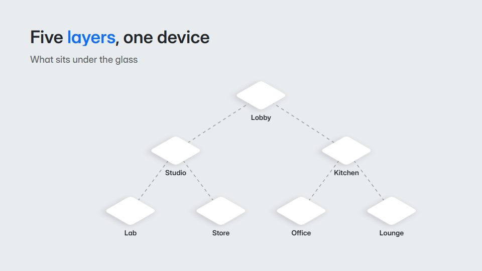

# Exploded-view callouts

**A product separates into layers along one axis, and dashed leader lines label each part** · Fit for our films: **Ready: our kit builds it today** · Live demo: [`demos/demo.html#exploded-view-callouts`](../demos/demo.html#exploded-view-callouts)

## The look
Soft grey studio (#E9ECEF) with parts as clean isometric flats (#FFFFFF, #CED4DA, #343A40) and one accent (#0D6EFD) on the part that matters; dashed leaders and small numbered labels in a technical sans.

## How it moves
The assembled object turns slightly, then its layers slide apart along one axis with a stagger; leaders draw out and labels type; the key layer lifts; everything slides back together.

## Shape of a piece
The whole object, the explode, 3-5 labelled layers, focus on the key layer, re-assembly with the name.

## Craft rules
Layers travel on one axis only; labels never overlap each other or the parts; one highlighted layer.

## Ask for, before building
The layer or component list, the hero layer, labels, product outline

## Where it fits
Hardware or platform architecture, what's-inside explainer, security or tech-stack story

## Build it with our kit
isometric, hand-drawn strokes (dashed leaders), kinetic text, camera push

**Small helpers it would want (none built yet; the engine is unchanged):** A dashed leader line with a label anchor

## Tuning scale
| Energy | Pace | Camera | Density | Background | Type | Realism | Sound |
|---|---|---|---|---|---|---|---|
| −1 | 0 | 0 | 0 | −1 | −1 | 0 | −1 |

## Our director prompt
Direct this film (or these segments) in the **Exploded-view callouts** style. Follow the script word for word, time everything to the voiceover clock, and show me the storyboard before building.

- **Look:** Soft grey studio (#E9ECEF) with parts as clean isometric flats (#FFFFFF, #CED4DA, #343A40) and one accent (#0D6EFD) on the part that matters; dashed leaders and small numbered labels in a technical sans.
- **Motion:** The assembled object turns slightly, then its layers slide apart along one axis with a stagger; leaders draw out and labels type; the key layer lifts; everything slides back together.
- **Shape of the piece:** The whole object, the explode, 3-5 labelled layers, focus on the key layer, re-assembly with the name.
- **Rules:** Layers travel on one axis only; labels never overlap each other or the parts; one highlighted layer.
- **Ask me first for:** the layer or component list, the hero layer, labels, product outline
- **Tuning scale:** Energy −1, Pace 0, Camera 0, Density 0, Background −1, Type −1, Realism 0, Sound −1.
- **Build it with:** isometric, hand-drawn strokes (dashed leaders), kinetic text, camera push. Keep to the engine's craft rules: one primary mover, scenes that open sparse and build, text that is readable before anything ornamental moves.
