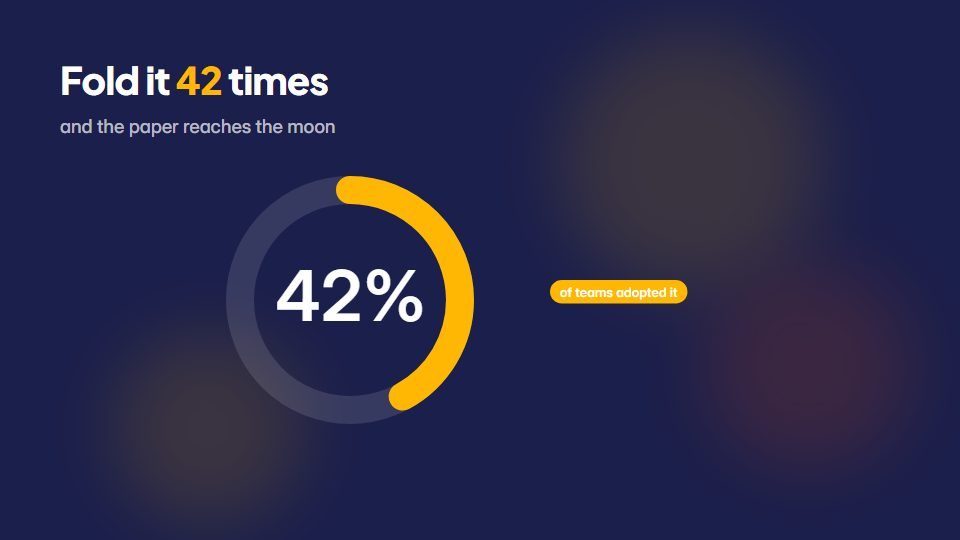

# Flat-vector science infographic

**A bright flat-vector world with no outlines, big numbers and rule-based zooms, for curious big-idea explainers** · Fit for our films: **Ready: our kit builds it today** · Live demo: [`demos/demo.html#flat-vector-infographic`](../demos/demo.html#flat-vector-infographic)

## The look
Deep indigo (#1B1F4B) with saturated flat fills (#FFB703, #FB5607, #3A86FF, #8AC926); a rounded geometric sans; soft long shadows and no strokes; friendly but precise objects.

## How it moves
Objects bob gently; the camera zooms by a fixed rule (each step doubles) while large numbers grow beside the object; scenes change through colour floods, with light and dark halves for cause and effect.

## Shape of a piece
A surprising question, the object, a doubling or scaling run with big numbers, the twist, a one-line takeaway.

## Craft rules
No outlines ever; flat colours and simple shapes only, and every on-screen number is big and labelled.

## Ask for, before building
The core question, the numbers, the analogy, brand colours if any

## Where it fits
Complex-topic explainer, market-size story, education or thought-leadership short

## Build it with our kit
data counters and unit charts, living ground washes, continuity moves (floods), camera zoom, kinetic text pop

**Small helpers it would want (none built yet; the engine is unchanged):** None

## Tuning scale
| Energy | Pace | Camera | Density | Background | Type | Realism | Sound |
|---|---|---|---|---|---|---|---|
| +1 | 0 | +1 | 0 | +1 | 0 | −2 | 0 |

## Our director prompt
Direct this film (or these segments) in the **Flat-vector science infographic** style. Follow the script word for word, time everything to the voiceover clock, and show me the storyboard before building.

- **Look:** Deep indigo (#1B1F4B) with saturated flat fills (#FFB703, #FB5607, #3A86FF, #8AC926); a rounded geometric sans; soft long shadows and no strokes; friendly but precise objects.
- **Motion:** Objects bob gently; the camera zooms by a fixed rule (each step doubles) while large numbers grow beside the object; scenes change through colour floods, with light and dark halves for cause and effect.
- **Shape of the piece:** A surprising question, the object, a doubling or scaling run with big numbers, the twist, a one-line takeaway.
- **Rules:** No outlines ever; flat colours and simple shapes only, and every on-screen number is big and labelled.
- **Ask me first for:** the core question, the numbers, the analogy, brand colours if any
- **Tuning scale:** Energy +1, Pace 0, Camera +1, Density 0, Background +1, Type 0, Realism −2, Sound 0.
- **Build it with:** data counters and unit charts, living ground washes, continuity moves (floods), camera zoom, kinetic text pop. Keep to the engine's craft rules: one primary mover, scenes that open sparse and build, text that is readable before anything ornamental moves.
