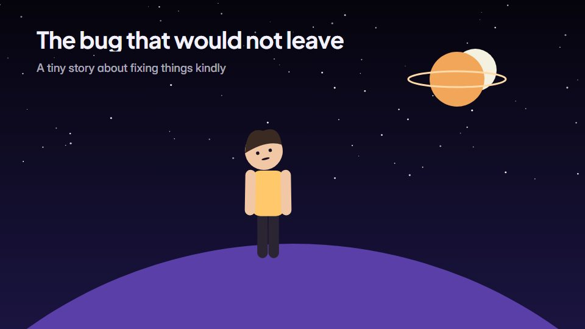

# Flat-vector character short

**Smooth flat-vector characters with soft gradients and glows instead of outlines, in a polished animated-short look** · Fit for our films: **Adapt: needs a small helper or a stylisation** · Live demo: [`demos/demo.html#flat-vector-short`](../demos/demo.html#flat-vector-short)

## The look
Night blues (#0F1B3D, #24346B) lit by warm glows (#FFC86B) and a cool rim (#7FD1FF); characters in flat shapes with gentle hand-set gradients and soft contact shadows, no outline and no line wobble; a rounded display sans for titles.

## How it moves
Clean, eased character cycles with light overlap (ears or scarves trail a frame behind); light sources pulse softly; the camera dollies sideways with parallax through 3-4 layers.

## Shape of a piece
An establishing night shot, the character's small problem, a try and a miss, the helping moment, a glowing resolution, title.

## Craft rules
No outlines and no line boil: light carries the emotion, and shapes stay simple enough to read at a glance.

## Ask for, before building
Script, protagonist idea, mood (night or day), brand colours, end line

## Where it fits
Launch short with a character hero, holiday or event card, social brand story

## Build it with our kit
camera with parallax, living ground washes and glows, shader grain, kinetic text, music+SFX

**Small helpers it would want (none built yet; the engine is unchanged):** A puppet rig; a soft radial glow light

## Tuning scale
| Energy | Pace | Camera | Density | Background | Type | Realism | Sound |
|---|---|---|---|---|---|---|---|
| 0 | 0 | +1 | 0 | +1 | −1 | −1 | +1 |

## Our director prompt
Direct this film (or these segments) in the **Flat-vector character short** style. Follow the script word for word, time everything to the voiceover clock, and show me the storyboard before building.

- **Look:** Night blues (#0F1B3D, #24346B) lit by warm glows (#FFC86B) and a cool rim (#7FD1FF); characters in flat shapes with gentle hand-set gradients and soft contact shadows, no outline and no line wobble; a rounded display sans for titles.
- **Motion:** Clean, eased character cycles with light overlap (ears or scarves trail a frame behind); light sources pulse softly; the camera dollies sideways with parallax through 3-4 layers.
- **Shape of the piece:** An establishing night shot, the character's small problem, a try and a miss, the helping moment, a glowing resolution, title.
- **Rules:** No outlines and no line boil: light carries the emotion, and shapes stay simple enough to read at a glance.
- **Ask me first for:** script, protagonist idea, mood (night or day), brand colours, end line
- **Tuning scale:** Energy 0, Pace 0, Camera +1, Density 0, Background +1, Type −1, Realism −1, Sound +1.
- **Build it with:** camera with parallax, living ground washes and glows, shader grain, kinetic text, music+SFX. Keep to the engine's craft rules: one primary mover, scenes that open sparse and build, text that is readable before anything ornamental moves.
