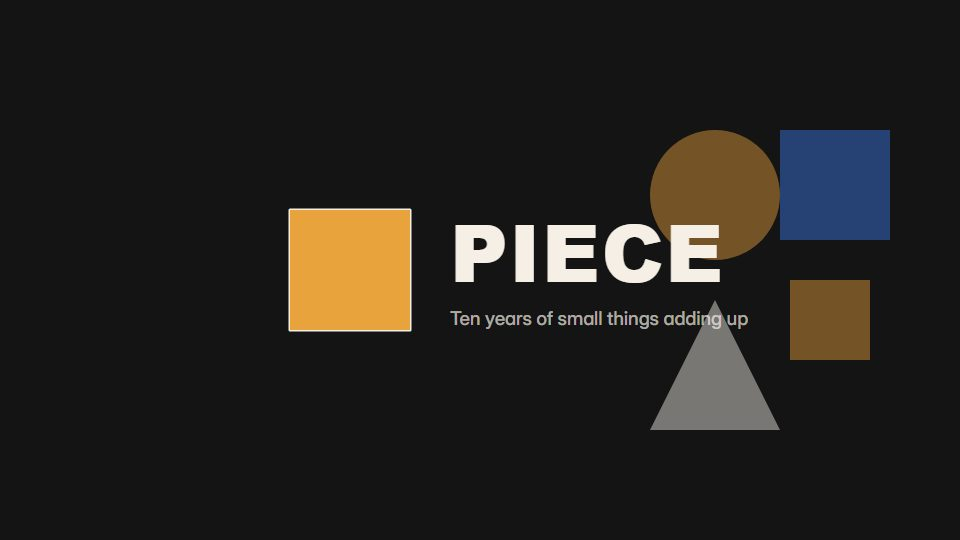

# Flip-tile mosaic reveal

**Thousands of small tiles drop and flip until, at the very end, they form the brand image or end card** · Fit for our films: **Adapt: needs a small helper or a stylisation** · Live demo: [`demos/demo.html#flip-tile-mosaic`](../demos/demo.html#flip-tile-mosaic)

## The look
Dark grout (#141414) with tiles in many tones sampled from the final image; one hard light from the top left; slight variation in tile tilt; the final card fully legible.

## How it moves
Tiles spiral down from one seed outward, the camera rises and pulls back, then the lettering tiles turn over in a left-to-right ripple; it ends on a near top-down hold.

## Shape of a piece
One tile, spreading growth, the pull-back shows the picture, the lettering ripple, a hold or click on the final card.

## Craft rules
Lettering tiles start in the surrounding colour so the words stay hidden until they flip; match the final frame's colour to the source image.

## Ask for, before building
The final card or poster image, the text that should ripple, logo

## Where it fits
Brand reveal, campaign end card, anniversary or milestone reveal

## Build it with our kit
living ground grid as the tile field, continuity moves, camera pull, music+SFX (tile clicks)

**Small helpers it would want (none built yet; the engine is unchanged):** A tile sampler that colours tiles from an image and flips them in a ripple

## Tuning scale
| Energy | Pace | Camera | Density | Background | Type | Realism | Sound |
|---|---|---|---|---|---|---|---|
| 0 | 0 | +1 | +2 | +1 | 0 | 0 | +1 |

## Our director prompt
Direct this film (or these segments) in the **Flip-tile mosaic reveal** style. Follow the script word for word, time everything to the voiceover clock, and show me the storyboard before building.

- **Look:** Dark grout (#141414) with tiles in many tones sampled from the final image; one hard light from the top left; slight variation in tile tilt; the final card fully legible.
- **Motion:** Tiles spiral down from one seed outward, the camera rises and pulls back, then the lettering tiles turn over in a left-to-right ripple; it ends on a near top-down hold.
- **Shape of the piece:** One tile, spreading growth, the pull-back shows the picture, the lettering ripple, a hold or click on the final card.
- **Rules:** Lettering tiles start in the surrounding colour so the words stay hidden until they flip; match the final frame's colour to the source image.
- **Ask me first for:** the final card or poster image, the text that should ripple, logo
- **Tuning scale:** Energy 0, Pace 0, Camera +1, Density +2, Background +1, Type 0, Realism 0, Sound +1.
- **Build it with:** living ground grid as the tile field, continuity moves, camera pull, music+SFX (tile clicks). Keep to the engine's craft rules: one primary mover, scenes that open sparse and build, text that is readable before anything ornamental moves.
