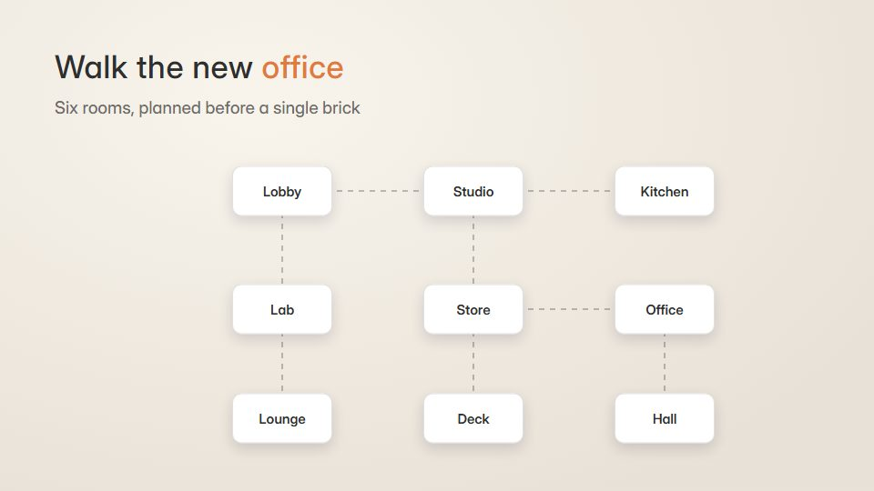

# Floor-plan walkthrough

**A top-down plan whose rooms furnish themselves, then the camera glides room to room as light turns from day to evening** · Fit for our films: **Adapt: needs a small helper or a stylisation** · Live demo: [`demos/demo.html#floor-plan-walkthrough`](../demos/demo.html#floor-plan-walkthrough)

## The look
Warm architectural paper (#F5F1EA) with charcoal walls (#2F2F2F), pale wood floors (#E3D3B8), simple furniture icons and one terracotta accent (#E07A3F); room labels in a light grotesque; a warm lamp glow (#FFD59E) for evening.

## How it moves
Walls draw, rooms fill with furniture in quick staggers, the camera tilts a little and glides room to room; the light shifts toward evening and lamps switch on.

## Shape of a piece
The empty plan, walls and doors, rooms furnished one by one, a glide through 3 rooms with one fact each, evening light and the line.

## Craft rules
Furniture stays to scale, one room is in focus at a time, and labels stay horizontal.

## Ask for, before building
The plan or layout, room purposes, furniture or equipment list, facts

## Where it fits
Office or facility tour, retail or warehouse layout, real-estate or venue presentation

## Build it with our kit
isometric, hand-drawn strokes, camera travel and parallax, living ground washes, kinetic text

**Small helpers it would want (none built yet; the engine is unchanged):** A plan helper that builds walls from a simple polygon list

## Tuning scale
| Energy | Pace | Camera | Density | Background | Type | Realism | Sound |
|---|---|---|---|---|---|---|---|
| −1 | −1 | +1 | +1 | 0 | −1 | 0 | −1 |

## Our director prompt
Direct this film (or these segments) in the **Floor-plan walkthrough** style. Follow the script word for word, time everything to the voiceover clock, and show me the storyboard before building.

- **Look:** Warm architectural paper (#F5F1EA) with charcoal walls (#2F2F2F), pale wood floors (#E3D3B8), simple furniture icons and one terracotta accent (#E07A3F); room labels in a light grotesque; a warm lamp glow (#FFD59E) for evening.
- **Motion:** Walls draw, rooms fill with furniture in quick staggers, the camera tilts a little and glides room to room; the light shifts toward evening and lamps switch on.
- **Shape of the piece:** The empty plan, walls and doors, rooms furnished one by one, a glide through 3 rooms with one fact each, evening light and the line.
- **Rules:** Furniture stays to scale, one room is in focus at a time, and labels stay horizontal.
- **Ask me first for:** the plan or layout, room purposes, furniture or equipment list, facts
- **Tuning scale:** Energy −1, Pace −1, Camera +1, Density +1, Background 0, Type −1, Realism 0, Sound −1.
- **Build it with:** isometric, hand-drawn strokes, camera travel and parallax, living ground washes, kinetic text. Keep to the engine's craft rules: one primary mover, scenes that open sparse and build, text that is readable before anything ornamental moves.
