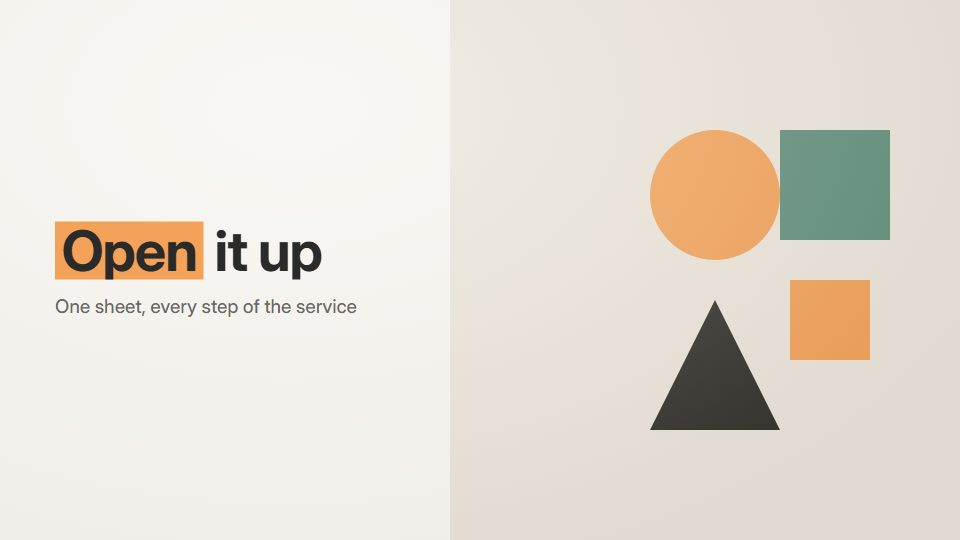

# Folded-paper transitions

**Scenes fold and unfold like paper: a panel creases, flips and opens into the next scene, like a map or a pop-up card** · Fit for our films: **Adapt: needs a small helper or a stylisation** · Live demo: [`demos/demo.html#folded-paper-transitions`](../demos/demo.html#folded-paper-transitions)

## The look
Light warm grey (#ECE8E1) with paper panels in white and two muted colours (#F4A259, #5B8E7D); soft crease shading and a thin shadow along every fold; a friendly grotesque.

## How it moves
Every transition is a fold: a panel hinges on a crease with a shading gradient, opens into a larger sheet with new content, or folds down into a small square that becomes the next object.

## Shape of a piece
A small folded square, unfold into the problem, fold into the solution panel, open into the result spread, fold down to the logo.

## Craft rules
Folds run along straight lines with one consistent light direction; content appears only once a fold has settled.

## Ask for, before building
3-5 scenes, brand colours, the final mark

## Where it fits
Product explainer, brochure-style service film, event invite

## Build it with our kit
continuity moves, living ground, kinetic text rise, camera push

**Small helpers it would want (none built yet; the engine is unchanged):** A fold helper (scale hinge with a shading gradient)

## Tuning scale
| Energy | Pace | Camera | Density | Background | Type | Realism | Sound |
|---|---|---|---|---|---|---|---|
| 0 | 0 | 0 | −1 | 0 | 0 | −1 | 0 |

## Our director prompt
Direct this film (or these segments) in the **Folded-paper transitions** style. Follow the script word for word, time everything to the voiceover clock, and show me the storyboard before building.

- **Look:** Light warm grey (#ECE8E1) with paper panels in white and two muted colours (#F4A259, #5B8E7D); soft crease shading and a thin shadow along every fold; a friendly grotesque.
- **Motion:** Every transition is a fold: a panel hinges on a crease with a shading gradient, opens into a larger sheet with new content, or folds down into a small square that becomes the next object.
- **Shape of the piece:** A small folded square, unfold into the problem, fold into the solution panel, open into the result spread, fold down to the logo.
- **Rules:** Folds run along straight lines with one consistent light direction; content appears only once a fold has settled.
- **Ask me first for:** 3-5 scenes, brand colours, the final mark
- **Tuning scale:** Energy 0, Pace 0, Camera 0, Density −1, Background 0, Type 0, Realism −1, Sound 0.
- **Build it with:** continuity moves, living ground, kinetic text rise, camera push. Keep to the engine's craft rules: one primary mover, scenes that open sparse and build, text that is readable before anything ornamental moves.
