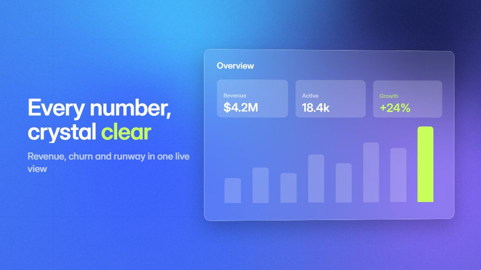

# Glass dashboard promo

**Frosted, see-through dashboard cards float over a soft colour field, layered like panes of glass** · Fit for our films: **Ready: our kit builds it today** · Live demo: [`demos/demo.html#glass-dashboard-promo`](../demos/demo.html#glass-dashboard-promo)

## The look
Mesh ground in blues and violets (#3A5BFF, #8D6BFF, #45C4FF, #0E1440); cards frosted white at 14-20% with a bright 1px rim; white grotesque type; white charts with one lime highlight (#C8FF5A).

## How it moves
Cards drift in at different depths with parallax and then align to a grid; the camera leans a little toward the active card; numbers tick and a chart draws across the glass.

## Shape of a piece
Colour field alone, the first card condenses out of it, the dashboard assembles, one card opens into detail, logo on glass.

## Craft rules
The blur must sample the moving ground so glass reads as glass; no more than three panes in focus, and text sits on the most opaque one.

## Ask for, before building
Real dashboard screens or metrics, brand colours, the three numbers to highlight

## Where it fits
Analytics or fintech promo, feature launch, website hero, investor demo

## Build it with our kit
shader mesh ground, screencast windows, data line and counters, camera parallax, kinetic text rise

**Small helpers it would want (none built yet; the engine is unchanged):** A glass-panel helper (blurred backdrop copy, tint, rim light)

## Tuning scale
| Energy | Pace | Camera | Density | Background | Type | Realism | Sound |
|---|---|---|---|---|---|---|---|
| 0 | 0 | +1 | 0 | +1 | 0 | 0 | 0 |

## Our director prompt
Direct this film (or these segments) in the **Glass dashboard promo** style. Follow the script word for word, time everything to the voiceover clock, and show me the storyboard before building.

- **Look:** Mesh ground in blues and violets (#3A5BFF, #8D6BFF, #45C4FF, #0E1440); cards frosted white at 14-20% with a bright 1px rim; white grotesque type; white charts with one lime highlight (#C8FF5A).
- **Motion:** Cards drift in at different depths with parallax and then align to a grid; the camera leans a little toward the active card; numbers tick and a chart draws across the glass.
- **Shape of the piece:** Colour field alone, the first card condenses out of it, the dashboard assembles, one card opens into detail, logo on glass.
- **Rules:** The blur must sample the moving ground so glass reads as glass; no more than three panes in focus, and text sits on the most opaque one.
- **Ask me first for:** real dashboard screens or metrics, brand colours, the three numbers to highlight
- **Tuning scale:** Energy 0, Pace 0, Camera +1, Density 0, Background +1, Type 0, Realism 0, Sound 0.
- **Build it with:** shader mesh ground, screencast windows, data line and counters, camera parallax, kinetic text rise. Keep to the engine's craft rules: one primary mover, scenes that open sparse and build, text that is readable before anything ornamental moves.
