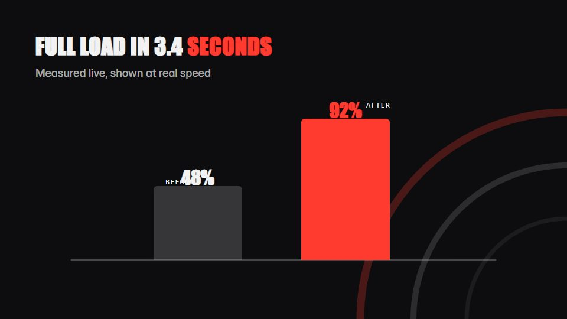

# Hardware spec telemetry

**Performance spec piece where real-time timers, firing-order lights and engineering callouts prove the numbers** · Fit for our films: **Adapt: needs a small helper or a stylisation** · Live demo: [`demos/demo.html#hardware-spec-telemetry`](../demos/demo.html#hardware-spec-telemetry)

## The look
Carbon black (#0D0D0F) with signal red (#FF3B30) and white; condensed grotesque numerals, mono units; hairline callout leaders, gauge arcs and fine tick scales.

## How it moves
Timers run at true speed on screen; parts light in the order they really fire; callouts extend from the object on leader lines; the camera holds still and cuts land hard on the beat.

## Shape of a piece
A dark silhouette, one sequence lights in its real order, the hero metric runs in real time, two supporting specs on gauges, name and spec line.

## Craft rules
Never fake a figure: show it at real speed or label it. One red, reserved for the live metric.

## Ask for, before building
Verified specs and timings, product silhouette or photo, the hero metric, disclaimer line

## Where it fits
Hardware launch, benchmark film, engineering spec reveal, sales enablement

## Build it with our kit
data counters and line, hand-drawn strokes (leader lines), kinetic text pop, real photos, music+SFX

**Small helpers it would want (none built yet; the engine is unchanged):** A gauge-arc widget; a real-time stopwatch counter

## Tuning scale
| Energy | Pace | Camera | Density | Background | Type | Realism | Sound |
|---|---|---|---|---|---|---|---|
| +1 | +1 | −1 | 0 | −1 | +1 | +1 | +1 |

## Our director prompt
Direct this film (or these segments) in the **Hardware spec telemetry** style. Follow the script word for word, time everything to the voiceover clock, and show me the storyboard before building.

- **Look:** Carbon black (#0D0D0F) with signal red (#FF3B30) and white; condensed grotesque numerals, mono units; hairline callout leaders, gauge arcs and fine tick scales.
- **Motion:** Timers run at true speed on screen; parts light in the order they really fire; callouts extend from the object on leader lines; the camera holds still and cuts land hard on the beat.
- **Shape of the piece:** A dark silhouette, one sequence lights in its real order, the hero metric runs in real time, two supporting specs on gauges, name and spec line.
- **Rules:** Never fake a figure: show it at real speed or label it. One red, reserved for the live metric.
- **Ask me first for:** verified specs and timings, product silhouette or photo, the hero metric, disclaimer line
- **Tuning scale:** Energy +1, Pace +1, Camera −1, Density 0, Background −1, Type +1, Realism +1, Sound +1.
- **Build it with:** data counters and line, hand-drawn strokes (leader lines), kinetic text pop, real photos, music+SFX. Keep to the engine's craft rules: one primary mover, scenes that open sparse and build, text that is readable before anything ornamental moves.
