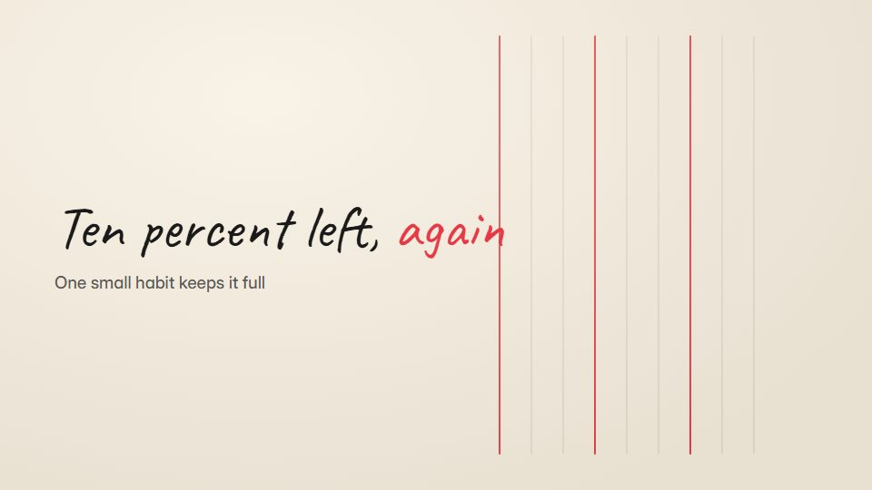

# Monoline icon world

**A tiny monoline figure lives inside interface icons on cream paper, and one red line plays the problem** · Fit for our films: **Adapt: needs a small helper or a stylisation** · Live demo: [`demos/demo.html#icon-world-monoline`](../demos/demo.html#icon-world-monoline)

## The look
Cream paper (#F5EFE3) with black monoline ink (#1A1A1A) at a single stroke weight; interface elements (battery, bell, inbox, toggle) drawn as big line icons; one red (#E63946) for the problem; light paper tooth.

## How it moves
The figure walks, pushes and climbs inside the icons in simple loops; the red line creeps forward like a fuse; icons turn into each other through shared strokes. It loops gently at the end.

## Shape of a piece
The figure in a calm icon, the red problem creeps in, the struggle, the product fixes it, back to calm.

## Craft rules
One stroke weight for everything and red only for the problem; the figure stays simple.

## Ask for, before building
The pain point in one sentence, the icon it lives in, the fix, accent

## Where it fits
Feature micro-explainer, app-store or social loop, support tip video

## Build it with our kit
hand-drawn strokes, continuity moves, living ground (paper), music+SFX

**Small helpers it would want (none built yet; the engine is unchanged):** A stroke morph between two icons

## Tuning scale
| Energy | Pace | Camera | Density | Background | Type | Realism | Sound |
|---|---|---|---|---|---|---|---|
| 0 | 0 | −1 | −2 | −1 | −1 | −2 | 0 |

## Our director prompt
Direct this film (or these segments) in the **Monoline icon world** style. Follow the script word for word, time everything to the voiceover clock, and show me the storyboard before building.

- **Look:** Cream paper (#F5EFE3) with black monoline ink (#1A1A1A) at a single stroke weight; interface elements (battery, bell, inbox, toggle) drawn as big line icons; one red (#E63946) for the problem; light paper tooth.
- **Motion:** The figure walks, pushes and climbs inside the icons in simple loops; the red line creeps forward like a fuse; icons turn into each other through shared strokes. It loops gently at the end.
- **Shape of the piece:** The figure in a calm icon, the red problem creeps in, the struggle, the product fixes it, back to calm.
- **Rules:** One stroke weight for everything and red only for the problem; the figure stays simple.
- **Ask me first for:** the pain point in one sentence, the icon it lives in, the fix, accent
- **Tuning scale:** Energy 0, Pace 0, Camera −1, Density −2, Background −1, Type −1, Realism −2, Sound 0.
- **Build it with:** hand-drawn strokes, continuity moves, living ground (paper), music+SFX. Keep to the engine's craft rules: one primary mover, scenes that open sparse and build, text that is readable before anything ornamental moves.
