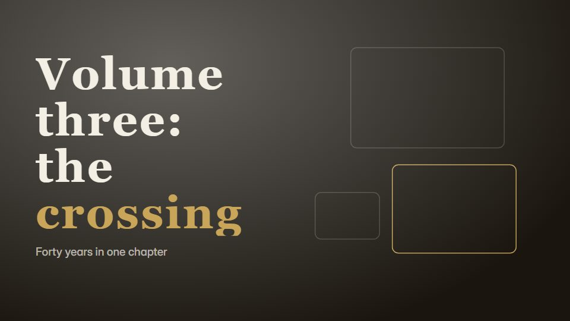

# Ink-and-seal scroll chronicle

**A long chronicle that alternates white-paper line drawings with gold-on-black plates, punctuated by red seals and one big brush keyword per shot** · Fit for our films: **Adapt: needs a small helper or a stylisation** · Live demo: [`demos/demo.html#ink-seal-chronicle`](../demos/demo.html#ink-seal-chronicle)

## The look
Two alternating modes: rice-paper white (#F4EFE4) with fine black line art, and black (#0F0D0B) with gold line art (#C9A55A); vermilion seals (#C0392B); one large brush-style keyword per shot, the era name set vertically at the right, a scroll ruler with a year counter along the bottom.

## How it moves
Each chapter opens with a seal pressing down on a drum hit; line art draws on, the keyword brushes in phrase by phrase, the ruler slides to the next era; the tempo rises as eras near the present.

## Shape of a piece
Prologue, 4-6 chapters each with its own colour and motif, a closing seal and the present day.

## Craft rules
Each chapter owns one colour and one pattern; the ruler and counter never move position. Dates are checked.

## Ask for, before building
Eras with dates, one keyword per era, motif ideas, closing line

## Where it fits
Company or industry history, heritage brand film, anniversary chronicle

## Build it with our kit
hand-drawn strokes and handwriting, kinetic text, data counters, living ground, music+SFX (drum)

**Small helpers it would want (none built yet; the engine is unchanged):** A seal-stamp press; a vertical text layout

## Tuning scale
| Energy | Pace | Camera | Density | Background | Type | Realism | Sound |
|---|---|---|---|---|---|---|---|
| 0 | 0 | 0 | 0 | +1 | +1 | −1 | +1 |

## Our director prompt
Direct this film (or these segments) in the **Ink-and-seal scroll chronicle** style. Follow the script word for word, time everything to the voiceover clock, and show me the storyboard before building.

- **Look:** Two alternating modes: rice-paper white (#F4EFE4) with fine black line art, and black (#0F0D0B) with gold line art (#C9A55A); vermilion seals (#C0392B); one large brush-style keyword per shot, the era name set vertically at the right, a scroll ruler with a year counter along the bottom.
- **Motion:** Each chapter opens with a seal pressing down on a drum hit; line art draws on, the keyword brushes in phrase by phrase, the ruler slides to the next era; the tempo rises as eras near the present.
- **Shape of the piece:** Prologue, 4-6 chapters each with its own colour and motif, a closing seal and the present day.
- **Rules:** Each chapter owns one colour and one pattern; the ruler and counter never move position. Dates are checked.
- **Ask me first for:** eras with dates, one keyword per era, motif ideas, closing line
- **Tuning scale:** Energy 0, Pace 0, Camera 0, Density 0, Background +1, Type +1, Realism −1, Sound +1.
- **Build it with:** hand-drawn strokes and handwriting, kinetic text, data counters, living ground, music+SFX (drum). Keep to the engine's craft rules: one primary mover, scenes that open sparse and build, text that is readable before anything ornamental moves.
