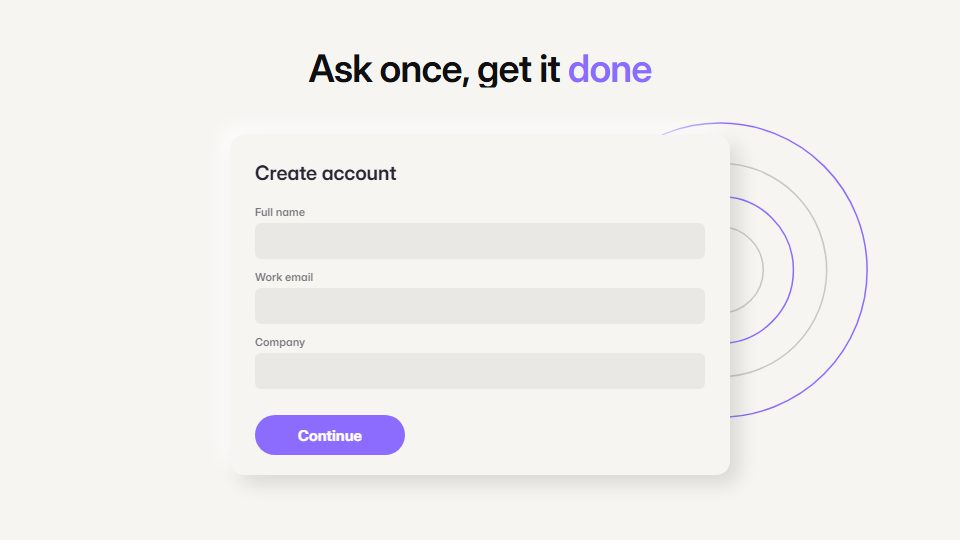

# Iridescent prompt launch

**An AI product told through one input box ringed by a slowly turning rainbow glow on a clean white page** · Fit for our films: **Ready: our kit builds it today** · Live demo: [`demos/demo.html#iridescent-prompt-launch`](../demos/demo.html#iridescent-prompt-launch)

## The look
Warm white (#F6F5F1) with black UI (#0F0F11); the input wears a blurred rim cycling through rose, tangerine, lime, aqua and violet (#FF6FB5, #FF8A3D, #CFF24F, #42D9F5, #8B6CFF); a clean grotesque plus one serif for the product name.

## How it moves
A slow push into the glowing box, the request types with natural keystrokes, send is pressed; the glow tightens into a progress ring and results bloom out as cards. One eased camera move per scene.

## Shape of a piece
The glowing input, the request, a thinking state, results unfold, one result is used, name and line.

## Craft rules
The glow is the only colour field; everything else stays black and white. The camera keeps one direction per scene.

## Ask for, before building
The real request a user would enter, 3-6 real result items, product name, brand accent

## Where it fits
AI feature launch, assistant or copilot promo, product-led ad

## Build it with our kit
screencast typed inputs, buttons, lists and toasts, camera push-ins, kinetic text word swaps, music+SFX

**Small helpers it would want (none built yet; the engine is unchanged):** A rotating conic-gradient glow ring around a box

## Tuning scale
| Energy | Pace | Camera | Density | Background | Type | Realism | Sound |
|---|---|---|---|---|---|---|---|
| 0 | 0 | +1 | −1 | −1 | 0 | 0 | 0 |

## Our director prompt
Direct this film (or these segments) in the **Iridescent prompt launch** style. Follow the script word for word, time everything to the voiceover clock, and show me the storyboard before building.

- **Look:** Warm white (#F6F5F1) with black UI (#0F0F11); the input wears a blurred rim cycling through rose, tangerine, lime, aqua and violet (#FF6FB5, #FF8A3D, #CFF24F, #42D9F5, #8B6CFF); a clean grotesque plus one serif for the product name.
- **Motion:** A slow push into the glowing box, the request types with natural keystrokes, send is pressed; the glow tightens into a progress ring and results bloom out as cards. One eased camera move per scene.
- **Shape of the piece:** The glowing input, the request, a thinking state, results unfold, one result is used, name and line.
- **Rules:** The glow is the only colour field; everything else stays black and white. The camera keeps one direction per scene.
- **Ask me first for:** the real request a user would enter, 3-6 real result items, product name, brand accent
- **Tuning scale:** Energy 0, Pace 0, Camera +1, Density −1, Background −1, Type 0, Realism 0, Sound 0.
- **Build it with:** screencast typed inputs, buttons, lists and toasts, camera push-ins, kinetic text word swaps, music+SFX. Keep to the engine's craft rules: one primary mover, scenes that open sparse and build, text that is readable before anything ornamental moves.
