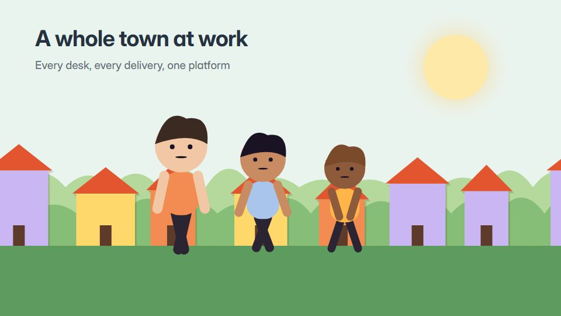

# Isometric living town

**A tidy isometric diorama of tiny people, desks and streets going about their day, with one storyline lit at a time** · Fit for our films: **Adapt: needs a small helper or a stylisation** · Live demo: [`demos/demo.html#isometric-living-town`](../demos/demo.html#isometric-living-town)

## The look
A pastel isometric island or office floor (#EAF4EF, #BFE3D0, #F6D6AD, #A9C5EB) with tiny round people, desks, trees and vehicles; soft shadows; small labels on pins; one orange pin colour (#F28C52) for the current storyline.

## How it moves
Tiny people loop through routines (walk, sit, chat), small vehicles follow paths, lights switch on as the day turns; the camera glides across the diorama and pushes into one corner for each beat.

## Shape of a piece
The whole town at dawn, one corner's problem, the product arrives and its effect spreads, the town busy at noon, the town glowing at night.

## Craft rules
Everything sits on the isometric grid and people stay tiny and simple; one storyline is pinned at a time.

## Ask for, before building
The places (teams, stores, sites), the activity to show, the product's role, palette

## Where it fits
Platform or marketplace overview, operations or logistics story, culture tour, facilities or smart-city

## Build it with our kit
isometric, camera travel and push-ins, living ground washes, data notes (pins), music+SFX

**Small helpers it would want (none built yet; the engine is unchanged):** A tiny-person loop sprite (walk, sit, talk) placed on the isometric grid

## Tuning scale
| Energy | Pace | Camera | Density | Background | Type | Realism | Sound |
|---|---|---|---|---|---|---|---|
| 0 | −1 | +1 | +2 | 0 | −1 | −1 | 0 |

## Our director prompt
Direct this film (or these segments) in the **Isometric living town** style. Follow the script word for word, time everything to the voiceover clock, and show me the storyboard before building.

- **Look:** A pastel isometric island or office floor (#EAF4EF, #BFE3D0, #F6D6AD, #A9C5EB) with tiny round people, desks, trees and vehicles; soft shadows; small labels on pins; one orange pin colour (#F28C52) for the current storyline.
- **Motion:** Tiny people loop through routines (walk, sit, chat), small vehicles follow paths, lights switch on as the day turns; the camera glides across the diorama and pushes into one corner for each beat.
- **Shape of the piece:** The whole town at dawn, one corner's problem, the product arrives and its effect spreads, the town busy at noon, the town glowing at night.
- **Rules:** Everything sits on the isometric grid and people stay tiny and simple; one storyline is pinned at a time.
- **Ask me first for:** the places (teams, stores, sites), the activity to show, the product's role, palette
- **Tuning scale:** Energy 0, Pace −1, Camera +1, Density +2, Background 0, Type −1, Realism −1, Sound 0.
- **Build it with:** isometric, camera travel and push-ins, living ground washes, data notes (pins), music+SFX. Keep to the engine's craft rules: one primary mover, scenes that open sparse and build, text that is readable before anything ornamental moves.
