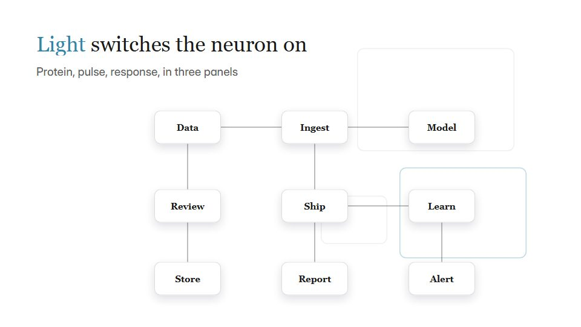

# Journal-figure science explainer

**Science explained like a well-made journal figure: lettered panels, precise diagrams and the source on screen** · Fit for our films: **Ready: our kit builds it today** · Live demo: [`demos/demo.html#journal-figure-science`](../demos/demo.html#journal-figure-science)

## The look
Clean white plates (#FFFFFF) with panel letters (A, B, C) in a bold grotesque, a technical serif for captions, muted scientific colours (#2E86AB, #A23B72, #F18F01), fine scale bars and a citation chip.

## How it moves
Panels open one at a time and the process plays inside each (a cell lights, a signal travels); the camera steps from panel to panel; a citation chip slides in under each claim.

## Shape of a piece
The hook question, panel A (setup), B (mechanism), C (result), the counter-intuitive point, sources.

## Craft rules
Every claim carries a source chip and analogies are labelled as analogies; no decorative glow.

## Ask for, before building
The paper or source, the 3 findings, the audience level, any figures to adapt

## Where it fits
Life-science or medtech explainer, R&D communication, white-paper launch

## Build it with our kit
diagram strokes and cards, data notes, kinetic text, camera push, hand-drawn strokes

**Small helpers it would want (none built yet; the engine is unchanged):** A citation-chip component

## Tuning scale
| Energy | Pace | Camera | Density | Background | Type | Realism | Sound |
|---|---|---|---|---|---|---|---|
| −1 | −1 | 0 | +1 | −2 | −1 | 0 | −1 |

## Our director prompt
Direct this film (or these segments) in the **Journal-figure science explainer** style. Follow the script word for word, time everything to the voiceover clock, and show me the storyboard before building.

- **Look:** Clean white plates (#FFFFFF) with panel letters (A, B, C) in a bold grotesque, a technical serif for captions, muted scientific colours (#2E86AB, #A23B72, #F18F01), fine scale bars and a citation chip.
- **Motion:** Panels open one at a time and the process plays inside each (a cell lights, a signal travels); the camera steps from panel to panel; a citation chip slides in under each claim.
- **Shape of the piece:** The hook question, panel A (setup), B (mechanism), C (result), the counter-intuitive point, sources.
- **Rules:** Every claim carries a source chip and analogies are labelled as analogies; no decorative glow.
- **Ask me first for:** the paper or source, the 3 findings, the audience level, any figures to adapt
- **Tuning scale:** Energy −1, Pace −1, Camera 0, Density +1, Background −2, Type −1, Realism 0, Sound −1.
- **Build it with:** diagram strokes and cards, data notes, kinetic text, camera push, hand-drawn strokes. Keep to the engine's craft rules: one primary mover, scenes that open sparse and build, text that is readable before anything ornamental moves.
