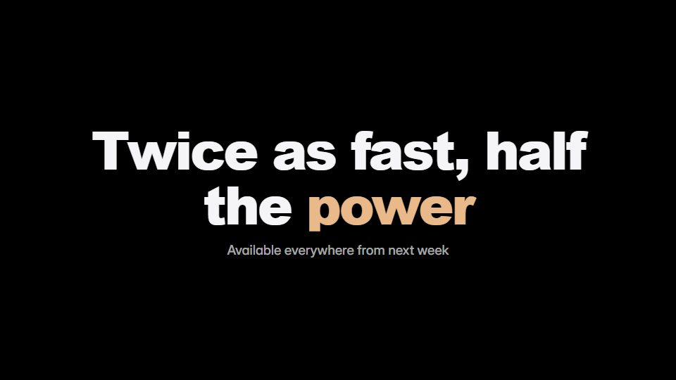

# Keynote-stage launch

**Stage-presentation launch: pure black, enormous headline words, spec numbers set huge, one hero object under a top light** · Fit for our films: **Ready: our kit builds it today** · Live demo: [`demos/demo.html#keynote-stage-launch`](../demos/demo.html#keynote-stage-launch)

## The look
True black (#000000) with one soft overhead light; a very heavy grotesque headline with a warm-to-lilac gradient fill (#E9B98A to #B79CFF) on a single word; giant numerals with tiny unit labels; no texture.

## How it moves
Unhurried: headline words rise one at a time, hold, then clear; the hero turns slightly under a light sweep; spec numbers count and lock. Changes happen on black, never over a busy frame.

## Shape of a piece
A word on black, the hero reveal, three spec beats with one giant number each, a final surprise feature, name and date.

## Craft rules
2-4 words per beat and a mostly empty frame; gradients live only inside type, never on the ground.

## Ask for, before building
Hero product image or screen, 3 headline specs with real numbers, launch date, the surprise

## Where it fits
Flagship launch, annual event opener, executive announcement, investor update intro

## Build it with our kit
kinetic text rise and word-by-word, data counters, real photos, camera push, living ground sweeps, music+SFX

**Small helpers it would want (none built yet; the engine is unchanged):** Gradient-filled text; a top-light vignette preset

## Tuning scale
| Energy | Pace | Camera | Density | Background | Type | Realism | Sound |
|---|---|---|---|---|---|---|---|
| 0 | −1 | 0 | −2 | −2 | +2 | +1 | 0 |

## Our director prompt
Direct this film (or these segments) in the **Keynote-stage launch** style. Follow the script word for word, time everything to the voiceover clock, and show me the storyboard before building.

- **Look:** True black (#000000) with one soft overhead light; a very heavy grotesque headline with a warm-to-lilac gradient fill (#E9B98A to #B79CFF) on a single word; giant numerals with tiny unit labels; no texture.
- **Motion:** Unhurried: headline words rise one at a time, hold, then clear; the hero turns slightly under a light sweep; spec numbers count and lock. Changes happen on black, never over a busy frame.
- **Shape of the piece:** A word on black, the hero reveal, three spec beats with one giant number each, a final surprise feature, name and date.
- **Rules:** 2-4 words per beat and a mostly empty frame; gradients live only inside type, never on the ground.
- **Ask me first for:** hero product image or screen, 3 headline specs with real numbers, launch date, the surprise
- **Tuning scale:** Energy 0, Pace −1, Camera 0, Density −2, Background −2, Type +2, Realism +1, Sound 0.
- **Build it with:** kinetic text rise and word-by-word, data counters, real photos, camera push, living ground sweeps, music+SFX. Keep to the engine's craft rules: one primary mover, scenes that open sparse and build, text that is readable before anything ornamental moves.
