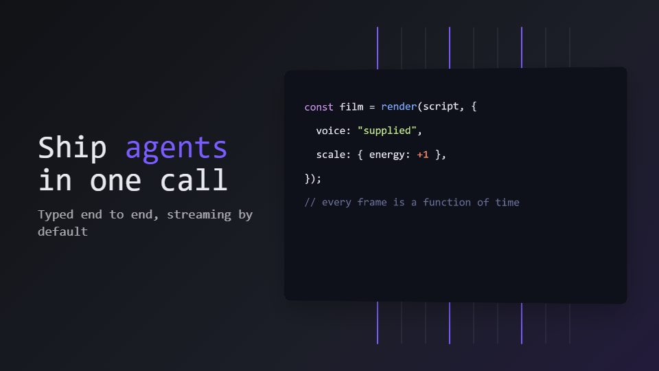

# Kinetic-code graphite launch

**Developer-tool launch where code itself streams, splits into tokens and re-forms as the next idea on graphite** · Fit for our films: **Adapt: needs a small helper or a stylisation** · Live demo: [`demos/demo.html#kinetic-code-launch`](../demos/demo.html#kinetic-code-launch)

## The look
Graphite (#16181D) with violet and cyan light (#7B5CFF, #2DD4E8) leaking from behind layered panes; monospace for code, a tight grotesque for claims; 1px rules and interface fragments at several depths.

## How it moves
Lines type, then break into tokens that fly and rebuild as the next scene; data runs along branching paths; the camera glides through stacked panes with parallax.

## Shape of a piece
A lone blinking cursor, one call turns into streaming output, the stream branches into modes or providers, a check passes, wordmark with the install line.

## Craft rules
Each transition proves a feature rather than decorating; code stays readable for at least a beat, and claims match what really ships.

## Ask for, before building
Real code snippets, install command, 3 capabilities, release status wording, brand light colours

## Where it fits
SDK or API launch, developer-tool release, conference keynote opener

## Build it with our kit
screencast typed inputs and windows, kinetic text letter-by-letter, camera parallax, shader mesh ground, music+SFX

**Small helpers it would want (none built yet; the engine is unchanged):** A token-split helper that breaks a typed line into flying pieces; simple syntax colouring

## Tuning scale
| Energy | Pace | Camera | Density | Background | Type | Realism | Sound |
|---|---|---|---|---|---|---|---|
| +1 | +1 | +1 | 0 | 0 | 0 | −1 | +1 |

## Our director prompt
Direct this film (or these segments) in the **Kinetic-code graphite launch** style. Follow the script word for word, time everything to the voiceover clock, and show me the storyboard before building.

- **Look:** Graphite (#16181D) with violet and cyan light (#7B5CFF, #2DD4E8) leaking from behind layered panes; monospace for code, a tight grotesque for claims; 1px rules and interface fragments at several depths.
- **Motion:** Lines type, then break into tokens that fly and rebuild as the next scene; data runs along branching paths; the camera glides through stacked panes with parallax.
- **Shape of the piece:** A lone blinking cursor, one call turns into streaming output, the stream branches into modes or providers, a check passes, wordmark with the install line.
- **Rules:** Each transition proves a feature rather than decorating; code stays readable for at least a beat, and claims match what really ships.
- **Ask me first for:** real code snippets, install command, 3 capabilities, release status wording, brand light colours
- **Tuning scale:** Energy +1, Pace +1, Camera +1, Density 0, Background 0, Type 0, Realism −1, Sound +1.
- **Build it with:** screencast typed inputs and windows, kinetic text letter-by-letter, camera parallax, shader mesh ground, music+SFX. Keep to the engine's craft rules: one primary mover, scenes that open sparse and build, text that is readable before anything ornamental moves.
