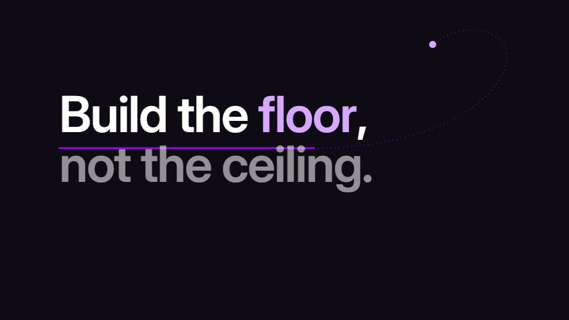

# Kinetic typography: speech, quote, manifesto

**The words are the picture; layout and geometry act out the rhetoric** · Fit for our films: **Ready: our kit builds it today** · Live demo: [`demos/demo.html#kinetic-type`](../demos/demo.html#kinetic-type)

## The look
One dark or paper ground, a confident grotesque or high-contrast serif, a single structural accent, fine geometric guides (orbits, rules, baselines). No illustrations or clichés behind the words.

## How it moves
The words get physical roles. A baseline becomes a trajectory, a heavy word becomes a lintel, a letter's counter becomes an aperture into the next scene. Phrases reveal in spoken groups. A reading hold comes before any ornamental travel. Three named camera operations, each with a rhetorical purpose.

## Shape of a piece
Statement, then pressure or problem, turn, resolution, held declaration, and the end returns to the opening.

## Craft rules
Exact words in exact order. Earn at least one moment of total stillness. Blur trailing geometry, never the active text. Deform only what the metaphor needs.

## Ask for, before building
The exact text, the three words to land hardest, the central metaphor.

## Where it fits
CEO quotes, mission statements, values films, keynote interstitials.

## Build it with our kit
kinetic text (all entrances), mask wipes, word swaps, living ground, camera.

**Small helpers it would want (none built yet; the engine is unchanged):** Text-on-path with arc-length spacing; text as a mask for the next scene (glyph outlines revealing the incoming shot).

## Tuning scale
| Energy | Pace | Camera | Density | Background | Type | Realism | Sound |
|---|---|---|---|---|---|---|---|
| 0 | −1 | 0 | −2 | −1 | +2 | −2 | −1 |

## Our director prompt
Direct this film (or these segments) in the **Kinetic typography: speech, quote, manifesto** style. Follow the script word for word, time everything to the voiceover clock, and show me the storyboard before building.

- **Look:** one dark or paper ground, a confident grotesque or high-contrast serif, a single structural accent, fine geometric guides (orbits, rules, baselines). No illustrations or clichés behind the words.
- **Motion:** the words get physical roles. A baseline becomes a trajectory, a heavy word becomes a lintel, a letter's counter becomes an aperture into the next scene. Phrases reveal in spoken groups. A reading hold comes before any ornamental travel. Three named camera operations, each with a rhetorical purpose.
- **Shape of the piece:** statement, then pressure or problem, turn, resolution, held declaration, and the end returns to the opening.
- **Rules:** exact words in exact order. Earn at least one moment of total stillness. Blur trailing geometry, never the active text. Deform only what the metaphor needs.
- **Ask me first for:** the exact text, the three words to land hardest, the central metaphor.
- **Tuning scale:** Energy 0, Pace −1, Camera 0, Density −2, Background −1, Type +2, Realism −2, Sound −1.
- **Build it with:** kinetic text (all entrances), mask wipes, word swaps, living ground, camera.. Keep to the engine's craft rules: one primary mover, scenes that open sparse and build, text that is readable before anything ornamental moves.
