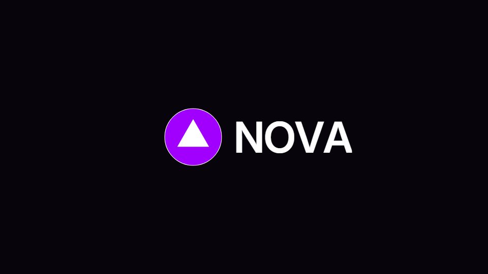

# Logo ident, bumper and reveal

**Short marks: wireframe-to-solid, letters folding into a dot, assembly reveals** · Fit for our films: **Ready: our kit builds it today** · Live demo: [`demos/demo.html#logo-ident`](../demos/demo.html#logo-ident)

## The look
A black or brand-colour field, the real mark, at most one supporting texture.

## How it moves
The mark is drawn as wireframe and then filled. Pieces fly in and lock. Letters squeeze toward the dot like an accordion, with their drawn width following. Rays fan out of a single line. A micro-breath (scale 1.000 to 1.012) works on the hold.

## Shape of a piece
Glint or line, construction, lock, tagline, hold. Often a loop.

## Craft rules
Never redraw or approximate the logo. The final frame needs enough stillness to register. No generic logo fade.

## Ask for, before building
Vector logo, tagline, colour values, intended length.

## Where it fits
Film open and close, segment bumpers, webinar intro.

## Build it with our kit
hand-drawn stroke draw-on, kinetic letters, light sweep, shader grounds.

**Small helpers it would want (none built yet; the engine is unchanged):** SVG path draw-on for the real logo with fill handoff; per-letter width squeeze.

## Tuning scale
| Energy | Pace | Camera | Density | Background | Type | Realism | Sound |
|---|---|---|---|---|---|---|---|
| 0 | 0 | −1 | −2 | −1 | +1 | −1 | 0 |

## Our director prompt
Direct this film (or these segments) in the **Logo ident, bumper and reveal** style. Follow the script word for word, time everything to the voiceover clock, and show me the storyboard before building.

- **Look:** a black or brand-colour field, the real mark, at most one supporting texture.
- **Motion:** the mark is drawn as wireframe and then filled. Pieces fly in and lock. Letters squeeze toward the dot like an accordion, with their drawn width following. Rays fan out of a single line. A micro-breath (scale 1.000 to 1.012) works on the hold.
- **Shape of the piece:** glint or line, construction, lock, tagline, hold. Often a loop.
- **Rules:** never redraw or approximate the logo. The final frame needs enough stillness to register. No generic logo fade.
- **Ask me first for:** vector logo, tagline, colour values, intended length.
- **Tuning scale:** Energy 0, Pace 0, Camera −1, Density −2, Background −1, Type +1, Realism −1, Sound 0.
- **Build it with:** hand-drawn stroke draw-on, kinetic letters, light sweep, shader grounds.. Keep to the engine's craft rules: one primary mover, scenes that open sparse and build, text that is readable before anything ornamental moves.
