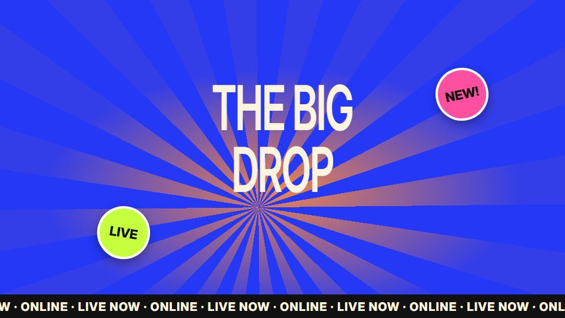

# Loud poster / op-art trailer

**Bold condensed type, sunbursts, stickers, stamps, tickers and print offsets** · Fit for our films: **Adapt: needs a small helper or a stylisation** · Live demo: [`demos/demo.html#loud-poster`](../demos/demo.html#loud-poster)

## The look
Saturated cobalt, pink, tangerine and cream (or black with magenta and acid green), extra-condensed black type for names, a mono face for labels, rotating sunbursts, scrolling waves, die-cut stickers with white borders, stamps, polaroids, a ticker round the frame edge, film grain.

## How it moves
The camera never rests (a slow 1.03–1.07 push per scene). Letters rise through a mask line one by one. Patterns rotate continuously rather than ticking per beat. Swaps are carousel glides of about 0.55 s, and colour changes fade over about 0.35 s. Print misregistration appears only on impact frames.

## Shape of a piece
Wordmark on the pattern, the drop with big stacked claims, a "ticket" or brief that fills in, proof, a call-to-action ticket, a poster lockup.

## Craft rules
A pattern stepping one notch per beat reads as stutter, so rotate it smoothly and pick speeds that land on the same pattern at the end. No full stops after headlines. Keep three type roles only.

## Ask for, before building
A bold palette, one tagline, real clips or portraits, the drop time.

## Where it fits
Consumer-facing or creator-economy launches, event promos, recruiting. Use sparingly in premium films.

## Build it with our kit
living ground rays and waves, kinetic text, real photos, camera.

**Small helpers it would want (none built yet; the engine is unchanged):** A sticker border (alpha dilation plus shadow), stamp press, edge ticker, misregistration offset.

## Tuning scale
| Energy | Pace | Camera | Density | Background | Type | Realism | Sound |
|---|---|---|---|---|---|---|---|
| +2 | +1 | +1 | +1 | +2 | +2 | 0 | +1 |

## Our director prompt
Direct this film (or these segments) in the **Loud poster / op-art trailer** style. Follow the script word for word, time everything to the voiceover clock, and show me the storyboard before building.

- **Look:** saturated cobalt, pink, tangerine and cream (or black with magenta and acid green), extra-condensed black type for names, a mono face for labels, rotating sunbursts, scrolling waves, die-cut stickers with white borders, stamps, polaroids, a ticker round the frame edge, film grain.
- **Motion:** the camera never rests (a slow 1.03–1.07 push per scene). Letters rise through a mask line one by one. Patterns rotate continuously rather than ticking per beat. Swaps are carousel glides of about 0.55 s, and colour changes fade over about 0.35 s. Print misregistration appears only on impact frames.
- **Shape of the piece:** wordmark on the pattern, the drop with big stacked claims, a "ticket" or brief that fills in, proof, a call-to-action ticket, a poster lockup.
- **Rules:** a pattern stepping one notch per beat reads as stutter, so rotate it smoothly and pick speeds that land on the same pattern at the end. No full stops after headlines. Keep three type roles only.
- **Ask me first for:** a bold palette, one tagline, real clips or portraits, the drop time.
- **Tuning scale:** Energy +2, Pace +1, Camera +1, Density +1, Background +2, Type +2, Realism 0, Sound +1.
- **Build it with:** living ground rays and waves, kinetic text, real photos, camera.. Keep to the engine's craft rules: one primary mover, scenes that open sparse and build, text that is readable before anything ornamental moves.
