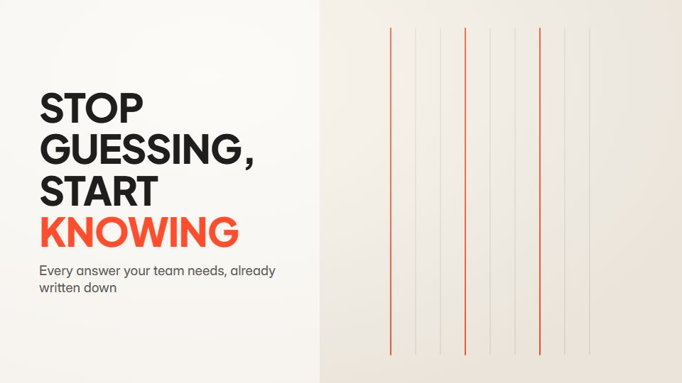

# Marker-note flip explainer

**Paper-light explainer with huge type, marker notes that draw themselves and hard light/dark inversions** · Fit for our films: **Adapt: needs a small helper or a stylisation** · Live demo: [`demos/demo.html#marker-flip-explainer`](../demos/demo.html#marker-flip-explainer)

## The look
Light paper (#F7F4EE) with charcoal (#1E1E1E) and two marker colours (#FF4D2E, #2E6BFF); a tall heavy display sans; hand-drawn arrows, rings and underlines; the dark state is a matching charcoal.

## How it moves
Ideas turn over roughly every 1.5 to 2 seconds; marker strokes draw on beneath key words; at the turn the whole frame flips to dark in one cut and later flips back. One main move per transition.

## Shape of a piece
The claim in huge type, marker notes, a hard flip to dark for the problem, a flip back for the fix, logo.

## Craft rules
Each note points at a single word; inversions are cuts, never fades; two marker colours at most.

## Ask for, before building
The one-liner, audience, the turning point, brand colours, logo

## Where it fits
Short product explainer, social launch cut, event teaser

## Build it with our kit
kinetic text rise and pop, hand-drawn strokes and handwriting, living ground, music+SFX

**Small helpers it would want (none built yet; the engine is unchanged):** None

## Tuning scale
| Energy | Pace | Camera | Density | Background | Type | Realism | Sound |
|---|---|---|---|---|---|---|---|
| +1 | +1 | 0 | 0 | 0 | +2 | −1 | +1 |

## Our director prompt
Direct this film (or these segments) in the **Marker-note flip explainer** style. Follow the script word for word, time everything to the voiceover clock, and show me the storyboard before building.

- **Look:** Light paper (#F7F4EE) with charcoal (#1E1E1E) and two marker colours (#FF4D2E, #2E6BFF); a tall heavy display sans; hand-drawn arrows, rings and underlines; the dark state is a matching charcoal.
- **Motion:** Ideas turn over roughly every 1.5 to 2 seconds; marker strokes draw on beneath key words; at the turn the whole frame flips to dark in one cut and later flips back. One main move per transition.
- **Shape of the piece:** The claim in huge type, marker notes, a hard flip to dark for the problem, a flip back for the fix, logo.
- **Rules:** Each note points at a single word; inversions are cuts, never fades; two marker colours at most.
- **Ask me first for:** the one-liner, audience, the turning point, brand colours, logo
- **Tuning scale:** Energy +1, Pace +1, Camera 0, Density 0, Background 0, Type +2, Realism −1, Sound +1.
- **Build it with:** kinetic text rise and pop, hand-drawn strokes and handwriting, living ground, music+SFX. Keep to the engine's craft rules: one primary mover, scenes that open sparse and build, text that is readable before anything ornamental moves.
